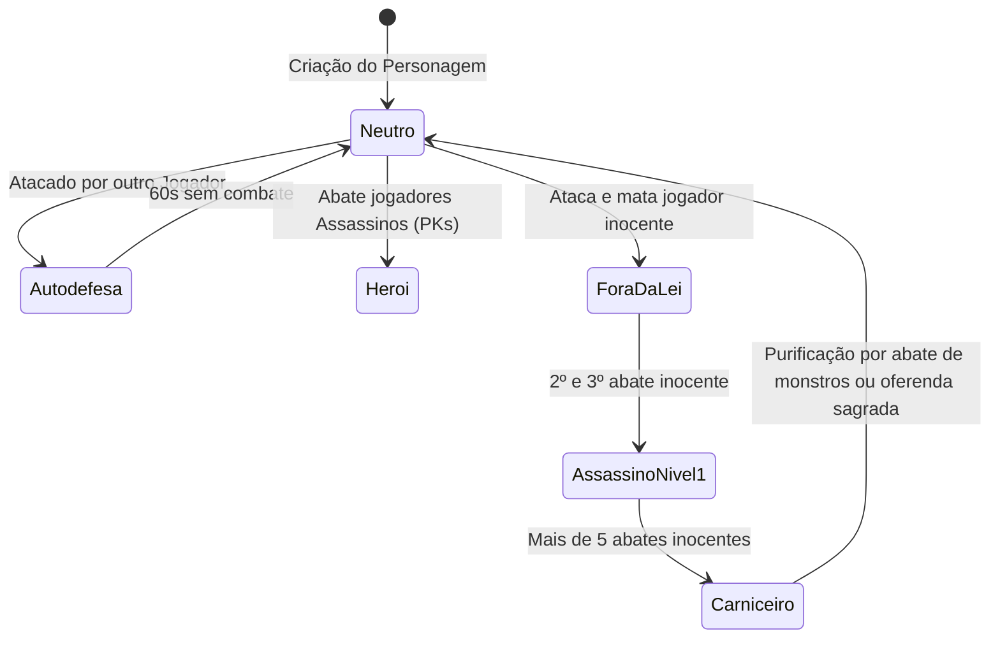

# PVP, SISTEMA DE ASSASSINATO (PK) E CASTLE SIEGE — DASI

> **Tensão e Honra:** O conflito entre jogadores é o motor emocional do jogo. O perigo espreita além dos portões da cidade, mas as regras de retribuição moral são implacáveis.

---

## 1. SISTEMA MORAL DE ALINHAMENTO E PK (PLAYER KILLER)



### 1.1 Tabela de Status e Penalidades

| Nível de Alinhamento | Cor do Nome & Aura Visual | Acesso à Cidade / NPCs | Risco de Drop ao Morrer |
| :--- | :--- | :--- | :--- |
| **Herói das Terras** | Azul Claro / Partículas douradas | Total; descontos especiais em mercadores | 0% de risco de perda de itens |
| **Cidadão Comum** | Branco / Sem aura extra | Total e irrestrito | Pequena perda de Zen acumulado |
| **Autodefesa Ativa** | Amarelo piscante (duração 60s) | Permitido revidar sem penalidades | Padrão |
| **Fora da Lei (PK 1)** | Laranja / Fumaça tênue avermelhada | Guardas ficam em alerta | Perda aumentada de Zen |
| **Assassino (PK 2)** | Vermelho vivo / Gotas de sangue | Guardas atacam à vista; NPCs recusam venda | 15% de chance de dropar itens da mochila |
| **Carniceiro (PK 3)** | Vermelho escuro / Fumaça negra e sangue | Banido das cidades; respawn em covil isolado | **Risco real de dropar equipamentos equipados** |

---

## 2. DUELOS DE HONRA NA ARENA

Para quem busca combate competitivo sem o risco do modo PK aberto:
- **Salão da Arena:** Espaço arquitetônico grego-gótico cercado por grades de ferro e arquibancadas para espectadores.
- **Regras do Duelo:**
  - Desafio aceito por ambos os combatentes.
  - Disputa em formato "Melhor de 10 Pontos" (quem abater o adversário 10 vezes primeiro vence).
  - Imunidade a perda de experiência, itens ou durabilidade de armaduras.
  - Placar holográfico no topo da arena visível para todo o público presente.

---

## 3. CASTLE SIEGE — A GUERRA DO FIM DE SEMANA

O evento máximo de guildas acontece todo domingo à noite, onde as maiores alianças disputam o controle do **Castelo do Vale de Loren**.

```
                         ESTRUTURA DO CASTELO
[ Campo de Guerra ] ──► [ Portão 1 de Ferro ] ──► [ 1ª Estátua da Vida ]
         │
         ▼
[ Portão 2 de Aço ] ──► [ Ponte Levadiça ]  ──► [ 2ª e 3ª Estátuas ]
         │
         ▼
[ Salão Interior ]  ──► [ 4ª Estátua ]       ──► [ O Selo do Trono Real ]
```

### 3.1 Etapas da Batalha (Duração: 90 minutos)
1. **Ruptura dos Portões de Ferro:**
   - Os portões possuem milhões de pontos de vida e resistência a armas comuns.
   - Os atacantes usam catapultas móveis e investidas pesadas de *Blood Knights* para rachar o metal.
2. **As Estátuas da Vida:**
   - 4 monumentos sagrados protegem a passagem. Enquanto estiverem de pé, os defensores ressurgem diretamente no pátio com escudo de invulnerabilidade temporária.
   - Os atacantes precisam pulverizar cada estátua para empurrar o ponto de ressurgimento da guilda defensora para mais longe.
3. **A Travessia da Ponte Levadiça:**
   - Um gargalo estreito sobre um fosso de lava ardente.
   - Magos e Caçadoras disparam tempestades de gelo e flechas de longo alcance dos muros para impedir a marcha inimiga.
4. **O Selo da Coroa no Salão Real:**
   - Dois pedestais sagrados precisam ser mantidos simultaneamente por sub-líderes de guilda.
   - O Mestre da Guilda (preferencialmente um *Soberano Imperial*) inicia a canalização do Selo Real no trono.
   - A canalização dura **30 segundos contínuos**. Se o líder for empurrado, atordoado ou morto, o progresso reseta.

### 3.2 Privilégios do Senhor do Castelo
- **Imposto Territorial:** Uma porcentagem de todo o ouro (*Zen*) movimentado em vendas e serviços de todas as cidades vai para o tesouro da guilda dona do castelo.
- **Acesso à Terra das Provações (*Land of Trials*):** Uma região exclusiva repleta de monstros especiais com chances elevadas de soltar itens excelentes e joias raras.
- **Asas da Coroa:** O mestre da guilda vencedora pode equipar a *Manta do Imperador Supremo* até a próxima batalha semanal.
