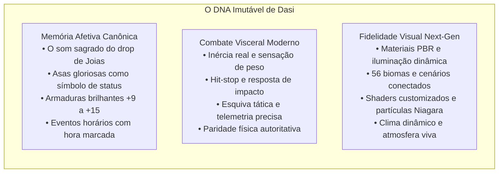
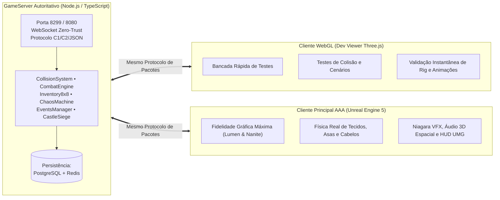
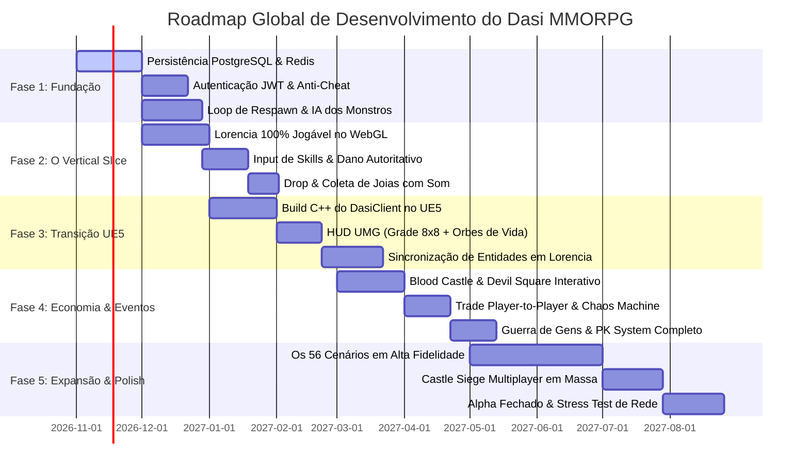

# PLANO MESTRE DE DESENVOLVIMENTO GLOBAL — DASI MMORPG
## *Continent of Legend Reimagined*

> **Status:** Documento Estratégico Executivo (v1.0)  
> **Versão da Engine/Ecossistema:** Node.js 22+ (Backend) • Three.js WebGL (Dev Viewer) • Unreal Engine 5.4+ (Cliente AAA)  
> **Base Canônica Homologada:** MU Online Season 5.2 (`reference/mu_roxgaming_5.2/`)  
> **Qualidade e QA Atual:** 429/429 Testes Automatizados Aprovados em 97 suítes (100% Pass)  
> **IP Canônico de Rede:** `26.32.29.60` (Radmin VPN) / `127.0.0.1` (Local Dev)

---

## 1. Visão Executiva & DNA do Projeto

**DASI** não é apenas um clone retrô, nem um projeto conceitual abstrato: é a **reimaginação definitiva do gênero MMORPG isométrico de ação clássico** (*Continent of Legend* / *MU Online*), transposto para os padrões de engenharia, física e fidelidade visual da nova geração.



---

## 2. Diagnóstico do Estado Atual (Inventário de Ativos Prontos)

Com base em uma auditoria completa de todo o repositório (`D:\Dasi`), o projeto já conta com uma fundação técnica robusta, testada e com documentação extensa:

| Camada / Subsistema | O que JÁ ESTÁ PRONTO e Validado | O que FALTA para Versão Jogável Completa |
| :--- | :--- | :--- |
| **Servidor Autoritativo** (`src/server/`) | • Protocolo binário C1/C2 + JSON unificado.<br/>• Handshake Zero-Trust e checagem CRC16-CCITT.<br/>• Motor de colisão com física de deslizamento cilíndrico/AABB.<br/>• Sistema canônico de 5 atributos (STR, AGI, VIT, ENE, CMD).<br/>• Inventário em grade 8x8 com slots de equipamento.<br/>• Joias canônicas (Bless, Soul, Life, Chaos) e Máquina do Caos calculada.<br/>• Lógica de 4 eventos canônicos (Blood Castle, Devil Square, Chaos Castle, Coliseu).<br/>• Sistema de Guildas e Cerco ao Castelo (Castle Siege).<br/>• Sistema PK de 6 níveis morais e facções Gens (Duprian/Vanert).<br/>• **429 testes automatizados cobrindo 100% das regras.** | • Camada de persistência real (substituir o DB em memória por PostgreSQL + Redis).<br/>• Autenticação real com hashing seguro de senhas (Argon2/bcrypt) e JWT de sessão.<br/>• Rate limiting de pacotes e proteção anti-flood.<br/>• Spawner dinâmico contínuo com ciclo de respawn no mundo aberto. |
| **Mundo & Cenários** (`docs/level_design/` & `src/server/world/`) | • Catálogo mestre unificado dos **56 cenários canônicos**.<br/>• Paridade estrita 1:1 de IDs, bounds, spawns e colisores entre cliente e servidor.<br/>• 56 GLBs de blockout procedural gerados e inspecionáveis.<br/>• Editor de pisos modulares e exportador de pacotes ZIP com snapshots. | • Detalhamento artístico AAA dos cenários (substituir geometria blockout por props de alta fidelidade Nanite/PBR).<br/>• NavMesh para pathfinding dos monstros. |
| **Heróis & Classes** (`docs/art/` & `src/client/dev_viewer/models/`) | • 5 classes canônicas homologadas: Dark Knight, Dark Wizard, Fairy Elf, Magic Gladiator e Dark Lord.<br/>• Modelos de base modular e 60 peças experimentais de armadura.<br/>• 5 modelos com rig canônico e **21 animações de combate, corrida e descanso**.<br/>• Suporte visual no Dev Viewer para alternar peças modulares em tempo real. | • Skinning profissional e malhas de armaduras de tier avançado (+9 a +15 com auras em tempo real).<br/>• Árvore de evolução de 2ª e 3ª classes (Blade Master, Grand Master, High Elf, Duel Master, Lord Emperor). |
| **Bestiário & Chefes** (`src/server/bosses/` & `prototypes/3d_bestiary_animated/`) | • 12 criaturas canônicas catalogadas (6 chefes mundiais e 6 da Invasão Dourada).<br/>• GLBs estáticos e GLBs articulados com 5 clips cada (IDLE, WALK, ATTACK, HURT, DEATH).<br/>• Texturas PBR procedurais injetadas nos GLBs. | • IA de combate dos monstros com máquinas de estado (patrulha, perseguição, conjuração de habilidades, fuga). |
| **Cliente WebGL** (`src/client/dev_viewer/`) | • Motor Three.js completo com câmera isométrica livre.<br/>• Sistema de vida ambiental (aves voando, morcegos, peixes, tochas piscantes).<br/>• Sintetizador de áudio procedural via Web Audio API.<br/>• Painel de controle de validação, comparador de concept art e testes de colisão. | • Interface de jogo em tela cheia com HUD de vida/mana, chat, barra de skills e inventário visual interativo. |
| **Cliente Unreal Engine 5** (`src/client/ue5_project/`) | • Estrutura de código C++ limpa organizada em módulos.<br/>• `UDasiNetworkSubsystem` com cliente WebSocket nativo e enquadramento C1/C2.<br/>• Componentes de inventário em grade 8x8 e atributos.<br/>• Shaders HLSL para brilho de itens (+0 a +15) e Niagara VFX para feixe de drop. | • Compilação do executável final UE5 e integração do HUD Slate/UMG.<br/>• Vinculação dos inputs do jogador e câmera isométrica dinâmica. |

---

## 3. Arquitetura de Transição & Estratégia dos Dois Clientes

Para garantir agilidade sem perder a meta do jogo AAA, adotamos uma **estratégia dual-client altamente eficiente**:



> Como o GameServer autoritativo centraliza toda a lógica física, de combate e de dados em TypeScript, o cliente Unreal Engine 5 atua estritamente como renderizador de alta performance e interface de input, eliminando divergências de regras. O Dev Viewer WebGL continuará existindo como nossa bancada de validação rápida em tempo de desenvolvimento.

---

## 4. O Roadmap Estratégico em 5 Fases



---

### Detalhamento das 5 Fases

### Fase 1: Fundação & Persistência do Servidor (Hardening)
*Objetivo: Tornar o servidor persistente, seguro e capaz de sustentar sessões reais de múltiplos jogadores sem perda de dados ao reiniciar.*
1. **Banco de Dados Real:**
   - Implementar driver PostgreSQL para substituir o protótipo `Database.ts` em memória.
   - Tabelas estruturadas: `accounts`, `characters`, `inventory_items`, `warehouse_items`, `guilds`, `guild_members`, `event_scores`.
   - Camada de cache em memória rápida via Redis para estados dinâmicos (sessões ativas, posições e cooldowns).
2. **Autenticação Segura & Handshake:**
   - Hash de senhas com Argon2id.
   - Emissão de tokens de sessão criptografados para reconexão transparente.
3. **Loop de Mundo Ativo & IA de Monstros:**
   - Spawners configuráveis por cenário com zonas de atuação e limites de densidade.
   - Máquina de estados básica dos monstros: `IDLE` $\to$ `AGGRO` (ao avistar herói) $\to$ `CHASE` (perseguir respeitando colisão) $\to$ `ATTACK` $\to$ `RETURN_SPAWN` (caso o herói se afaste muito).

---

### Fase 2: O Primeiro "Vertical Slice" Jogável (Lorencia Completa)
*Objetivo: Criar uma experiência jogável de ponta a ponta em Lorencia, onde um jogador pode nascer, equipar itens, matar monstros, coletar joias e fazer upgrade na Máquina do Caos.*
1. **Gameplay Integrado no Dev Viewer WebGL:**
   - Movimentação por clique no chão (click-to-move) ou WASD com câmera isométrica travada/livre.
   - Barra de ação funcional: atalho para poções (Q, W, E) e seleção de habilidades (botão esquerdo / botão direito).
2. **Execução de Habilidades Canônicas do Dark Knight & Dark Wizard:**
   - DK: Ataque básico de espada, *Twisting Slash* (área giratória) e *Death Stab* (perfuração com dash).
   - DW: *Energy Ball*, *Lightning*, *Fireball* e *Evil Spirits* (espíritos serpenteantes com busca de alvos).
   - Verificação autoritativa de custos (Mana / AG) e intervalo de ataque no servidor.
3. **Loop de Drop & O Som Sagrado:**
   - Monstros de Lorencia (Spider, Budge Dragon, Bull Fighter, Hound) dropando Zen, poções e joias.
   - O feixe de luz vertical emanando do item no chão e o som metálico cristalino ao cair e ao ser recolhido.
   - Venda em NPCs e refinamento na Máquina do Caos de Noria.

---

### Fase 3: Conexão e Ativação do Cliente Unreal Engine 5
*Objetivo: Elevar a experiência para a qualidade visual AAA definitiva através do projeto C++ já estruturado em `src/client/ue5_project/`.*
1. **Pipeline de Compilação & Execução do DasiClient:**
   - Validar a compilação com Visual Studio / MSBuild e Unreal Engine 5.4+.
   - Conectar o `UDasiNetworkSubsystem` ao servidor via WebSocket local (`ws://127.0.0.1:8080`) ou Radmin (`ws://26.32.29.60:8080`).
2. **Interface do Usuário (HUD UMG):**
   - Esferas clássicas de Vida (Vermelha) e Mana (Azul) com shaders dinâmicos de líquido.
   - Barra de Vigor / AG (Roxa) e Escudo SD (Amarela).
   - Janela do Inventário 8x8 em Slate/UMG com suporte a arrastar e soltar (drag & drop), rotação de itens e tooltip com status.
3. **Iluminação, Shaders e Niagara VFX:**
   - Implementação das auras de equipamento (+0 metálico sem brilho até +15 com distorção de calor e labaredas douradas).
   - Shaders de asas com movimentação aerodinâmica e física de vento.

---

### Fase 4: Sistemas Sociais, Economia & Eventos Horários
*Objetivo: Ativar a dinâmica multiplayer de cooperação, comércio e competição que consagra o gênero.*
1. **Eventos com Ciclo de 2 Horas:**
   - **Blood Castle (EVT_01):** Entrada com Invisibility Cloak, marcha na ponte de 120m, destruição dos portões, abate dos generais esqueléticos e entrega da Arma do Arcanjo.
   - **Devil Square (EVT_02):** Entrada com Devil Square Ticket, sobrevivência em 4 ondas sucessivas de monstros crescentes com cálculo de pontuação e ranking.
   - **Chaos Castle (EVT_03):** 100 gladiadores com a mesma armadura e sem nomes; o piso periférico desaba conforme o tempo passa até restar um único vencedor.
2. **Economia Viva & Trocas:**
   - Sistema de Trade seguro de janela dupla entre dois jogadores.
   - Loja Pessoal (Personal Shop / PShop) onde jogadores montam barracas de venda nas praças das cidades negociando por Zen ou Joias.
3. **PVP, Sistema Moral e Guerras:**
   - Mudança de alinhamento moral de Herói (Azul) para Assassino Serial (Vermelho Escuro), com risco de drop de peças do inventário para PKs de nível 5 e 6.
   - Duelos no Coliseu de Lorencia com placar de 10 pontos.
   - Batalha de Facções Gens: Zonas hostis abertas onde membros de Duprian e Vanert podem batalhar livremente sem penalidade de PK, ganhando pontos de patente.

---

### Fase 5: Expansão dos 56 Cenários, Castle Siege & Alpha Fechado
*Objetivo: Conectar todo o continente e realizar o primeiro teste em massa com jogadores reais.*
1. **Navegação Contínua pelos 56 Cenários:**
   - Portais físicos de transição e comando `/move` com tabela canônica de requisitos de nível e taxas em Zen.
   - Condição obrigatória de uso de Asas ou Dinorant/Fenrir para cruzar o portal do Arquipélago Celeste de Icarus (`ICAR_01`).
2. **O Cerco ao Castelo no Vale de Loren (Castle Siege):**
   - Evento dominical entre guildas aliançadas.
   - Destruição dos 3 Portões Ciclópicos e das 4 Estátuas da Vida.
   - Acionamento das duas torres de selo e registro da coroa na Sala do Trono pelo Guild Master atacante sob canalização de tempo.
3. **Alpha Fechado & Testes de Carga:**
   - Stress test de 500+ conexões simultâneas disparando pacotes de combate.
   - Validação da estabilidade de memória e taxa de quadros (60 FPS travados).

---

## 5. Matriz de Frentes de Trabalho & Responsabilidades

```
┌─────────────────────────────────────────────────────────────────────────────┐
│                       MATRIZ DE EXECUÇÃO — DASI MMORPG                      │
├──────────────────────┬──────────────────────────────────────────────────────┤
│ FRENTE               │ RESPONSABILIDADES IMEDIATAS                          │
├──────────────────────┼──────────────────────────────────────────────────────┤
│ 1. Core Backend      │ • Substituição do DB em memória por PostgreSQL       │
│    (Node.js / TS)    │ • Autenticação com Argon2 + JWT de reconexão         │
│                      │ • Spawners dinâmicos e IA de combate dos monstros    │
├──────────────────────┼──────────────────────────────────────────────────────┤
│ 2. Gameplay & WebGL  │ • Controles de ação (Click-to-move / WASD + Skills)  │
│    (Three.js Client) │ • HUD e janela de inventário interativa              │
│                      │ • Loop completo de drop, coleta e áudio de joias     │
├──────────────────────┼──────────────────────────────────────────────────────┤
│ 3. Cliente C++ UE5   │ • Compilação da solução DasiClient.uproject          │
│    (Unreal Engine 5) │ • Mapeamento do HUD UMG / Slate da grade 8x8         │
│                      │ • Integração das malhas e Niagara VFX de auras       │
├──────────────────────┼──────────────────────────────────────────────────────┤
│ 4. Arte 3D & Biomas  │ • Modelagem de props em Lorencia (Blender 5.2 / UE5) │
│    (3D Pipeline)     │ • Refinamento de malhas de monstros e rigs           │
│                      │ • Shaders de água cáustica em Atlans e neve em Devias│
├──────────────────────┼──────────────────────────────────────────────────────┤
│ 5. QA & Balanceamento│ • Manter os 429 testes passando em 100% dos commits  │
│    (Engenharia QA)   │ • Testes de estresse de tráfego de pacotes binários  │
│                      │ • Calibração fina das fórmulas de defesa e combo     │
└──────────────────────┴──────────────────────────────────────────────────────┘
```

---

## 6. Decisões Estratégicas para Iniciar Imediatamente

Para começarmos a execução prática de forma cirúrgica, precisamos deliberar sobre **3 escolhas fundamentais de escopo inicial**:

1. **Foco do Primeiro Ciclo Jogável (Sprint 1):**
   - **Opção A (Recomendada):** Focar em transformar o Dev Viewer WebGL em um **jogo jogável completo em Lorencia** (movimentação, matar monstros, dropar joias, gerenciar inventário e testar no navegador em 1 clique) e, com isso 100% estável, plugar o UE5.
   - **Opção B:** Partir imediatamente para a compilação e integração do cliente nativo Unreal Engine 5 em C++, usando o Dev Viewer apenas como referência.

2. **Estratégia de Persistência:**
   - **Opção A (Recomendada):** Usar **SQLite / PostgreSQL local** conteinerizado ou instalado localmente para que os personagens, contas e inventários salvem automaticamente em disco a partir de hoje.
   - **Opção B:** Continuar provisoriamente em memória rápida para acelerar o desenvolvimento de gameplay antes de travar os esquemas de banco de dados.

3. **Classe Piloto de Combate:**
   - Iniciar o polimento das habilidades de combate e animações pelo **Dark Knight (Blade Knight)** com armas corpo a corpo e escudos, ou pelo **Dark Wizard (Soul Master)** com magias projéteis e em área.
