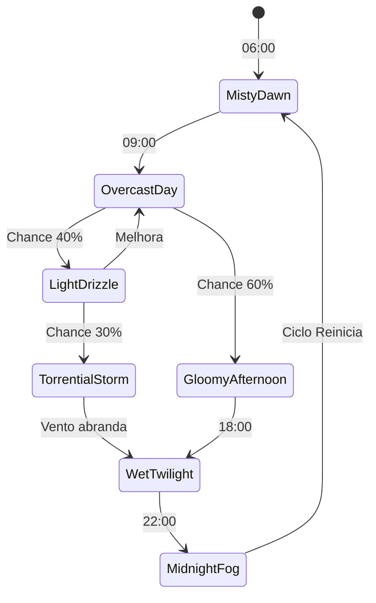
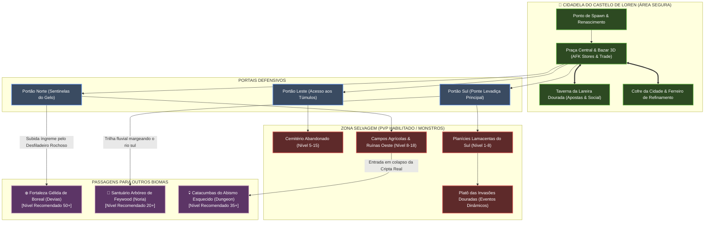

# DOCUMENTO DE LEVEL DESIGN & WORLD BUILDING: LORENCIA & O CASTELO DE LOREN

> **Projeto:** Dasi (Inspirado no Continent of Legend - MU Online)  
> **Status:** Especificação Técnica & Artística de Level Design (v1.0)  
> **Ambiente:** Castelo de Loren & Planícies Cinzentas (*Lorencia*)  
> **Público-Alvo:** Level Designers, Environment Artists, Lighting Artists e Technical Shaders  

---

## 1. VISÃO GERAL & HIGH CONCEPT DA ZONA

O **Castelo de Loren & Planícies Cinzentas** é a porta de entrada para o mundo de Dasi. Mais do que uma simples "cidade inicial", Lorencia é o pulso socioeconômico do jogo, um centro cosmopolita medieval-gótico cercado por campos agrestes, charcos lamacentos e sepulturas esquecidas.

### 1.1 Identidade Visual & Tom Emocional
- **Paleta de Sensações:** Melancolia gótica, resiliência humana, calor acolhedor contra um mundo selvagem hostil e desejo de ascensão heroica.
- **Arquitetura:** Alvenaria em pedra cinzenta esculpida, vigas maciças de carvalho escurecido pelo mofo e umidade, telhados de ardósia negra e estruturas de ferro forjado cobertas de fuligem e orvalho.
- **Contraste de Iluminação:** O exterior é dominado por céus nublados de chumbo e névoa rasteira, enquanto o interior da muralha e da taverna irradia o calor ambarino de tochas ardentes, brasas de forja e lâmpadas a óleo.

---

## 2. TOPOGRAFIA & MACRO-LAYOUT

O mapa mede **2048m x 2048m** com uma malha de elevação orgânica:
- **O Platô Central da Cidadela (+18m):** Construído sobre rocha maciça para drenagem natural, cercado pelo fosso de pedra do Castelo de Loren.
- **As Planícies Lamacentas Médias (+8m a +12m):** Solo arável abandonado, sulcos de carroças e declives suaves cortados por córregos barrentos.
- **As Baixadas Pantanosas e Cemitério (+0m a +5m):** Áreas baixas onde a água da chuva se acumula em pântanos rasos e cryptas inundadas, envoltas em névoa volumétrica perpétua.

```
                                  [ ROTA PARA DEVIAS ]
                             (Desfiladeiro Rochoso Glacial)
                                           ▲
                                           │
                         ┌─────────────────┴─────────────────┐
                         │       MURALHA NORTE & BASTIÃO     │
                         │    (Guarnição de Sentinelas)     │
                         └─────────────────┬─────────────────┘
                                           │
                                           ▼
      [ CAMPOS DO POENTE ]        ┌─────────────────┐        [ CEMITÉRIO ABANDONADO ]
   (Aranhas Gigantes & Lobos)     │                 │        (Esqueletos, Criptas &
   (Círculos de Pedra Mágica) ◄───┤  PRAÇA CENTRAL  ├───►    Tochas Espectrais)
                                  │   (Bazar 3D &   │
                                  │  Fonte Rúnica)  │
                                  └────────┬────────┘
                                           │
                                           ▼
                         ┌─────────────────┴─────────────────┐
                         │   TAVERNA DA LAREIRA DOURADA      │
                         │   (Área Social & Ponto Neutro)    │
                         └─────────────────┬─────────────────┘
                                           │
                         ┌─────────────────┴─────────────────┐
                         │        MURALHA SUL & FOSSO        │
                         │     (Ponte Levadiça Principal)    │
                         └─────────────────┬─────────────────┘
                                           │
                                           ▼
                         [ PLANÍCIES LAMACENTAS & CHARCOS ]
                           (Touros Selvagens, Caçadores)
                                           │
                                           ▼
                                  [ ROTA PARA NORIA ]
                            (Floresta Ancestral de Feywood)
```

---

## 3. ZONEAMENTO DETALHADO (POINTS OF INTEREST - POIs)

### 3.1 Zona 1: A Praça Central & Tendas do Bazar 3D (Coração Social)
- **Função:** Centro neurálgico para comércio, ostentação de equipamentos (+9/+13/+15 e asas) e formação de grupos para masmorras.
- **Marco Central:** Uma estátua colossal do *Arcanjo de Loren* em bronze envelhecido, vertendo água pura em uma bacia octogonal decorada com entalhes rúnicos iluminados por feixes de luz mística azul-celeste.
- **Tendas de Bazar 3D (Player Personal Stores):**
  - Diferente dos bazares 2D estáticos antigos, os jogadores montam **tendas físicas 3D personalizáveis** (toldos de tecido com física Cloth Simulation que reagem ao vento e chuva, tapetes ornados, baús de ferro com cadeados e manequins de exibição de armaduras).
  - Tapetes de veludo púrpura e estandartes de guildas conferem à praça um ar de feira medieval viva e efervescente.
- **NPCs e Serviços:** Mestre de Armas (Repair & Forge), Banqueiro da Cripta (Vault), Comerciante de Poções Potionmaster Liam.

### 3.2 Zona 2: A Taverna da Lareira Dourada (The Hearth Tavern)
- **Função:** Zona livre de PvP permanente, ponto de encontro imersivo, troca de boatos (Lore), contratação de mercenários e minijogos de apostas de dados rúnicos.
- **Atmosfera & Interior:**
  - **Lareira Titânica:** Esculpida em rocha com uma grelha de ferro que estala fagulhas volumétricas dinâmicas; toras incandescentes emitem uma luz quente dourada (temperatura de cor de 2100K) que projeta sombras longas nas mesas de mogno.
  - Canecas de hidromel com espuma física, barris de carvalho pingando e fumaça de cachimbo que sobe em volutas volumétricas até o teto de vigas expostas.
  - Transição de áudio sem costura (Seamless Occlusion): o som da chuva e vento do lado de fora é amortecido gradualmente por filtro passa-baixa (*Low-Pass Filter*) à medida que o jogador cruza as portas duplas de carvalho, sendo substituído pelo som aconchegante da lareira e melodias de alaúde.

### 3.3 Zona 3: Muralhas Fortificadas (Norte & Sul)
- **Muralha Sul (O Portão de Ferro):**
  - O principal portal de saída para as Planícies. Uma ponte levadiça monumental de carvalho reforçado com tiras de aço negro sobre um fosso repleto de estacas defensivas.
  - Duas torres gêmeas com baluartes onde tochas de pitch flamejam 24 horas por dia, soltando fagulhas que são sopradas pelo vento dominante.
  - Guarda Real de Lorencia patrulhando com lanças e capas vermelhas esvoaçantes.
- **Muralha Norte (O Bastião da Vigília Glacial):**
  - Mais severa e desgastada pelos ventos cortantes que descem de Boreal (Devias).
  - Gárgulas góticas gotejando água acumulada nas cornijas; tochas instaladas em suportes de ferro com gaiolas protetoras contra rajadas de vento e gelo incipiente.
  - Posto avançado dos batedores que alertam sobre as Invasões Douradas e monstros do norte.

### 3.4 Zona 4: O Cemitério Abandonado das Almas Esquecidas
- **Localização:** Sudeste das muralhas, em uma depressão de terra encharcada cercada por grades de ferro enferrujadas e quebradas.
- **Atmosfera & Visual:**
  - Lápides góticas em ângulos tortos cobertas de musgo e líquen fluorescente.
  - Mausoléus de pedra rachada onde criptas subterrâneas exalam névoa fria ao nível do chão (*Ground Fog* via Exponential Height Fog e Shaders de Volume Local).
  - Fogo-fátuo (*Will-o'-the-wisps*) e tochas com chamas verde-esmeralda e pálidas tremeluzindo sobre sepulturas antigas.
- **Bestiário Local (Early Game Grind):**
  - *Esqueletos Arruinados* empunhando escudos rachados, *Almas Errantes* translúcidas que soltam gemidos ecoantes e *Necromantes Prófugos*.

### 3.5 Zona 5: As Planícies Lamacentas & Campos Agrícolas
- **Topografia:** Solo rico em argila e húmus negro, trilhas de carruagens com sulcos profundos preenchidos por poças de água barrenta e estacas de madeira delimitando fazendas queimadas na Grande Guerra.
- **Vegetação Dinâmica:**
  - Grama alta de savana fria (*tall reed grass*) com malha interativa que se dobra conforme o personagem corre, rola ou desfere cortes de espada (via Vector Field no Vertex Shader da folhagem).
  - Árvores retorcidas com folhas molhadas que gotejam periodicamente sobre o chão.
- **Perigos & Monstros:**
  - *Touros Selvagens* de chifres blindados, *Espantalhos Possuídos* e matilhas de *Lobos Sarnentos* que flanqueiam jogadores desprevenidos.

---

## 4. ILUMINAÇÃO VOLUMÉTRICA & PONTOS DE LUZ

O sistema de iluminação de Lorencia utiliza **Unreal Engine 5 Lumen** combinado com **Volumetric Cloud & Fog Pass** de alta precisão.

### 4.1 Parâmetros de Luz e Atmosfera

| Parâmetro | Configuração Base (Lorencia Exterior) | Configuração Interior (Taverna) |
| :--- | :--- | :--- |
| **Direct Directional Light** | 12.000 Lux (Dia Nublado / 5500K com matiz fria) | Desativada / Oclusão de Geometria |
| **Sky Light** | Híbrido HDRI com Cubemap nublado escurecido | Luz rebatida indireta suave de quina |
| **Volumetric Fog Scattering** | 0.45 (Alto espalhamento para God Rays entre nuvens) | 0.08 (Leve fumaça volumétrica de cachimbo) |
| **Extinction Scale** | 0.035 por metro cúbico | 0.01 por metro cúbico |
| **Point Lights (Tochas)** | 2200K (Laranja Fogo), 850 Lumens, Raio 6m, Radius Shadow jitter | 1900K (Brasas quentes), 1200 Lumens com Shadow Maps suaves |

### 4.2 VFX de Pontos de Luz (Tochas & Lanternas)
1. **Tochas de Muralha:**
   - Emissor Niagara com 3 camadas:
     - *Core da Chama:* Mesh de fita suave com textura de ruído VDB em rotação contínua.
     - *Emissão de Fagulhas:* 40 partículas/seg com atrito de ar e colisão simples contra a alvenaria, brilhando em laranja incandescente.
     - *Fumaça Preta com Fuligem:* Sprite volumétrico com iluminação directional sub-surface que sobe e se dispersa a 3 metros de altura.
2. **Lanternas de Ferro Suspensas:**
   - Física de pêndulo (*Rigid Body Physics Constraint*) que oscila suavemente com rajadas de vento do clima, movendo a projeção de sombras no chão em sincronia.

---

## 5. SISTEMA DE CLIMA DINÂMICO & ESTADOS ATMOSFÉRICOS

O clima em Lorencia opera em um ciclo contínuo gerido pelo subsistema de ambiente `WeatherManager`:



### 5.1 Fases do Clima e Resposta no Mundo:
1. **Névoa Matinal (*Misty Dawn*):**
   - Visibilidade reduzida a 80 metros; névoa rasteira nos charcos; orvalho brilhando nas pontas da relva e lâminas de metal.
2. **Chuva Leve (*Light Drizzle*):**
   - Gotículas finas preenchem o ar; o shader de terreno ativa acúmulo de umidade progressivo (Roughness cai de 0.8 para 0.25).
   - Som de gotejamento suave em toldos e armaduras.
3. **Tempestade Torrencial (*Torrential Storm*):**
   - Vento a 45 km/h que curva árvores e banners de tendas; relâmpagos estroboscópicos iluminam a praça central por milissegundos.
   - Poças de água acumulam-se no chão em sulcos de terra e depressões de paralelepípedos, com ondulações de gotas (*rain ripples* dinâmicos).
   - Oclusão de chuva sob telhados e pórticos (jogadores na taverna ou sob tendas não recebem chuva graças a um Depth Rain Mask global).

---

## 6. DIAGRAMA DE FLUXO DE JOGADORES & ROTAS REGIONAIS



---

## 7. DIRETRIZES TÉCNICAS PARA ARTISTAS & ENGENHARIA DE CENÁRIO

1. **Nanite Mesh Streaming:**
   - Paredes do castelo e rochedos usam malhas de alta contagem de polígonos sem necessidade de LODs tradicionais manuais.
   - Texturas em 4K organizadas em UDIMs com canais compactados:
     - `R`: Ambient Occlusion
     - `G`: Roughness
     - `B`: Metallic / Porosity
     - `A`: Cavity / Micro-Displacement
2. **Sistema de Oclusão de Som Wwise:**
   - Volumes de áudio cobrindo os portões do castelo atenuam sons de batalha externos para garantir que a praça permaneça como um refúgio acústico com trilha instrumental orquestral solene.
3. **Decals e Pegadas em Tempo Real:**
   - Render Target circular em torno do jogador para registrar deformações de lama (*Mud Trails*) com fade out de 30 segundos.
