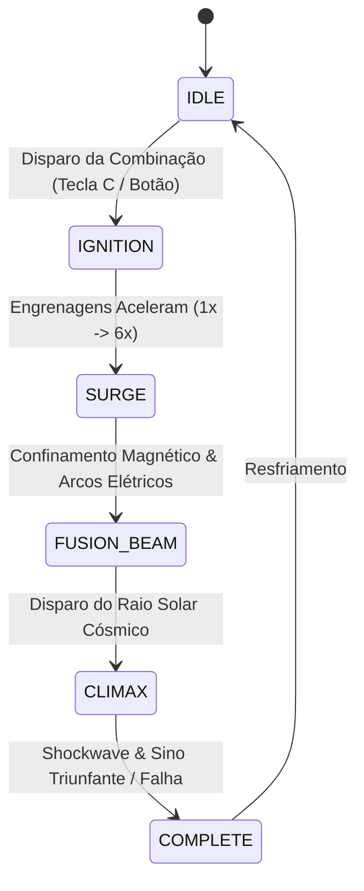
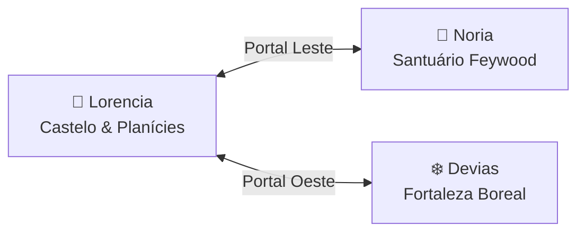

# Especificação Técnica: Mecânicas de Gameplay de Ação, Portais 3D e Áudio Harmônico

**Projeto:** Dasi (Continent of Legend Inspired Action RPG)  
**Versão:** 1.0.0  
**Status:** Implementado e Verificado em Testes Automatizados (74 testes ativos)  
**Módulos Centrais:**
- [`HarmonicAudioSynthesizer.ts`](file:///d:/Dasi/src/client/gameplay/HarmonicAudioSynthesizer.ts)
- [`LevelUpSystem.ts`](file:///d:/Dasi/src/client/gameplay/LevelUpSystem.ts)
- [`ChaosMachineVFX.ts`](file:///d:/Dasi/src/client/gameplay/ChaosMachineVFX.ts)
- [`PortalSystem.ts`](file:///d:/Dasi/src/client/gameplay/PortalSystem.ts)
- [`KeyboardController.ts`](file:///d:/Dasi/src/client/gameplay/KeyboardController.ts)
- [`dasiActionGameplay.js`](file:///d:/Dasi/src/client/dev_viewer/dasiActionGameplay.js)
- [`dasi3dRealtimeArena.js`](file:///d:/Dasi/src/client/dev_viewer/dasi3dRealtimeArena.js)
- [`dasi3dViewer.js`](file:///d:/Dasi/src/client/dev_viewer/dasi3dViewer.js)

---

## 1. Efeito Visual e Sonoro de Level Up (Ascensão Solar Dourada)

O efeito de **Level Up** foi projetado para transmitir uma sensação imediata de glória, poder arcano e recompensa sensorial, combinando geometria tridimensional, materiais emissivos PBR, partículas volumétricas e síntese de áudio arpejada.

### 1.1 Arquitetura Tridimensional (3D VFX)

O grupo de Level Up gerado por [`LevelUpSystem.createLevelUp3DGroup()`](file:///d:/Dasi/src/client/gameplay/LevelUpSystem.ts) é ancorado diretamente na posição do herói e é composto por 5 subsistemas sincronizados:

1. **Auréola Dourada Ascendente (`aureoleMesh`):**
   - Geometria: `TorusGeometry(0.75, 0.065, 12, 36)`.
   - Material: `MeshBasicMaterial` com coloração ouro solar (`#facc15`), transparência e `AdditiveBlending`.
   - Dinâmica: Eleva-se verticalmente do solo ($y = 0.1\,\text{m}$) até a altura do vértice ($y \approx 3.8\,\text{m}$) seguindo uma curva exponencial de aceleração:
     $$y(t) = \left(\frac{t}{T}\right)^{0.75} \times 3.8\,\text{m}$$
     onde $T = 1.8\,\text{s}$ (duração total da animação).
   - Expansão Radial: O raio do toro expande com escala $S(t) = 1.0 + 1.6 \times \left(\frac{t}{T}\right)$.

2. **Coluna Volumétrica de Luz Solar (`lightBeamMesh`):**
   - Geometria: `CylinderGeometry(0.85, 0.65, 4.5, 24, 1, true)` vazado.
   - Material: Gradiente translúcido solar aditivo (`#fef08a`), conectando os pés do personagem aos céus de Lorencia.

3. **Onda de Choque Rúnica no Solo (`groundShockMesh`):**
   - Geometria: `RingGeometry(0.3, 0.75, 32)` no plano $XZ$.
   - Expansão: Alastra-se com escala $1.0 \to 5.2\times$ em $0.6\,\text{s}$ varrendo o solo com faíscas douradas.

4. **Partículas Solares em Dupla Hélice Espiral (`particlesMesh`):**
   - Geometria: `BufferGeometry` com 75 partículas aditivas de alta luminância.
   - Movimento: Subida vetorial com rotação de vórtice angular $\omega = 3.5\,\text{rad/s}$, simulando a subida de centelhas de luz solar primordial ao redor da silhueta do herói.

5. **Fonte Pontual de Luz Dinâmica (`lightSource`):**
   - Luz `PointLight(0xfacc15, 4.5, 12)` que ilumina instantaneamente a armadura metálica do herói, o piso e os monstros vizinhos.

### 1.2 Síntese de Áudio Harmônico Triunfante

No [`HarmonicAudioSynthesizer.playLevelUpSound()`](file:///d:/Dasi/src/client/gameplay/HarmonicAudioSynthesizer.ts), o som é sintetizado proceduralmente através da **Web Audio API**:

- **Arpejo Ascendente em Dó Maior:**  
  Executa notas com espaçamento $\Delta t = 75\,\text{ms}$:
  1. $C_4$ ($261.63\,\text{Hz}$)
  2. $G_4$ ($392.00\,\text{Hz}$)
  3. $C_5$ ($523.25\,\text{Hz}$)
  4. $E_5$ ($659.25\,\text{Hz}$)
  5. $G_5$ ($783.99\,\text{Hz}$)
  6. $C_6$ ($1046.50\,\text{Hz}$)
- **Sino Celestial de Ouro:**  
  No ápice do arpejo ($t \approx 0.45\,\text{s}$), dispara oscilador senoidal puro em $G_6$ ($1567.98\,\text{Hz}$) com pitch-bend ascendente para $C_7$ ($2093.00\,\text{Hz}$) e decay estendido de $1.8\,\text{s}$.
- **Sub-Grave Expansivo:**  
  Pulso em $C_3$ ($130.81\,\text{Hz}$) rampa para $65.4\,\text{Hz}$, conferindo impacto físico à expansão da auréola.

---

## 2. Sequência de Animação e VFX do Chaos Machine (Forja Ativa)

A lendária **Chaos Machine dos Goblins de Noria** conta com uma state machine cinemática em 4 fases sequenciais gerenciada pela classe [`ChaosMachineVFX`](file:///d:/Dasi/src/client/gameplay/ChaosMachineVFX.ts).

### 2.1 Especificação das Fases da Forja

| Fase | Duração | Comportamento Mecânico | VFX Visual 3D | Feedback de Áudio |
| :--- | :--- | :--- | :--- | :--- |
| **1. IGNITION** | $1.4\,\text{s}$ | Engrenagens rotativas aceleram de $1.0\times$ para $6.0\times$. Caldeirão aquece. | Pulso de calor inicial; as 3 joias dos pedestais começam a oscilar. | Catraca mecânica de engrenagens goblins acelerando (`tick-tick-whirrr`). |
| **2. SURGE** | $1.6\,\text{s}$ | Engrenagens atingem $10.0\times$. Confinamento magnético entra em ressonância. | Anéis magnéticos giram em 3 eixos opostos; núcleo de plasma aquece para $1.0$. | Zumbido oscilante senoidal/sawtooth de confinamento de plasma ($110\,\text{Hz} \to 840\,\text{Hz}$). |
| **3. FUSION_BEAM** | $1.2\,\text{s}$ | Potência máxima da forja. | **Raio Laser de Fusão Solar** desce do zênite (cilindro branco-dourado aditivo de $9.0\,\text{m}$ de altura), centelhas cobrem o caldeirão. | Impacto acústico do raio laser cósmico com varredura descendente ($920\,\text{Hz} \to 45\,\text{Hz}$). |
| **4. CLIMAX** | $1.0\,\text{s}$ | Explosão de shockwave expansiva ($1.0 \to 8.0\times$). Desaceleração suave. | Se **Sucesso:** flash dourado solar e item levita radiante. Se **Falha:** fumaça cinzenta e estilhaços. | **Sucesso:** Acorde triunfante em Ré Maior ($587.33\,\text{Hz} + 1760.0\,\text{Hz}$). **Falha:** Choque metálico abafado. |

---

## 3. Portais de Teletransporte 3D e Transição Dinâmica de Mapas

A classe [`PortalSystem`](file:///d:/Dasi/src/client/gameplay/PortalSystem.ts) implementa a interconexão contínua entre os três mapas fundamentais do jogo: **Planícies de Lorencia**, **Santuário de Noria (Feywood)** e **Fortaleza Boreal de Devias**.

### 3.1 Topologia de Zonas e Conexões

- **Lorencia $\to$ Noria:** Portal em $(x: 13.5\,\text{m}, z: -1.0\,\text{m})$, Cor Esmeralda (`#10b981`), Raio de ativação: $2.2\,\text{m}$.
- **Lorencia $\to$ Devias:** Portal em $(x: -13.5\,\text{m}, z: -1.0\,\text{m})$, Cor Azul Glacial (`#38bdf8`), Raio de ativação: $2.2\,\text{m}$.
- **Noria / Devias $\to$ Lorencia:** Portal Sul em $(x: 0\,\text{m}, z: 9.5\,\text{m})$, Cor Âmbar/Dourado (`#f59e0b`), Raio de ativação: $2.2\,\text{m}$.

### 3.2 Estrutura 3D do Portal de Vórtice

Cada portal é gerado proceduralmente com:
1. **Pilares Góticos de Pedra Talhada:** Dois pilares cilíndricos com verga de cantaria superior.
2. **Anéis de Confinamento Duplos:** Dois toros concêntricos em rotação contraposta ($\omega_1 = 1.2\,\text{rad/s}$, $\omega_2 = -1.8\,\text{rad/s}$).
3. **Horizonte de Eventos (Vórtice Espacial):** Disco emissivo de alta transparência com shader translúcido e rotação contínua.
4. **Partículas de Vórtice Dimensional:** 45 partículas orbitais que espiralam em direção ao centro do disco.
5. **Luz Dinâmica Respirante:** Emite pulso contínuo de iluminação $I(t) = 3.2 \times [1.0 + 0.22 \sin(3.5 t)]$.
6. **Placa Billboard Tridimensional:** Etiqueta flutuante iluminada indicando o destino (ex: `🌿 Portal de Noria`).

### 3.3 Mecanismo de Transição em Tempo Real

Ao colidir com a área do portal ou clicar nele:
1. O sintetizador emite o áudio **Warp Whoosh** com varredura de filtro passa-faixa ressonante ($250\,\text{Hz} \to 3200\,\text{Hz}$).
2. O elemento `.warp-tunnel-overlay` dispara um pulso de vinheta azul/dourada de dobra espacial.
3. O motor 3D reconstrói o ambiente dinamicamente sem recarregar a página:
   - Substitui materiais do solo (calçamento escuro em Lorencia, musgo esmeralda em Noria, neve compactada em Devias).
   - Atualiza a cor e densidade da névoa volumétrica do Three.js (`scene.fog.color` e `fog.density`).
   - Troca as luzes ambiente e solar direcionais.
   - Reposiciona o herói no ponto de spawn correspondente.

---

## 4. Controles por Teclado (WASD) e Feedback Sonoro Harmônico

O módulo [`KeyboardController`](file:///d:/Dasi/src/client/gameplay/KeyboardController.ts) fornece movimentação fluida de **Action RPG** com física cinemática de inércia, rotação contínua e desaceleração proporcional.

### 4.1 Física Cinemática de Movimentação

- **Aceleração Snappy:** $a = 30.0\,\text{m/s}^2$
- **Velocidade Terminal Máxima:** $v_{\max} = 5.6\,\text{m/s}$
- **Desaceleração por Atrito:** $\mu = 36.0\,\text{m/s}^2$
- **Taxa de Giro Angular:** $\omega = 14.0\,\text{rad/s}$
- **Normalização Diagonal Unitária:**  
  Quando teclas opostas ou ortogonais são pressionadas simultaneamente (ex: $W + D$), o vetor de entrada $\vec{u} = (u_x, u_z)$ é normalizado:
  $$\hat{u} = \frac{\vec{u}}{\max(1, \|\vec{u}\|)}$$
  garantindo que o herói nunca corra mais rápido em trajetórias diagonais ($\|\vec{v}\| \le v_{\max}$).

### 4.2 Mapeamento Completo de Teclado e Atalhos

| Tecla / Atalho | Ação de Gameplay | Feedback Visual | Feedback Acústico Harmônico |
| :--- | :--- | :--- | :--- |
| **W, A, S, D** / **Setas** | Movimento direcional contínuo | Passada do herói e rotação contínua da malha | Passos dinâmicos baseados no solo (pedra, grama ou neve) |
| **1** | Teletransporte para **Lorencia** | Flash de dobra + reconstrução do castelo | Whoosh de portal em $440\,\text{Hz}$ |
| **2** | Teletransporte para **Noria** | Flash de dobra + árvores feywood e musgo | Whoosh de portal em $523.25\,\text{Hz}$ |
| **3** | Teletransporte para **Devias** | Flash de dobra + manto de neve e fogueira | Whoosh de portal em $392.0\,\text{Hz}$ |
| **Q** | Poção de Vida Instantânea | Regeneração do orbe de HP 3D | Borbulhar quente e revigorante |
| **W** | Poção de Mana Instantânea | Regeneração do orbe de MP 3D | Ressonância arcana cristalina |
| **E** | **Twisting Slash** (Área) | Vórtice cortante de fogo circular | Vento cortante rápido (`cyclone`) |
| **R** | **Death Stab** (Perfurante) | Estocada linear com rastro de faíscas | Estocada de alta frequência |
| **Space** | **Esquiva Tática** (I-Frames) | Rolamento físico rápido com deslocamento | Whoosh de vento e evasão |
| **F** | Coleta Rápida de Drops | Absorção dos itens próximos para a bolsa | Sino celestial ou tilintar de moedas |
| **L** | **Teste de Level Up** | Auréola dourada ascendente + partículas solares | **Fanfarra arpejada em Dó Maior** |
| **C** | **Forja do Caos** | Engrenagens rotativas + raio de fusão solar | Sequência de 4 fases mecânicas/laser |

### 4.3 Acumulador de Passos e Áudio por Superfície

A cada $d_{\text{step}} = 1.2\,\text{m}$ percorridos pelo jogador, o método [`playFootstep(surface)`](file:///d:/Dasi/src/client/gameplay/HarmonicAudioSynthesizer.ts) dispara um pulso de áudio filtrado específico para o mapa atual:
- **`stone` (Lorencia):** Oscilador triangular curto com filtro passa-baixa em $900\,\text{Hz}$ (estalo seco de bota metálica na calçada).
- **`grass` (Noria):** Oscilador senoidal macio em $80\,\text{Hz}$ com filtro em $450\,\text{Hz}$ (farfalhar de musgo úmido).
- **`snow` (Devias):** Oscilador dente-de-serra com filtro passa-faixa em $1200\,\text{Hz}$ com $Q=1.5$ (crocância de neve compactada sob as grevas).

---

## 5. Matriz de Testes e Validação Automatizada

Os novos sistemas contam com testes unitários e de integração em [`src/client/gameplay/tests/gameplay_action.test.ts`](file:///d:/Dasi/src/client/gameplay/tests/gameplay_action.test.ts), totalizando **74 testes automatizados** aprovados em **571ms**:

1. **LevelUpSystem:** Validação da progressão de XP, cálculo de vitais e delta da animação volumétrica.
2. **ChaosMachineVFX:** Transição cronometrada pelas 4 fases, limites de aceleração de engrenagens ($1\times \to 10\times$) e disparo do feixe laser.
3. **PortalSystem:** Mapeamento geográfico de portais, tolerâncias de proximidade física e integridade das conexões.
4. **KeyboardController:** Aceleração, desaceleração por atrito, limitação diagonal uniforme, bounds check e acumulador de passos.
5. **HarmonicAudioSynthesizer:** Inicialização tolerante a ambientes sem GPU/áudio (modo headless) e geração de curvas analíticas.
