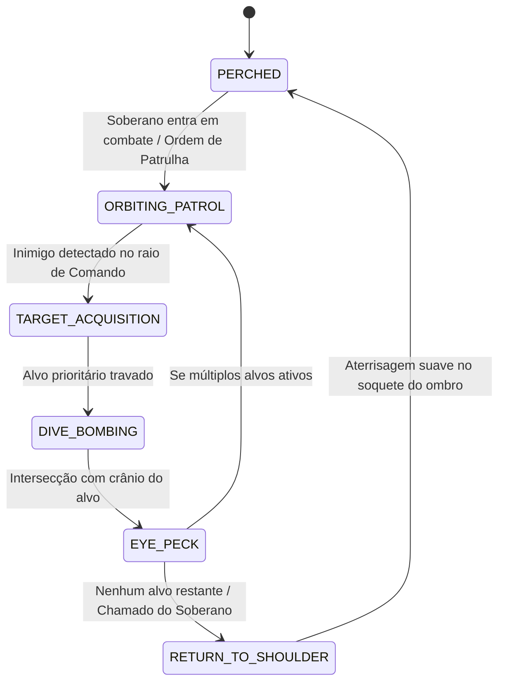

# ESPECIFICAÇÃO TÉCNICA: FÍSICA DE COMBATE AVANÇADO E COMPANHEIROS DE GUERRA — DASI

> **Documento:** Engenharia de Gameplay, Classes Avançadas & IA de Companheiros Físicos  
> **Versão:** 1.0.0  
> **Status:** Aprovado para Implementação e Validação  
> **Classes Cobertas:** Gladiador Rúnico (*Rune Duelist*) & Soberano Imperial (*Imperial Sovereign*)  
> **Módulos Vinculados:** `prototypes.combat_system.advanced_skills`, `prototypes.combat_system.vector3`  

---

## SUMÁRIO EXECUTIVO

Em **Dasi**, a evolução para classes avançadas eleva radicalmente a complexidade das interações físicas no campo de batalha. O Gladiador Rúnico manipula a fusão instável entre artes marciais pesadas e canalização éter-mágica direta, gerando ondas de choque supersônicas e fraturas tectônicas de plasma. Por sua vez, o Soberano Imperial comanda as energias terrestres através de seu Corcel de Ferro (*Dark Horse*), manipula detonações termobáricas com chicotes incandescentes (*Fireburst*) e rege um Companheiro de Guerra com inteligência de voo livre tridimensional (*Dark Raven*), cujo comportamento é governado dinamicamente pelo atributo de **Comando (CMD)**.

Este documento detalha os modelos matemáticos, algoritmos de cálculo vetorial, parâmetros físicos e fluxos de estado dessas cinco mecânicas fundamentais.

---

## 1. FIRE SLASH (GLADIADOR RÚNICO)

O *Fire Slash* funde a energia sísmica da lâmina rúnica com a injeção subterrânea de plasma ígneo superaquecido ($T > 3200^\circ\text{C}$).

```
  Caster (Rune Duelist)
      [P_origin]
          │ 
          │  v_fissure ──► Propagação Sísmica (18 m/s)
          ▼
      ===#=======#=======#=======#=======#======► Direção Forward (D_fissure)
       Vent 1  Vent 2  Vent 3  Vent 4  Vent 5
        (▲)     (▲)     (▲)     (▲)     (▲)
         │       │       │       │       │  J_z (Impulso Convectivo de Plasma)
         └───────┴───────┴───────┴───────┘  Desintegração Térmica de Armadura
```

### 1.1 Cinemática da Fenda Tectônica

A fenda progride pelo solo a partir do ponto de impacto $\vec{P}_0$ na direção horizontal normalizada $\hat{D}$ com velocidade $v_{\text{fissure}}$ até a distância máxima $L_{\text{reach}}$:

$$L(t) = \min(L_{\text{reach}},\, v_{\text{fissure}} \cdot t), \quad t \in [0, t_{\text{max}}]$$

A largura da abertura no solo $W(x, t)$ exibe um perfil elíptico amortecido que decai longitudinalmente:

$$W(x, t) = W_{\text{max}} \cdot \sqrt{1 - \left(\frac{x}{L(t)}\right)^2} \cdot e^{-\lambda_w (t - t_{\text{open}}(x))}$$

Onde:
- $W_{\text{max}} = 0.85\text{ m}$ (largura máxima da fratura).
- $L_{\text{reach}} = 8.5\text{ m}$.
- $v_{\text{fissure}} = 22.0\text{ m/s}$ (tempo de trânsito $\approx 0.386\text{ s}$).
- $\lambda_w = 1.8\text{ s}^{-1}$ (coeficiente de fechamento da terra).

### 1.2 Erupção dos Gêiseres de Plasma e Impulso Convectivo

Ao longo da fenda, $N_{\text{vents}}$ respiradouros de plasma eclodem sequencialmente. O instante de ignição do respiradouro $k$ localizado em $x_k = k \cdot \Delta x$ é:

$$t_{\text{ignite}, k} = \frac{x_k}{v_{\text{fissure}}}$$

Cada jato de plasma atinge altura $H_k(t)$ modelada por empuxo térmico convectivo e resistência do ar:

$$\frac{d^2 z_p}{dt^2} = g \left(\frac{\rho_{\text{amb}} - \rho_{\text{plasma}}}{\rho_{\text{plasma}}}\right) - \frac{1}{2} C_d \frac{A_{\text{jet}}}{m_p} \rho_{\text{amb}} v_z^2$$

Alvos dentro do raio de blast do respiradouro ($R_{\text{vent}} \approx 1.4\text{ m}$) recebem:
1. **Dano Ígneo Primário:** $D_{\text{plasma}} = D_{\text{base}} \cdot \left(1 - \frac{d}{R_{\text{vent}}}\right)$.
2. **Impulso Convectivo Vertical:** $\vec{J}_{\text{lift}} = m_{\text{target}} \cdot \Delta v_z \hat{k}$, onde $\Delta v_z = v_{\text{lift\_base}} \cdot \left(\frac{80.0}{\max(40.0, m_{\text{target}})}\right)$.
3. **Repulsão Lateral:** Força de ejeção direcionada para fora da linha central da fenda:
   $$\vec{F}_{\text{eject}} = F_{\text{lateral}} \cdot (\hat{r}_{\perp}) \cdot \left(1 - \frac{d_\perp}{R_{\text{vent}}}\right)$$

### 1.3 Algoritmo de Degradação Térmica de Armadura (*Armor Shredding*)

O calor extremo quebra as ligações cristalinas dos metais e ligas rúnicas, enquanto a onda sísmica fragmenta escudos.
- Cada pulso de plasma que atinge o alvo aplica $1$ acúmulo de **Fissura Térmica** (*Molten Rupture*).
- **Redução percentual de armadura por acúmulo:** $\Delta \text{Arm} = 10\%$ (acumulável até 5 vezes, totalizando $50\%$ de redução).
- **Tempo de vida do debuff:** $\tau_{\text{shred}} = 6.0\text{ s}$, renovado a cada novo acúmulo.
- A fórmula de resistência efetiva da armadura do alvo torna-se:
  $$R_{\text{armor\_eff}} = R_{\text{armor\_base}} \cdot \max\left(0.50,\, 1.0 - N_{\text{stacks}} \cdot 0.10\right)$$

---

## 2. POWER SLASH (GLADIADOR RÚNICO)

O *Power Slash* converte o momentum de corte da lâmina rúnica em lâminas de éter supersônicas que se propagam em leque cônico com concha de Mach (*bow shock*).

```
                      ▲ Direção Forward (+Y)
                     /│\
                    / │ \
       Lâmina -2   /  │  \   Lâmina +2
          \       /   │   \       /
           \     /    │    \     /
            \   /  Lâmina 0 \   /
             \ /      │      \ /
              ▼       │       ▼
           ─────────────────────── Arc Spread (48°)
                      │
                  [Caster]
```

### 2.1 Concha de Mach e Aerodinâmica Compressível

A lâmina viaja no meio atmosférico a velocidade supersônica inicial:
$$v_0 = 450.0\text{ m/s} \quad (M \approx 1.31\text{ em } T=20^\circ\text{C})$$

O ângulo de Mach do cone de choque é:
$$\mu_{\text{Mach}} = \arcsin\left(\frac{1}{M}\right) = \arcsin\left(\frac{343}{450}\right) \approx 49.7^\circ$$

A desaceleração pelo corte da atmosfera é governada pela força de arrasto transônico:
$$m_{\text{blade}} \frac{dv}{dt} = -\frac{1}{2} \rho_{\text{air}} v^2 C_d A_{\text{blade}}$$
$$v(t) = \frac{v_0}{1 + \gamma_{\text{drag}} \cdot v_0 \cdot t}, \quad \text{onde } \gamma_{\text{drag}} = \frac{\rho C_d A}{2 m}$$

### 2.2 Geometria do Leque Cônico e Dispersão de Lâminas

O leque é composto por $N_{\text{blades}} = 5$ projéteis planares com espaçamento angular uniforme em torno do eixo de disparo $\phi_0$:
$$\theta_i = \phi_0 + \left(i - \frac{N_{\text{blades}} - 1}{2}\right) \cdot \frac{\Delta \Theta_{\text{total}}}{N_{\text{blades}} - 1}, \quad i \in \{0, 1, 2, 3, 4\}$$

Onde $\Delta \Theta_{\text{total}} = 48^\circ$ ($0.8377\text{ rad}$).

Cada lâmina possui um perfil de corte planar com envergadura transversal que se expande ligeiramente com a distância percorrida:
$$W_{\text{arc}}(s) = W_0 + 2 \cdot s \cdot \tan\left(\frac{\delta\psi}{2}\right)$$
- $W_0 = 0.9\text{ m}$ (largura na boca da espada).
- $\delta\psi = 4^\circ$ (divergência intrínseca da lâmina de éter).

### 2.3 Detecção de Intersecção Varredura-Cilindro e Danos Sobrepostos

Alvos próximos ao ponto de disparo ou localizados em áreas de convergência angular podem ser atingidos por múltiplas lâminas. Para evitar acúmulo desproporcional (*shotgunning* artificial), aplica-se o amortecimento de dano correlato:
$$D_k = D_{\text{base}} \cdot (0.65)^{k-1}, \quad k \ge 1 \text{ (índice do impacto no mesmo alvo)}$$

---

## 3. EARTHQUAKE (SOBERANO IMPERIAL & DARK HORSE)

O Soberano empina o Corcel de Ferro e desfere uma pisada sísmica com seus quatro cascos de ferro incandescentes, transferindo a energia cinética do corcel somada ao influxo gravitacional imperial diretamente para o substrato rochoso.

```
          [Imperial Lord & Dark Horse]
                  │ M = 1150 kg
                  ▼ Queda de Cascos (h = 1.3 m)
          ═══════( * )═══════ Solo
                 /   \
                /     \  Onda Sísmica Expansiva (v_s = 20 m/s)
               ▼       ▼
        ◄── Ring Front ──►
      (Upward Knock-Up Impulse J_z + Radial Ragdoll Push)
```

### 3.1 Balanço de Energia do Impacto

A energia mecânica do impacto é o produto da massa do conjunto montado ($M_{\text{mount}} \approx 1150\text{ kg}$) sob gravidade, acrescida da força mágica de compressão imperial $E_{\text{arcane}}$:
$$E_{\text{impact}} = M_{\text{mount}} \cdot g \cdot h_{\text{rear}} + E_{\text{arcane}} \approx 1150 \times 9.81 \times 1.3 + 35000 \approx 49.66\text{ kJ}$$

### 3.2 Propagação da Onda de Choque Sísmica (Onda Rayleigh)

A frente de onda sísmica viaja radialmente através do solo como uma onda de superfície dispersiva:
$$R_{\text{wave}}(t) = v_{\text{seismic}} \cdot t, \quad t \in \left[0, \frac{R_{\text{max}}}{v_{\text{seismic}}}\right]$$
- $v_{\text{seismic}} = 20.0\text{ m/s}$.
- $R_{\text{max}} = 9.0\text{ m}$ (alcance total da devastação sísmica).
- Espessura ativa da crista sísmica: $\Delta R_{\text{crest}} = 1.25\text{ m}$.

A densidade de energia da onda atenua geometricamente com o inverso do raio e amortecimento geomecânico do solo:
$$I(r) = I_0 \cdot \left(\frac{r_{\text{inner}}}{r}\right)^{\gamma} \cdot e^{-\kappa_{\text{soil}} (r - r_{\text{inner}})}$$
- $\gamma = 0.5$ (onda de superfície bidimensional cilíndrica).
- $\kappa_{\text{soil}} = 0.08\text{ m}^{-1}$ (dissipação inelástica do solo).

### 3.3 Cinemática de Arremesso Físico e Ragdoll Parabólico

Quando a frente sísmica intercepta o hurtbox do monstro, a energia do solo é transferida vertical e radialmente.

#### Cálculo do Impulso:
$$J_z(r) = J_{z0} \cdot \sqrt{\frac{I(r)}{I_0}} \cdot \left(\frac{75.0}{\max(35.0, m_{\text{target}})}\right)$$
$$J_r(r) = J_{r0} \cdot \left(\frac{I(r)}{I_0}\right) \cdot \left(\frac{75.0}{\max(35.0, m_{\text{target}})}\right)$$

#### Velocidades Iniciais de Lançamento:
$$v_{z0} = \frac{J_z}{m_{\text{target}}}, \quad \vec{v}_r = \frac{J_r}{m_{\text{target}}} \hat{r}_{\text{radial}}$$

- **Resistência de Chefes (*Poise Check*):** Se o alvo possuir postura superior ao limite de quebra de terremoto ($\text{Poise} > 150$), o lançamento aéreo é suprimido, resultando apenas em micro-estremecimento (*stagger* severo no solo com interrupção de conjuração).
- **Fórmula da Balística Aérea:**
  $$z(t) = z_0 + v_{z0} t - \frac{1}{2} g t^2$$
  $$\vec{x}_{xy}(t) = \vec{x}_0 + \vec{v}_r t$$
- **Dano de Queda ao Atingir o Solo:** No retorno a $z \le 0$, calcula-se o impacto inercial:
  $$D_{\text{fall}} = \frac{1}{2} m_{\text{target}} v_{\text{impact}, z}^2 \cdot \eta_{\text{ground}}$$

---

## 4. FIREBURST (SOBERANO IMPERIAL)

O *Fireburst* utiliza o estalo hipersônico de um chicote de chamas ou cetro real para aerosolizar e detonar micro-partículas etéricas e sulfúricas no ar, gerando uma tríplice detonação em cadeia termobárica.

```
       Caster
      [Scepter]
         │
         │  Whip Crack (Estalo Supersônico)
         ▼
     ( P_crack ) ──► Ignição de Partículas em Cascata
           │
           ├── Node 1 [t = 0.00s] ──► Overpressure Blast 1
           │
           ├── Node 2 [t = 0.09s] ──► Overpressure Blast 2 (Maior Raio)
           │
           └── Node 3 [t = 0.18s] ──► Overpressure Blast 3 (Implosão / Choque Residual)
```

### 4.1 Cinemática do Chicote e Ignição de Aerossol

A ponta do chicote afunilado atinge aceleração extrema pela conservação de momento angular ao longo da conicidade da fibra:
$$v_{\text{tip}} = v_{\text{hand}} \cdot \sqrt{\frac{\rho_{\text{base}} A_{\text{base}}}{\rho_{\text{tip}} A_{\text{tip}}}} > 343\text{ m/s}$$

A compressão adiabática do ar na ponta aquece localmente o ar acima do ponto de autoignição do éter de fogo ($T_{\text{flash}} \approx 650^\circ\text{C}$), detonando a nuvem de partículas previamente dispersada em 3 núcleos longitudinais:
- **Núcleo 1:** No ponto central de impacto $\vec{P}_{\text{impact}}$.
- **Núcleo 2:** Deslocado lateral/frontalmente $\vec{P}_{\text{impact}} + \delta\vec{r}_1$.
- **Núcleo 3:** Deslocado vertical/profundamente $\vec{P}_{\text{impact}} + \delta\vec{r}_2$.

### 4.2 Onda de Sobrepressão Termobárica e Dano em Cadeia

Cada nó de explosão deflagra uma curva de pressão característica de Friedlander:
$$P(r, t) = P_{\text{peak}} \cdot \left(1 - \frac{t - t_{\text{det}}}{t_{\text{pos}}}\right) \cdot e^{-\frac{t - t_{\text{det}}}{\theta_{\text{decay}}}}$$

- **Interferência Construtiva:** Se um inimigo for apanhado nas zonas de interseção de múltiplos nós, as sobrepressões se somam, gerando colapso instantâneo da armadura e postura:
  $$P_{\text{total}} = \sum_{k=1}^3 P_k(r_k)$$
- **Efeito de Combustão Secundária (DoT de Fogo):** Inimigos atingidos por 2 ou mais nós sofrem ignição contínua com queima de 4 segundos ($D_{\text{burn}} = 0.20 \cdot D_{\text{total\_blast}}$ por segundo).

---

## 5. DARK RAVEN (CORVO DE GUERRA SOBERANO)

O Corvo de Guerra é uma entidade autônoma com dinâmica de voo tridimensional, orientada por forças aerodinâmicas (sustentação, arrasto e vetor de empuxo) e acoplada diretamente ao atributo de **Comando (CMD)** do Soberano Imperial.



### 5.1 Matriz de Escalonamento por Comando (CMD)

O atributo **Comando (CMD)** é o canalizador psíquico entre o Soberano e a ave de rapina. Seus multiplicadores operam da seguinte forma:

| Parâmetro Físico / Combate | Fórmula de Escalonamento por CMD | Faixa Operacional (CMD: 0 a 1000) |
|---|---|---|
| Raio de Detecção e Ataque ($R_{\text{cmd}}$) | $R_{\text{base}} + 0.015 \cdot \text{CMD}$ | $8.0\text{ m} \to 23.0\text{ m}$ |
| Velocidade de Patrulha ($v_{\text{patrol}}$) | $v_{\text{p0}} \cdot \left(1 + 0.40 \cdot \frac{\text{CMD}}{1000}\right)$ | $7.0\text{ m/s} \to 9.8\text{ m/s}$ |
| Velocidade de Mergulho ($v_{\text{dive}}$) | $v_{\text{d0}} \cdot \left(1 + 0.85 \cdot \frac{\text{CMD}}{1000}\right)$ | $18.0\text{ m/s} \to 33.3\text{ m/s}$ |
| Dano Base da Bicada / Garras ($D_{\text{raven}}$) | $D_0 \cdot \left(1 + 1.50 \cdot \frac{\text{CMD}}{1000}\right)$ | $120 \to 300$ de dano físico |
| Chance de Cegueira por Ataque ($P_{\text{blind}}$) | $P_{\text{base}} + \min\left(0.50,\, 0.45 \cdot \frac{\text{CMD}}{1000}\right)$ | $15\% \to 60\%$ de probabilidade |
| Duração da Cegueira ($T_{\text{blind}}$) | $T_0 + 2.5 \cdot \frac{\text{CMD}}{1000}$ | $3.0\text{ s} \to 5.5\text{ s}$ |

### 5.2 Estados da Máquina de IA de Voo Livre

#### Estado 1: `PERCHED` (Pousado no Ombro)
- O corvo permanece ancorado na coordenada do soquete direito da couraça do Soberano:
  $$\vec{P}_{\text{raven}} = \vec{P}_{\text{hero}} + \vec{R}_{\text{hero\_orient}} \cdot \vec{O}_{\text{shoulder}}$$
  onde $\vec{O}_{\text{shoulder}} = [0.35, -0.15, 1.65]^T\text{ m}$.

#### Estado 2: `ORBITING_PATROL` (Patrulha Orbital Elíptica)
- A ave circula acima do Soberano a uma altitude operacional $H_{\text{orbit}} = 4.5\text{ m}$.
- As coordenadas são calculadas dinamicamente via parametrização elíptica amortecida:
  $$\theta(t) = \theta_0 + \omega_{\text{orbit}} \cdot t$$
  $$\vec{P}_{\text{raven}}(t) = \vec{P}_{\text{hero}} + \begin{bmatrix} R_a \cos(\theta(t)) \\ R_b \sin(\theta(t)) \\ H_{\text{orbit}} + 0.4 \sin(2 \theta(t)) \end{bmatrix}$$
- Adiciona oscilação de sustentação por batimento de asas (*flapping lift oscillation*).

#### Estado 3: `TARGET_ACQUISITION` (Aquisição e Varredura)
- Varre todos os alvos vivos dentro da esfera $R_{\text{cmd}}$.
- Aplica ordenação por função utilitária de prioridade:
  $$U(\text{target}) = \frac{1}{\text{dist}} \times (1.5 \text{ se atacando o herói}) \times (1.3 \text{ se baixa vida})$$

#### Estado 4: `DIVE_BOMBING` (Mergulho em Parafuso)
- O corvo fecha as asas e mergulha em direção ao topo da cabeça do alvo ($\vec{P}_{\text{target}} + [0, 0, 1.7]^T$).
- O vetor de aceleração combina atração direta com rotação helicoidal (*screw rotation*):
  $$\vec{D}_{\text{dive}} = \frac{\vec{P}_{\text{head}} - \vec{P}_{\text{raven}}}{\|\vec{P}_{\text{head}} - \vec{P}_{\text{raven}}\|}$$
  $$\vec{v}_{\text{screw}} = \omega_{\text{screw}} \cdot (\vec{D}_{\text{dive}} \times \hat{k}) \cdot R_{\text{screw}} \cdot e^{-\lambda_s \tau}$$
  $$\vec{v}(t) = v_{\text{dive}} \cdot \vec{D}_{\text{dive}} + \vec{v}_{\text{screw}}$$
- A energia cinética do impacto transfere choque inercial:
  $$E_{\text{impact}} = \frac{1}{2} m_{\text{raven}} v_{\text{dive}}^2$$

#### Estado 5: `EYE_PECK` (Ataque aos Olhos e Debuff de Cegueira)
- O corvo atinge a cabeça do inimigo e executa uma sequência de bicadas rítmicas ultrarrápidas ($N_{\text{pecks}} = 3$ em $0.25\text{ s}$).
- Realiza o teste estatístico da probabilidade de cegueira $P_{\text{blind}}(\text{CMD})$.
- Se bem-sucedido, aplica o status **Cegueira Profunda** (*Ocular Rupture*):
  - Redução de precisão do alvo em $65\%$.
  - Perda de travamento de alvo (o monstro ataca aleatoriamente ou fica desorientado).
  - Micro-estremecimento craniano (*cranial flinch*).

#### Estado 6: `RETURN_TO_SHOULDER` (Retorno Curvilíneo ao Ombro)
- O corvo realiza uma curva de sustentação com subida dinâmica (*climb bank turn*) para recuperar altitude e desacelera suavemente ao se aproximar do ombro:
  $$\vec{v}_{\text{return}} = \vec{v}_{\text{max}} \cdot \text{clamp}\left(\frac{\text{dist}}{d_{\text{decel}}},\, 0.15,\, 1.0\right) \cdot \hat{D}_{\text{shoulder}}$$
- Ao atingir distância $< 0.12\text{ m}$, ancora novamente no estado `PERCHED`.

---

## 6. TABELA DE COEFICIENTES E CALIBRAÇÃO FÍSICA

| Mecânica / Parâmetro | Símbolo | Valor Numérico | Unidade SI | Justificativa Física |
|---|---|---|---|---|
| Velocidade Fenda Fire Slash | $v_{\text{fissure}}$ | 22.0 | m/s | Propagação sísmica ultrarrápida da fenda tectônica |
| Shred Máximo Fire Slash | $\text{Shred}_{\text{max}}$ | 0.50 | Ratio (50%) | Redução termomecânica por quebra de blindagem |
| Velocidade Inicial Power Slash | $v_{\text{mach}}$ | 450.0 | m/s | Lâmina supersônica de éter ($M \approx 1.31$) |
| Ângulo Leque Power Slash | $\Delta\Theta$ | 48.0 | graus | Cobertura cônica balanceada para dispersão |
| Velocidade Onda Earthquake | $v_{\text{seismic}}$ | 20.0 | m/s | Onda Rayleigh de compressão de solo superficial |
| Raio Máximo Earthquake | $R_{\text{max}}$ | 9.0 | metros | Área de impacto da pisada do Dark Horse |
| Gravidade Queda Earthquake | $g$ | 9.81 | $\text{m/s}^2$ | Balística newtoniana para arremesso ragdoll |
| Intervalo Nós Fireburst | $\Delta t_{\text{node}}$ | 0.09 | segundos | Deflagração em cascata de sobrepressão |
| Massa do Dark Raven | $m_{\text{raven}}$ | 2.4 | kg | Ave de rapina mágica com ossatura densificada |
| Escala CMD Voo Raven | $k_{\text{cmd}}$ | 0.015 | m/CMD | Expansão do raio psíquico de controle de voo |

---

## 7. CONCLUSÃO E PROTOCOLOS DE VALIDAÇÃO

Todas as cinco mecânicas aqui especificadas estão desacopladas de frames gráficos estáticos e fundamentadas em vetores 3D de alta precisão. Seus comportamentos devem ser validados através da suíte executável `test_advanced_skills.py` cobrindo:
1. Verificação da propagação com velocidade correta da fenda do *Fire Slash* e acúmulo de *Armor Shred*.
2. Verificação supersônica e detecção de intersecção cônica do *Power Slash*.
3. Balística vetorial de lançamento parabólico e queda no solo do *Earthquake*.
4. Sequência cronológica das 3 detonações termobáricas do *Fireburst*.
5. Transições da máquina de estados do *Dark Raven*, resposta ao comando (CMD) e aplicação de cegueira.
