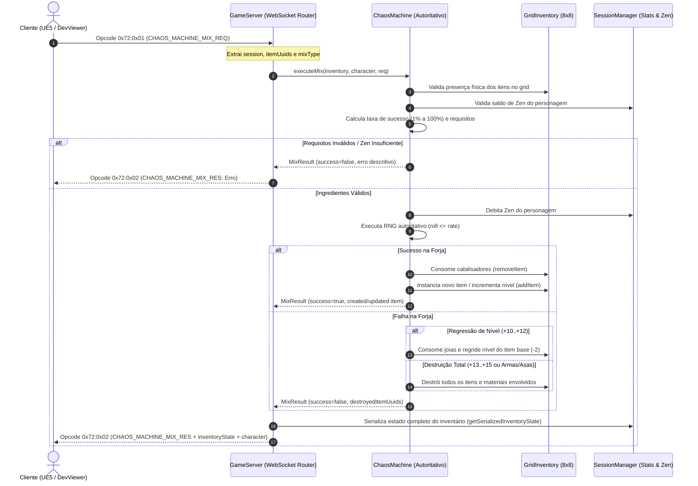

# ARQUITETURA DE SINCRONIZAÇÃO DA MÁQUINA DO CAOS E ECONOMIA AUTORITATIVA

> **Dasi MMORPG Core Backend Infrastructure**  
> *Autor: Lead Systems & Network Engineer*  
> *Módulos: `ChaosMachine.ts`, `NPCShop.ts`, `GameServer.ts`, `protocol.ts`, `SessionManager.ts`*

---

## 1. VISÃO GERAL & PRINCÍPIO ZERO-TRUST

No design clássico de Continent of Legend (MU Online), a Máquina do Caos (Chaos Machine) em Noria é o pilar central de risco, queima de itens e circulação econômica. No **Dasi**, a síntese alquímica e o comércio são regidos por uma arquitetura **100% autoritativa no servidor (Zero-Trust)**:

1. **Cliente Passivo / Visual:** O cliente (seja em Three.js Dev Viewer ou Unreal Engine 5) envia apenas a intenção de combinação (`CHAOS_MACHINE_MIX_REQ` 0x72:0x01) ou intenção de compra (`NPC_SHOP_BUY_REQ` 0x74:0x01).
2. **Cálculo Determinístico no Backend:** O servidor calcula as taxas reais, valida pré-requisitos de itens na bolsa do jogador, debita Zen e executa a rolagem pseudo-aleatória criptográfica ou sementeada no servidor.
3. **Atomicidade Transacional:** A remoção de catalisadores, consumo de Zen e inserção/destruição de itens ocorrem em um único ciclo síncrono atômico antes do envio de resposta, impedindo duplicação de itens (*item duping*), *race conditions* ou dessincronização de grade 8x8.
4. **Sincronização Completa de Estado:** A resposta (`CHAOS_MACHINE_MIX_RES` 0x72:0x02) retorna o item resultante e o `inventoryState` completo e atualizado, garantindo reconciliação visual instantânea na interface gráfica do jogador.

---

## 2. ARQUITETURA DE SINCRONIZAÇÃO DA MÁQUINA DO CAOS

---

## 3. ESPECIFICAÇÃO DAS RECEITAS CLÁSSICAS DE NORIA

### 3.1 Forja de Armas do Caos (`CHAOS_WEAPON`)
- **Ingredientes Obrigatórios:**
  - 1x Item (Arma, Escudo ou Armadura) com nível $\ge +4$ e Opção Adicional $\ge +4$.
  - 1x `jewel_of_chaos`.
  - Custo em Zen: `20,000 Zen`.
- **Catalisadores Opcionais:**
  - `jewel_of_blessing` (+5% por joia).
  - `jewel_of_soul` (+3% por joia).
- **Cálculo da Taxa:**
  $$\text{Taxa} = \min(100, \max(1, \sum(\text{Nível} \times 6 + \text{Opção} \times 3 + \text{Luck}(+10) + \text{Excl}(+15)) + 5 + 5B + 3S))$$
- **Saídas Possíveis (Sucesso):**
  - `chaos_dragon_axe` (Dark Knight)
  - `chaos_nature_bow` (Fairy Elf)
  - `chaos_lightning_staff` (Dark Wizard)
  *(Com chances de Skill de Arma, Sorte e Opção Adicional)*.
- **Penalidade (Falha):** Todos os itens são consumidos e destruídos em pó cinzento.

---

### 3.2 Forja de Asas Tier 1 (`FIRST_WING`)
- **Ingredientes Obrigatórios:**
  - 1x Arma do Caos (`chaos_dragon_axe`, `chaos_nature_bow` ou `chaos_lightning_staff`) com nível $\ge +4$ e Opção Adicional $\ge +4$.
  - 1x `jewel_of_chaos`.
  - Custo em Zen: `100,000 Zen`.
- **Cálculo da Taxa:**
  $$\text{Taxa} = \min(100, \max(1, 40 + \text{Nível} \times 4 + \text{Opção} \times 2 + \text{Luck}(+10) + 5B + 3S))$$
- **Saídas Possíveis (Sucesso):**
  - `wings_of_dragon` (Dark Knight)
  - `wings_of_soul` (Dark Wizard)
  - `wings_of_elf` (Fairy Elf)
- **Penalidade (Falha):** Destruição total de todos os materiais.

---

### 3.3 Refinamento de Níveis Altos +10 até +15 (`ITEM_UPGRADE`)
- **Ingredientes Obrigatórios:**
  - Item Alvo com nível $+9$ até $+14$.
  - 1x `jewel_of_chaos`.
  - $N = (\text{Nível Alvo} - 8)$ `jewel_of_blessing` (ex: +10 exige 1, +11 exige 2 ... +15 exige 6).
  - $N = (\text{Nível Alvo} - 8)$ `jewel_of_soul`.
  - Zen: $2,000,000 \times N$ Zen.
- **Tabela de Taxas e Penalidades:**

| Nível Alvo | Taxa Base | Taxa com Sorte (Luck) | Penalidade em Caso de Falha |
| :---: | :---: | :---: | :--- |
| **+10** | 60% | **75%** | Regressão de 2 níveis (+10 vira +8) |
| **+11** | 55% | **70%** | Regressão de 2 níveis (+11 vira +9) |
| **+12** | 50% | **65%** | Regressão de 2 níveis (+12 vira +10) |
| **+13** | 45% | **60%** | **Destruição Total do Item** |
| **+14** | 45% | **60%** | **Destruição Total do Item** |
| **+15** | 40% | **55%** | **Destruição Total do Item** |

---

## 4. SISTEMA DE LOJAS DE NPCS (NPC ECONOMY)

### 4.1 Comerciantes Registrados
1. **Han the Blacksmith (Lorencia):**
   - `small_dagger`: 500 Zen
   - `short_sword`: 1,500 Zen (vem com Skill de Arma)
   - `dragon_gloves`: 20,000 Zen
   - `dragon_boots`: 25,000 Zen
2. **Pupa the Potion Girl (Noria):**
   - `potion_health`: 200 Zen
   - `potion_mana`: 300 Zen

### 4.2 Fluxo de Compra (Opcode 0x74:0x01 / 0x74:0x02)
- Valida NPC e item no catálogo.
- Valida se `character.zen >= preco`.
- Cria a instância e verifica se o `GridInventory` 8x8 possui células livres para as dimensões do item.
- Debita Zen, aloca item e sincroniza o `inventoryState` completo.

---

## 5. LEVEL UP E DISTRIBUIÇÃO DE ATRIBUTOS (STATS)

- **Regra Base:** Cada nível conquistado concede **exatamente 5 pontos livres de atributos** (`statPoints`).
- **Alocação Autoritativa (Opcode 0x75:0x01 / 0x75:0x02):**
  - Atributos válidos: `strength`, `agility`, `vitality`, `energy`.
  - Validações: Quantidade de pontos deve ser inteiro positivo $\le$ `character.statPoints`.
  - Servidor aplica o incremento, deduz `statPoints` e responde com o `CharacterSummary` atualizado.

---

## 6. SANIDADE DAS ROTAS DO SERVIDOR HTTP & WEBSOCKET

| Rota / Protocolo | Tipo | Descrição | Status de Sanidade |
| :--- | :--- | :--- | :---: |
| `GET /api/status` | HTTP REST | Telemetria, uptime, sessões, monstros ativos e drops | **200 OK + CORS** |
| `GET /api/items/definitions` | HTTP REST | Catálogo completo de definições de itens e equipamentos | **200 OK + CORS** |
| `GET /api/shops` | HTTP REST | Catálogo de todos os NPCs mercadores e preços | **200 OK + CORS** |
| `GET /api/chaos/recipes` | HTTP REST | Fórmulas, taxas e custos de receitas da Máquina do Caos | **200 OK + CORS** |
| `GET /api/* (desconhecido)` | HTTP REST | Rota de API inexistente | **404 JSON protegido** |
| `GET /* (arquivos estáticos)` | HTTP Static | Dev Viewer Three.js | **200 OK + Path Traversal Protection** |
| `0x70:0x01` | WS Binário/JSON | Sincronização completa de inventário e equipamentos | **Ativo & Validado** |
| `0x70:0x02` / `0x03` | WS Binário/JSON | Movimentação / equipar / desequipar no Grid 8x8 | **Ativo & Validado** |
| `0x71:0x01` / `0x02` | WS Binário/JSON | Uso de Joias Sagradas (Bless, Soul, Life, Harmony) | **Ativo & Validado** |
| `0x72:0x01` / `0x02` | WS Binário/JSON | Combinação e Forja na Máquina do Caos | **Ativo & Validado** |
| `0x74:0x01` / `0x02` | WS Binário/JSON | Compra em lojas de NPCs por Zen | **Ativo & Validado** |
| `0x75:0x01` / `0x02` | WS Binário/JSON | Alocação de pontos de atributos (Level Up) | **Ativo & Validado** |
