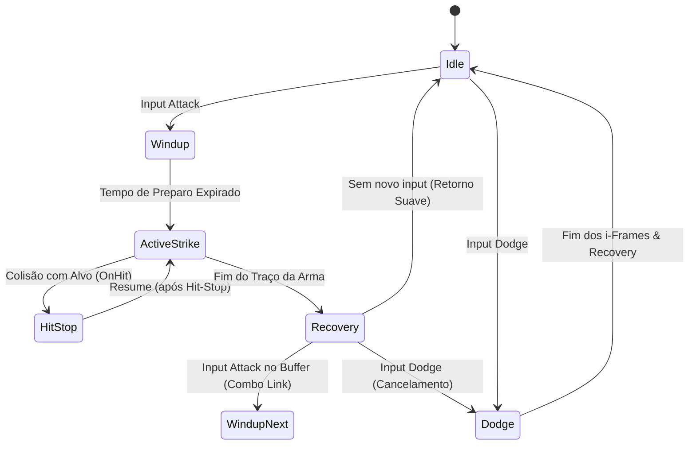

# ARQUITETURA TÉCNICA: SISTEMA DE COMBATE, FÍSICA E ANIMAÇÕES REAIS — DASI

> **Documento:** Especificação Técnica de Engenharia de Gameplay & Física  
> **Versão:** 1.0.0  
> **Status:** Aprovado para Implementação de Protótipo  
> **Engine Alvo:** Unreal Engine 5.4+ / Custom Physics Simulation Module  

---

## SUMÁRIO EXECUTIVO

Dasi reimagina o combate clássico isométrico e em terceira pessoa do estilo Continent of Legend, eliminando a estática, o "clique-automático sem física" e o histórico **bug de quebra de animação por agilidade**. Este documento detalha a arquitetura matemática, os pipelines de animação orientados a inércia, a detecção volumétrica de colisão tridimensional (*Weapon Traces*), o sistema cinemático de impacto (*Hit-Stop* e *Stagger*) e o pipeline aerodinâmico para o lendário *Sistema de Asas (Tiers 1, 2 e 3)*.

---

## 1. SISTEMA DE IMPACTO: HIT-STOP E STAGGER FÍSICO

No combate tradicional do gênero, o feedback de dano dependia exclusivamente de números coloridos subindo na tela (*floating damage numbers*). Em **Dasi**, cada golpe transmite transferência de momentum real através de dois subsistemas acoplados: **Hit-Stop** (micro-congelamento temporal do atacante e do defensor) e **Stagger** (reação de recuo postural com deformação física).

```
                      ┌──────────────────────────────────────┐
                      │    DETECÇÃO DE COLISÃO NA ARMA       │
                      └──────────────────┬───────────────────┘
                                         │
                                         ▼
                      ┌──────────────────────────────────────┐
                      │    CÁLCULO DE DANO & INTENSIDADE     │
                      │  (Normal, Crítico, Excelente, Pesado)│
                      └──────────────────┬───────────────────┘
                                         │
                ┌────────────────────────┴────────────────────────┐
                ▼                                                 ▼
   ┌─────────────────────────┐                       ┌─────────────────────────┐
   │        HIT-STOP         │                       │         STAGGER         │
   │ Micro-Freeze Temporal   │                       │ Deslocamento e Animação │
   │ • Atacante: TimeDilation│                       │ • Flinch Leve           │
   │ • Alvo: Animação Congel.│                       │ • Knockback Médio       │
   │ • Vibração de Mesh      │                       │ • Posture Break / Queda │
   │ • Shaker de Câmera      │                       │ • Rigidez Direcional    │
   └─────────────────────────┘                       └─────────────────────────┘
```

### 1.1 Equações e Duração do Hit-Stop

O Hit-Stop não afeta o clock global do servidor (evitando dessincronizações), mas opera como uma **curva de desaceleração local de time-dilation** na entidade (`MeshTimeDilation` e `AnimRateScale`):

$$\text{HitStopDuration} = T_{\text{base}} \times M_{\text{impact}} \times (1 - R_{\text{tenacity}})$$

Onde:
- $T_{\text{base}}$: Tempo base de congelamento por tipo de ataque.
- $M_{\text{impact}}$: Modificador de impacto da arma (armas de 1 mão = 1.0; armas colossais de 2 mãos = 1.4 ~ 1.8).
- $R_{\text{tenacity}}$: Tenacidade do defensor derivada de Vitalidade e Armadura Pesada ($0 \le R \le 0.65$).

#### Tabela de Calibração de Hit-Stop e Feedback Visual

| Tipo de Dano | Tempo Base ($T_{\text{base}}$) | Time Dilation Local ($\Delta t$) | Mesh Micro-Jitter (Offset) | Camera Shake (Freq / Amp) | Efeito de Áudio / VFX |
| :--- | :--- | :--- | :--- | :--- | :--- |
| **Normal (Branco)** | 40 ms (0.040s) | 0.05 | $\pm 0.8 \text{ cm}$ (eixo do corte) | $18\text{ Hz} / 0.15^{\circ}$ | Corte seco de lâmina em ferro |
| **Habilidade (Laranja)** | 60 ms (0.060s) | 0.02 | $\pm 1.4 \text{ cm}$ | $22\text{ Hz} / 0.30^{\circ}$ | Erupção de faíscas + corte de vácuo |
| **Crítico (Azul Claro)** | 85 ms (0.085s) | 0.00 (Congelamento absoluto) | $\pm 2.2 \text{ cm}$ | $28\text{ Hz} / 0.55^{\circ}$ | Onda de choque sônica radial (*Lens Flare*) |
| **Excelente (Verde)** | 100 ms (0.100s) | 0.00 | $\pm 2.8 \text{ cm}$ | $30\text{ Hz} / 0.70^{\circ}$ | Explosão eletro-luminescente |
| **Arma Pesada (2M)** | 115 ms (0.115s) | 0.00 | $\pm 3.5 \text{ cm}$ | $20\text{ Hz} / 1.10^{\circ}$ | Ruptura sísmica de solo + *Dust Wave* |
| **Ignorar Defesa (Dourado)**| 120 ms (0.120s) | 0.00 | $\pm 4.0 \text{ cm}$ | $35\text{ Hz} / 1.25^{\circ}$ | Fragmentação de armadura (*glass shatter*) |

### 1.2 Mecânica de Stagger e Ruptura de Postura (Posture/Poise)

Cada monstro e personagem possui um medidor de **Equilíbrio/Postura (Poise Pool)**. Quando um ataque atinge o alvo, o dano de postura reduz esse valor.

1. **Flinch Leve (Poise > 0):** Apenas um blend aditivo na parte superior do tronco (Layered Blend per Bone a partir de `spine_01`). As pernas continuam seu ciclo de locomoção sem interromper comandos críticos.
2. **Stagger Médio (Poise = 0):** Interrupção momentânea da ação do alvo, com animação de recuo direcional (baseada no vetor inverso do golpe $\vec{V}_{\text{impact}} = -\vec{V}_{\text{weapon}}$).
3. **Knockdown / Lançamento:** Golpes colossais ou golpes de finalização de combo com $F > F_{\text{threshold}}$ arremessam o alvo pelo ar com ragdoll parcial ativado (*Active Physical Animation Rig*).

$$\vec{F}_{\text{recoil}} = \frac{M_{\text{weapon}} \cdot \vec{v}_{\text{blade}}}{M_{\text{target}}} \times (1 - \text{Tenacity})$$

---

## 2. SOLUÇÃO DEFINITIVA PARA ESCALABILIDADE DE ATTACK SPEED (SEM O "BUG DE AGILIDADE")

### 2.1 Análise da Falha Histórica do Continent of Legend
No jogo clássico (e na maioria dos clones legados), cada habilidade possuía um ciclo fixo de frames de animação (ex: 24 frames a 30 FPS = 800 ms). À medida que a Agilidade subia para milhares de pontos, a velocidade de animação escalava linearmente:
- A animação tentava rodar em tempos inferiores a 30-50 ms.
- O motor não conseguia disparar os eventos de início/fim (*Animation Notifies*), resultando em ataques invisíveis, monstros congelando sem tomar dano, ou o personagem travado em T-pose ("bug de agilidade").
- Para contornar, servidores privados pulavam frames inteiros (*frame skip*), destruindo completamente o feedback visual e a física do combate.

### 2.2 Arquitetura Dasi: Cadeia Rítmica de Inércia e Curvas Hermite/Bézier

Em Dasi, uma animação de golpe é particionada em três segmentos fundamentais:

```
    [ WIND-UP ]           [ ACTIVE STRIKE ]             [ RECOVERY ]
 (Preparação/Inércia)    (Janela de Colisão)       (Retorno ou Emenda de Combo)
◄───────────────────► ◄─────────────────────────► ◄─────────────────────────────►
   Compressão Máxima:       Reserva Mínima:            Janela de Emenda Dinâmica:
       Até 75%               Travada em 65 ms             Cancelável por Combo
```

#### Regras de Ouro da Scalability:
1. **Janela de Colisão Preservada ($T_{\text{active}} \ge 65 \text{ ms}$):** A lâmina nunca se teletransporta instantaneamente. Ela deve varrer o espaço por tempo suficiente para que a física espacial realize no mínimo 3 substeps de colisão volumétrica.
2. **Compressão Não-Linear com Curvas de Bézier Cúbicas:** O Wind-up e o Recovery são os segmentos comprimidos com o aumento de Agilidade, através da função:
   $$T_{\text{phase}}(AGI) = T_{\text{min}} + (T_{\text{base}} - T_{\text{min}}) \cdot e^{-k \cdot \text{AGI}}$$
   Onde $k$ é a constante de atenuação suave e $T_{\text{min}}$ é o limiar fisiológico da animação.
3. **Cadeia Rítmica de Inércia (Combo Chaining):** Quando um novo comando de ataque é registrado durante a **Janela de Cancelamento do Recovery**, o Recovery não é executado de volta à pose neutra (*Idle*). Em vez disso, o motor utiliza o momentum angular final da lâmina para disparar diretamente o **Wind-up do Próximo Golpe com Blending Contínuo (*Hermite Spline Interp*)**.



4. **Multi-Hit Blending com Efeito Ghosting Rítmico:**
   Em patamares colossais de agilidade ($AGI > 1500$):
   - O personagem não corta golpes; ele executa sequências em arco contínuo (técnica de corte infinito em *Oito / Lemniscata*).
   - As lâminas geram sombras rúnicas residuais (*after-images* com refração luminescente) que realizam cortes complementares, preservando a coerência visual das articulações anatômicas.

---

## 3. SISTEMA DE COLISÃO POR TRAÇO VOLUMÉTRICO (WEAPON TRACES)

### 3.1 Superação das Hitboxes Tradicionais
Em vez de disparar uma esfera de dano estática no centro do monstro (clique lock-on), Dasi implementa **Varreduras Volumétricas Contínuas (*Swept Sphere-Capsule Traces*)** distribuídas ao longo da geometria real da arma.

```
       Empunhadura (Hilt)        Centro da Lâmina         Ponta da Lâmina (Tip)
              Socket_0                 Socket_1                  Socket_2
                 O────────────────────────O─────────────────────────O
                 │                        │                         │
                 ▼                        ▼                         ▼
            [Capsule 0]              [Capsule 1]               [Capsule 2]
                 │                        │                         │
                 └───────────────┬──────────────────────────────────┘
                                 │
                   Vetor de Deslocamento Angular
                     (Sub-Frame Interpolation)
```

### 3.2 Algoritmo de Varredura e Sub-Passos Temporais (*Sub-Stepping*)
A 60 FPS, um golpe veloz pode girar $120^{\circ}$ em um único frame ($16.6\text{ ms}$), o que faria uma verificação ponto-a-ponto atravessar um inimigo estreito (*tunneling effect*).

Para garantir 100% de precisão sem estourar a CPU:
1. Armazenamos as coordenadas da matriz de transformação de cada socket no frame anterior:
   $$S_{i}^{(t-1)} = (P_i, R_i)$$
2. No frame atual $t$, para cada par de sockets vizinhos $(S_i, S_{i+1})$, discretizamos o arco em $N_{\text{substeps}}$ intermediários calculados por interpolação esférica (SLERP para rotação, LERP para posição):
   $$N_{\text{substeps}} = \max\left(2, \left\lceil \frac{\|\vec{v}_{\text{tip}}\| \cdot \Delta t}{R_{\text{trace}}} \right\rceil\right)$$
3. Traçamos uma cápsula tridimensional (*Capsule Sweep*) entre a trajetória anterior e a atual.
4. **Filtro de Impacto Único por Golpe (Hit-Actor Blacklist):** Uma lista interna `Set<ActorID>` registra os alvos já atingidos na rotação daquele golpe específico, garantindo que o mesmo monstro não sofra 4x dano da mesma lâmina em um único swing, a menos que o golpe seja explicitamente multi-hit (ex: *Twisting Slash*).

### 3.3 Penetração e Clivagem de Alvos (Cleave & Impact Energy)
Quando a arma atinge um monstro, a energia cinética do golpe é amortecida:

$$E_{\text{restante}} = E_{\text{inicial}} - \sum \text{ResistênciaFísica}(\text{Alvo}_k)$$

- Se $E_{\text{restante}} > 0$: A arma continua a trajetória e corta o próximo inimigo na área (Clivagem / Cleave).
- Se $E_{\text{restante}} \le 0$ (ex: escudo pesado, armadura colossal de chefe): A arma sofre **Ricochete/Deflexão (*Weapon Deflection*)**, interrompendo o golpe e aplicando recuo no atacante.

---

## 4. SISTEMA DE FÍSICA E DINÂMICA DE ASAS (TIERS 1, 2 E 3)

As Asas em Dasi são simuladas com física realística combinando aerodinâmica, resposta a vento ambiente e deformação de esqueletos dinâmicos (*Anim Dynamics & Chaos Cloth*).

### 4.1 Equações Aerodinâmicas Fundamentais
As forças atuando na sustentação e arrasto das asas são modeladas por:

$$\vec{F}_{\text{Lift}} = \frac{1}{2} \, \rho \, \|\vec{v}_{\text{rel}}\|^2 \, S \, C_L(\alpha) \, \hat{n}_{\text{wing}}$$

$$\vec{F}_{\text{Drag}} = \frac{1}{2} \, \rho \, \|\vec{v}_{\text{rel}}\|^2 \, S \, C_D(\alpha) \, (-\hat{v}_{\text{rel}})$$

Onde:
- $\rho$: Densidade do ar (varia por mapa: Devias = ar denso/frio; Icarus = atmosfera rarefeita).
- $\vec{v}_{\text{rel}} = \vec{v}_{\text{char}} - \vec{v}_{\text{wind}}$: Velocidade relativa do personagem em relação ao vento.
- $S$: Envergadura ativa da asa (m²), que se contrai em repouso e expande em voo.
- $C_L(\alpha), C_D(\alpha)$: Coeficientes de sustentação e arrasto em função do ângulo de ataque $\alpha$.
- $\hat{n}_{\text{wing}}$: Vetor normal à superfície do bordo de ataque.

### 4.2 Comportamento por Tier de Asas

```
          TIER 1                        TIER 2                        TIER 3
     (Asas Neófitas)            (Asas Celestiais/Infernais)       (Asas do Soberano)
  ┌─────────────────────┐        ┌─────────────────────┐       ┌─────────────────────┐
  │ • Estrutura de penas│        │ • Membrana dupla    │       │ • Envergadura maior │
  │ • Flapping reativo  │        │ • Vórtice etéreo    │       │ • Sustentação total │
  │ • Redução de queda  │        │ • Planeio rasante   │       │ • Manobras aéreas   │
  │ • Arrasto moderado  │        │ • Banking dinâmico  │       │ • Acesso a Icarus   │
  └─────────────────────┘        └─────────────────────┘       └─────────────────────┘
```

#### Tabela de Propriedades Físicas por Tier

| Parâmetro Físico | Tier 1 (Neófitas) | Tier 2 (Evoluídas) | Tier 3 (Soberanas) |
| :--- | :--- | :--- | :--- |
| **Envergadura Neutra / Máx** | $1.8\text{ m} / 2.4\text{ m}$ | $2.8\text{ m} / 3.8\text{ m}$ | $4.2\text{ m} / 6.0\text{ m}$ |
| **Frequência de Flap (Idle)** | $0.8\text{ Hz}$ (suave) | $1.2\text{ Hz}$ | $1.6\text{ Hz}$ com pulso de gravidade |
| **Frequência de Flap (Corrida)**| $2.4\text{ Hz}$ | $3.2\text{ Hz}$ | $4.0\text{ Hz}$ |
| **Coeficiente de Sustentação ($C_L$)**| $0.45$ (reduz gravidade em $30\%$) | $0.85$ (permite planeio sustentado) | $1.40$ (decolagem vertical e voo total) |
| **Inclinação de Curva (*Banking Angle*)**| $12^{\circ}$ | $28^{\circ}$ | $48^{\circ}$ com torsão de penas/arestas |
| **Deformação de Vento (*Cloth/Bones*)**| 6 ossos por asa | 14 ossos + malha de tecido dinâmico | 24 ossos com cinemática inversa rúnica |
| **Efeito no Solo (*Ground Downwash*)**| Dispersão sutil de poeira | Círculo de ar empurrando grama/neve | Cratera de vento expulsando projéteis leves |

### 4.3 Algoritmo de Flapping Dinâmico e Banking

1. **Velocidade de Deslocamento:**
   $$f_{\text{flap}} = f_{\text{idle}} + (f_{\text{max}} - f_{\text{idle}}) \times \text{clamp}\left(\frac{\|\vec{v}_{\text{horizontal}}\|}{v_{\text{sprint}}}, 0, 1\right)$$
2. **Ângulo de Rolagem em Curva (*Banking Angle*):**
   $$\theta_{\text{bank}} = \arctan\left(\frac{\omega \cdot \|\vec{v}\|}{g}\right) \times K_{\text{wing\_scale}}$$
   Onde $\omega$ é a velocidade angular de curva da câmera/movimento e $g$ é a aceleração da gravidade.
3. **Efeito Downwash no Solo:**
   Conforme a distância do solo $h$ diminui ($h < 2.5\text{ m}$), a sustentação aumenta em virtude do **efeito solo (*Ground Effect*)**:
   $$M_{\text{ground}} = \frac{1}{\sqrt{1 - \left(\frac{b}{4h}\right)^2}}$$

---

## 5. INTEGRAÇÃO COM A ENGINE (UNREAL ENGINE 5.4+)

- **Motion Matching & Pose Search Database:** Transições de inércia entre corridas, frenagens bruscas e giros de espada utilizam bancos de dados de trajetória contínua.
- **Control Rig Procedural:** Compensação dos pés no desnível do terreno (*Foot IK*) e torção espinhal durante os impactos.
- **Niagara VFX & Ribbons:** As trilhas de lâmina e as partículas de asas são conectadas diretamente aos sockets dos traços volumétricos via GPU emitter.
- **Replicação de Rede:** O servidor simula os arcos de colisão de forma determinística por *Fixed Timestep* (60 Hz), recebendo inputs com timestamps e reconciliando desvios pelo protocolo de previsão e compensação de lag (*Client-Side Prediction & Server Reconciliation*).

---

## 6. CONCLUSÃO

Esta arquitetura garante que **Dasi** honre o DNA e a paixão visual de Continent of Legend, ao mesmo tempo em que eleva a física, o impacto e a jogabilidade ao estado da arte dos action-RPGs modernos. A seguir, o protótipo matemático e funcional implementa e valida cada um destes conceitos em código executável.
