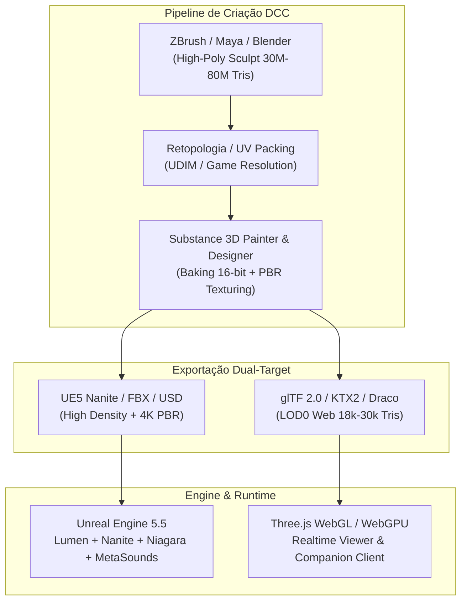
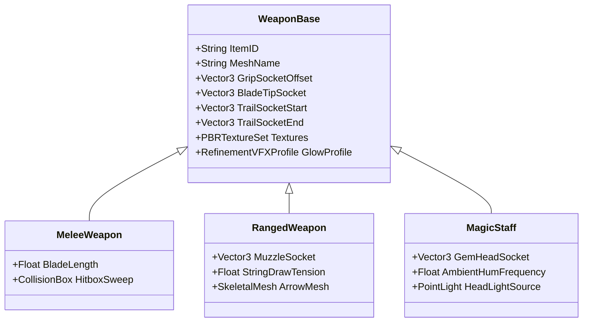
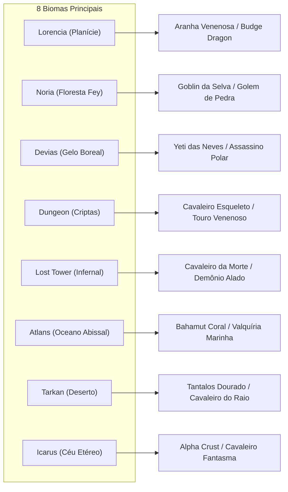
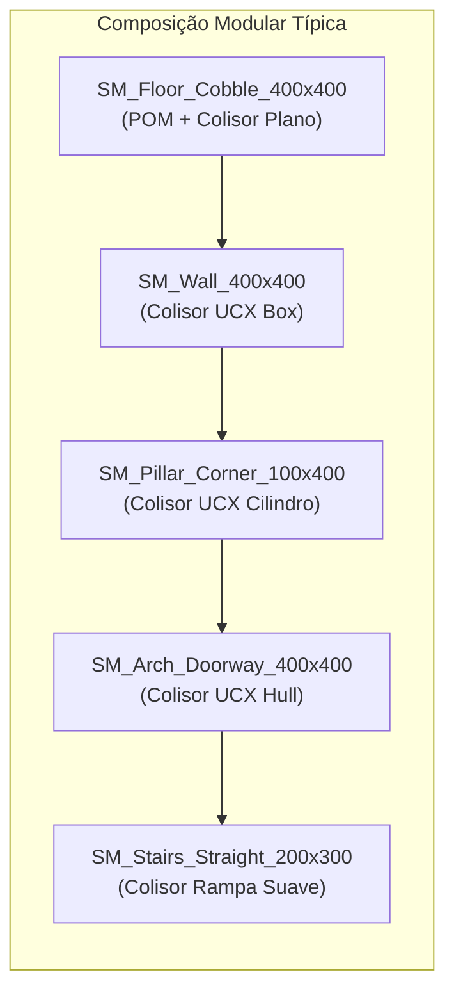
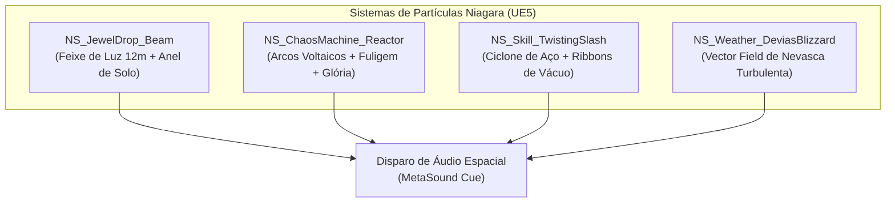
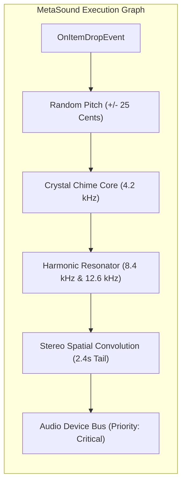

# MASTER ASSET PRODUCTION MANIFEST — DASI MMORPG
## Catálogo Completo de Assets para Produção 3D AAA (Unreal Engine 5) e WebGL / Three.js

> **Status do Documento:** Aprovado para Produção / Master Manifest  
> **Versão:** 1.0.0  
> **Data:** Novembro de 2026  
> **Público-Alvo:** Equipes de Arte 3D (Hard Surface & Organic), Shaders/Tech Art, Rigging, Animação, Level Designers, Audio Designers e Engenharia de Renderização.  
> **Engines Alvo:** Unreal Engine 5.5+ (Desktop High-End / Nanite / Lumen / Niagara / MetaSounds) & WebGL 2.0 / WebGPU (Three.js / Draco / Basis Universal).

---

## 1. VISÃO GERAL DE ARQUITETURA & DIRETRIZES DE PRODUÇÃO

O universo de **Dasi** inspira-se no legado gótico sombrio e ressonante do *Continent of Legend (MU Online)*, elevando sua identidade estética para uma produção tridimensional AAA de última geração com suporte duplo e simultâneo:
1. **Target Principal (PC Desktop / Steam):** Unreal Engine 5 utilizando geometria virtualizada *Nanite*, iluminação global e reflexões dinâmicas *Lumen*, simulação de partículas *Niagara* e síntese sonora modular *MetaSounds*.
2. **Target Web / Companion:** Renderizador em tempo real WebGL 2.0 / WebGPU (Three.js) com meshes otimizados via compressão *Draco*, texturas em formato supercomprimido *KTX2 / Basis Universal* e animações esqueléticas compartilhadas.



---

## 2. CATÁLOGO DETALHADO DE ASSETS 3D

### 2.1 Heróis e Sets Modulares de Armadura (+0 a +15)

Todos os personagens utilizam uma topologia modular idêntica por esqueleto base, permitindo a intercambialidade de peças cosméticas e equipamentos. Cada armadura é dividida em **5 peças canônicas**:
1. **Elmo / Tiara / Máscara (`Helm`)**
2. **Peitoral / Ombreiras (`Armor`)**
3. **Calças / Coxotes (`Pants`)**
4. **Luvas / Manoplas (`Gloves`)**
5. **Botas / Escarpes (`Boots`)**

#### Esqueletos Base (Rigging & Sockets)
- **SK_Hero_DarkKnight:** 112 ossos. Rig muscular com preservação de volume (Twist bones em antebraço, bíceps, coxa e panturrilha). Sockets: `hand_r_socket`, `hand_l_socket`, `back_weapon_socket_r`, `back_weapon_socket_l`, `spine_wing_socket`.
- **SK_Hero_DarkWizard:** 98 ossos. Esqueleto com suporte a panos etéreos (*Chaos Cloth* integrado na barra da túnica). Sockets: `hand_r_staff_socket`, `hand_l_tome_socket`, `spine_wing_socket`.
- **SK_Hero_FairyElf:** 108 ossos. Rig esguio com ossos dinâmicos para tranças/cabelos e aljava nas costas. Sockets: `hand_l_bow_socket`, `hand_r_arrow_socket`, `back_quiver_socket`, `spine_wing_socket`.
- **SK_Hero_MagicGladiator:** 114 ossos. Postura híbrida sem elmo. Permite empunhar duas armas de duas mãos simultâneas. Sockets: `hand_r_socket`, `hand_l_socket`, `back_dual_socket_r`, `back_dual_socket_l`, `spine_wing_socket`.
- **SK_Hero_DarkLord:** 124 ossos. Esqueleto nobre preparado para capa dinâmica de 18 nós físicos (*Cape Bones*) e socket de ombro para o Corvo Real. Sockets: `hand_r_scepter_socket`, `hand_l_shield_socket`, `shoulder_r_raven_socket`, `mount_pelvis_socket`, `spine_cape_socket`.

#### Matriz de Sets Modulares por Classe
| Classe | Nome do Set | Tier Estético | Orçamento Tris (Nanite UE5) | Orçamento Tris (WebGL LOD0) | Texturas PBR (Resolução / Mapas) | Sockets de Efeito / Auras |
| :--- | :--- | :--- | :--- | :--- | :--- | :--- |
| **Dark Knight** | *Leather Set* | Tier 1 (Inicial) | 85.000 (Sem limite Nanite) | 12.500 | 2K BaseColor, Normal, ORM | Nenhum |
| **Dark Knight** | *Bronze Set* | Tier 2 (Cobre) | 110.000 | 14.200 | 2K BaseColor, Normal, ORM | Peitoral, Joelhos |
| **Dark Knight** | *Scale / Brass* | Tier 3-4 (Escamas) | 135.000 | 16.000 | 4K BaseColor, Normal, ORM | Ombreiras |
| **Dark Knight** | *Plate Set* | Tier 5 (Aço Polido) | 160.000 | 18.500 | 4K BaseColor, Normal, ORM | Viseira, Ombreiras |
| **Dark Knight** | *Dragon Set* | Tier 6 (Carmesim) | 210.000 | 22.000 | 4K BC, N, ORM, EmissiveMask | Chifres Elmo, Faringe Dragão Ombro |
| **Dark Knight** | *Black Dragon* | Tier 7 (Obsidiana) | 240.000 | 24.500 | 4K BC, N, ORM, EmissiveMask | Escamas dorsais, Manoplas |
| **Dark Knight** | *Dark Phoenix* | Tier 8 (Chamas Negras)| 280.000 | 28.000 | 4K BC, N, ORM, EmissiveMask | Penas de Aço, Brasas Peitoral |
| **Dark Knight** | *Great Dragon* | Tier 9 (Lendário) | 350.000 | 32.000 | 4K BC, N, ORM, Emissive, SSS | Espigões dorsais, Olhos de Magma |
| **Dark Wizard** | *Pad / Bone Set* | Tier 1-2 (Ossos/Couro)| 78.000 | 11.800 | 2K BaseColor, Normal, ORM | Crânio no peito |
| **Dark Wizard** | *Sphinx Set* | Tier 3 (Ouro Antigo) | 120.000 | 14.500 | 2K BaseColor, Normal, ORM | Máscara funerária, Braçadeiras |
| **Dark Wizard** | *Legendary Set* | Tier 5 (Índigo Místico)| 180.000 | 19.000 | 4K BaseColor, Normal, ORM | Runas astrais nas mangas |
| **Dark Wizard** | *Grand Soul* | Tier 7 (Safira Divina)| 260.000 | 26.000 | 4K BC, N, ORM, EmissiveMask | Orbes de mana flutuantes nos ombros |
| **Dark Wizard** | *Dark Soul* | Tier 9 (Vazio Cósmico)| 320.000 | 30.000 | 4K BC, N, ORM, Emissive, SSS | Chifres etéreos, Cinturão de Almas |
| **Fairy Elf** | *Vine / Silk* | Tier 1-2 (Seda/Videira)| 65.000 | 10.500 | 2K BaseColor, Normal, ORM | Folhagens nos pulsos |
| **Fairy Elf** | *Wind / Spirit* | Tier 3-4 (Esmeralda) | 130.000 | 15.200 | 2K BaseColor, Normal, ORM | Asas vestigiais no diadema |
| **Fairy Elf** | *Guardian Set* | Tier 6 (Plata Élfica) | 195.000 | 21.000 | 4K BaseColor, Normal, ORM | Gemas peitorais luminosas |
| **Fairy Elf** | *Divine Set* | Tier 7 (Dourado Solar)| 245.000 | 25.500 | 4K BC, N, ORM, EmissiveMask | Filigranas douradas, Coxotes |
| **Fairy Elf** | *Red Spirit* | Tier 9 (Rubi Sagrado) | 310.000 | 29.000 | 4K BC, N, ORM, Emissive, SSS | Cristais de sangue nas ombreiras |
| **Magic Glad.**| *Storm Crow* | Tier 4 (Plumas Aço) | 170.000 | 18.000 | 4K BaseColor, Normal, ORM | Bico no peitoral |
| **Magic Glad.**| *Thunder Hawk* | Tier 6 (Tempestade) | 225.000 | 23.000 | 4K BC, N, ORM, EmissiveMask | Garras nas manoplas |
| **Magic Glad.**| *Hurricane Set* | Tier 8 (Trovão) | 290.000 | 27.500 | 4K BC, N, ORM, EmissiveMask | Lâminas de antebraço |
| **Magic Glad.**| *Volcano Set* | Tier 9 (Basalto/Magma)| 340.000 | 31.000 | 4K BC, N, ORM, Emissive, SSS | Fendas de magma pulsante |
| **Dark Lord** | *Light Plate* | Tier 3 (Aço Nobre) | 150.000 | 16.500 | 2K BaseColor, Normal, ORM | Brasão real peitoral |
| **Dark Lord** | *Adamantine* | Tier 5 (Metal Negro) | 210.000 | 22.000 | 4K BaseColor, Normal, ORM | Capuz blindado |
| **Dark Lord** | *Dark Steel* | Tier 7 (Aço Carmesim) | 270.000 | 27.000 | 4K BC, N, ORM, EmissiveMask | Ombreiras de leão em ferro fundido |
| **Dark Lord** | *Dark Master* | Tier 9 (Ouro Imperial) | 360.000 | 33.000 | 4K BC, N, ORM, Emissive, SSS | Coroa de ferro negro, Manto régio |

#### Especificações Visuais da Progressão de Refinamento (+0 a +15)
O sistema de materiais utiliza o master shader [ItemGlowShader.hlsl](file:///d:/Dasi/src/shaders/ItemGlowShader.hlsl), reagindo ao parâmetro escalar global `g_RefinementLevel` de 0 a 15:
- **+0 a +6 (Matéria Pura):** Propriedades PBR intactas (Metalness 0.05 a 0.95, Roughness 0.20 a 0.70). Sem emissão externa.
- **+7 a +8 (Lâmina Desperta):** Pulsação de Fresnel interno (*Breathing Fresnel*) com ciclo de 2.2 segundos e saturação cromática azulada suave nas bordas.
- **+9 a +10 (Aura Dourada / Safira):** Halo de contorno volumétrico de 4cm sobre as superfícies metálicas + faíscas estocásticas pontuais (*Glitter Sparkles*) no reflexo especular direto.
- **+11 a +12 (Tempestade Harmônica):** Ondas de interferência senoidal percorrendo a malha de cima para baixo com micro-arcos voltaicos (*Micro-Arcs*) entre os vértices da armadura.
- **+13 a +14 (Fenda Dimensional):** Distorção de refração de calor atmosférico (*Heat-Haze Refraction*) de até 15cm ao redor do corpo do personagem, coroas volumétricas ardentes e faíscas incandescentes em espiral.
- **+15 (Apoteose do Caos / Resplendor Absoluto):** A cor da armadura ganha um ciclo de interferência prismática cósmica (*Multi-Spectral Corona Bloom*), deixando um rastro de partículas e distorção óptica permanente no solo onde o herói caminha.

---

### 2.2 Armas, Cetros, Arcos e Escudos

Cada arma possui colisores físicos precisos para traçado de golpe (*Line Trace / Sweep Trace*) e sockets para efeitos de gume.



#### Lista Completa de Armas a Produzir
1. **Espadas de Uma Mão (1H Swords):**
   - `WP_SW1_ShortSword`: Lâmina rústica de ferro forjado (80cm).
   - `WP_SW1_Broadsword`: Espada larga de gume duplo e guarda cruzada (95cm).
   - `WP_SW1_Blade`: Espada curva rápida inspirada em cimitarras (105cm).
   - `WP_SW1_CrystalSword`: Espada de vidro vulcânico translúcido com refração interna (110cm).
   - `WP_SW1_ArchangelSword`: Lâmina sagrada angelical esculpida em marfim e ouro com asas na guarda (115cm).
   - `WP_SW1_KnightBlade`: Espada de duelo de alta precisão com acabamento em aço damasco (118cm).
2. **Espadas de Duas Mãos & Lanças (2H Colossais):**
   - `WP_SW2_GiantSword`: Lâmina pesada de execução (160cm, peso visual massivo).
   - `WP_SW2_ChaosDragonAxe`: Machado bifacial com mandíbulas de dragão mecânicas móveis (175cm).
   - `WP_SW2_DragonSpear`: Lança de justa blindada com ponta farpada e ranhuras de sangue (230cm).
   - `WP_SW2_BoneBlade`: Espada colossal forjada a partir da espinha dorsal de um monstro ancestral (190cm).
3. **Cajados Mágicos (Arcane Staves):**
   - `WP_ST_SkullStaff`: Cajado encimado por crânio com órbitas fumegantes (165cm).
   - `WP_ST_AngelicStaff`: Cetro esguio de prata coroado por auréola celestial giratória (170cm).
   - `WP_ST_SerpentStaff`: Duas serpentes entrelaçadas segurando um orbe de veneno líquido (175cm).
   - `WP_ST_GorgonStaff`: Tronco fossilizado com o olho petrificador da Górgona (180cm).
   - `WP_ST_ChaosLightningStaff`: Eixo de latão rúnico com eletrodos de descarga elétrica (185cm).
   - `WP_ST_KundunStaff`: Cajado supremo da destruição com anéis concêntricos que giram em oposição (205cm).
   - `WP_ST_GrandViperStaff`: Coluna espinhal de víbora colossal com mandíbulas abertas gotejando miasma (195cm).
4. **Cetros Reais do Lorde (Royal Scepters):**
   - `WP_SC_LordScepter`: Cetro de bronze com águia imperial no topo (110cm).
   - `WP_SC_GreatLordScepter`: Cetro de aço reforçado e chumbo para esmagamento contundente (120cm).
   - `WP_SC_ShiningScepter`: Lança-cetro banhado a ouro puro com feixe de luz vertical interno (125cm).
   - `WP_SC_SolemnScepter`: Insígnia imperial final com rubis lapidados e pulsação de comando (130cm).
5. **Arcos e Bestas Élficas (Bows & Crossbows):**
   - `WP_BW_ShortBow`: Arco curto de teixo flexível com corda de tripa torcida (110cm).
   - `WP_BW_ElvenBow`: Madeira viva entalhada com folhas secas e corda de luz etérea (140cm).
   - `WP_BW_BattleBow`: Arco reforçado com placas de bronze nas extremidades (150cm).
   - `WP_BW_TigerBow`: Design felino agressivo com dentes de sabre integrados às pontas (155cm).
   - `WP_BW_ChaosNatureBow`: Galhos vivos da Grande Árvore de Noria com flores biomecânicas (160cm).
   - `WP_BW_CelestialBow`: Arco de energia pura; a corda é um raio de sol esticado (165cm).
   - `WP_XB_Crossbow`: Besta manual com carcaça de madeira e gatilho de ferro.
   - `WP_XB_AquagoldCrossbow`: Besta anfíbia dourada com magazines de disparos em leque.
   - `WP_XB_ArrowViperBow`: Besta pesada de repetição com cabeça de víbora cuspindo setas (130cm).
6. **Escudos (Tower, Kite & Bucklers):**
   - `SH_SmallShield`: Broquel circular de carvalho com tachas de ferro (60cm diâmetro).
   - `SH_Buckler`: Escudo de esgrima com gancho de quebra de lâminas (50cm).
   - `SH_HornShield`: Escudo triangular montado com chifres de touro de combate (90cm).
   - `SH_KiteShield`: Escudo medieval em gota com brasão em alto-relevo (115cm).
   - `SH_DragonSlayerShield`: Carapaça blindada com escamas vermelhas de dragão capazes de defletir chamas (135cm).
   - `SH_GrandSoulShield`: Escudo etéreo de força arcana translúcida em formato de losango (120cm).
   - `SH_TowerShield`: Escudo torre de parede maciça com fresta de observação e base de fixação na terra (165cm).

---

### 2.3 Asas (Wings Progression Tiers 1, 2 e 3)

As asas representam a identidade máxima de poder em Dasi. Elas não são estáticas: utilizam **esqueletos secundários de 12 a 24 ossos** com dinâmica de *Kawaii Physics / Chaos Cloth*, reagindo à inércia do voo, arrasto aerodinâmico e rajadas de vento do cenário.

```
┌────────────────────────────────────────────────────────────────────────┐
│                      HIERARQUIA DE EVOLUÇÃO DAS ASAS                   │
├─────────────────────┬──────────────────────┬───────────────────────────┤
│ TIER 1 (Lvl 180)    │ TIER 2 (Lvl 215)     │ TIER 3 (Lvl 400 - Master) │
├─────────────────────┼──────────────────────┼───────────────────────────┤
│ • Fairy Wings       │ • Wings of Spirits   │ • Illusion Wings (Elf)    │
│ • Heaven Wings      │ • Wings of Soul      │ • Eternal Wings (Wizard)  │
│ • Satan Wings       │ • Wings of Dragon    │ • Storm Wings (Knight)    │
│                     │ • Cape of Darkness   │ • Ruin Wings (Duelist)    │
│                     │                      │ • Emperor's Cape (Lord)   │
└─────────────────────┴──────────────────────┴───────────────────────────┘
```

#### Especificações Técnicas de Rig e Materiais das Asas
- **Translucidez e Anisotropia:** O material utiliza o modelo de iluminação *Subsurface Two-Sided Foliage* na UE5 com scattering translúcido contra a luz solar (*Backlight Transmission*) e shader de reflexão anisotrópica para as penas metálicas.
- **Hierarquia Óssea:** `wing_root` $\rightarrow$ `wing_joint_l/r` $\rightarrow$ `feather_row_01..04` $\rightarrow$ `tip_trail_socket`.
- **Efeitos de Rastro:** Cada asa possui *Ribbon Particle Emitters* ancorados nas pontas das penas primárias, desenhando fitas luminosas durante rasantes e curvas de combate.

---

### 2.4 Acessórios, Pets e Montarias

1. **Montarias em Tempo Real:**
   - `MT_Uniria`: Unicórnio esquelético mutado com sela de couro cru e crina de cerdas rígidas. Movimentação veloz com pegadas que desprendem fagulhas.
   - `MT_Dinorant`: Quimera draconiana alada que permite planar em terrenos íngremes e dispara bolas de fogo pela boca.
   - `MT_DarkHorse`: Corcel negro imperial encouraçado com placas de ferro negro. Ao empinar, desfere o golpe *Earthquake* com fissuras de chão.
   - `MT_Fenrir_Red`: Lobo biomecânico colossal com presas de aço e armadura de tração.
   - `MT_Fenrir_Blue`: Variante de proteção com placas de gelo boreal e garras congelantes.
   - `MT_Fenrir_Black`: Variante assassina de alta velocidade com lâminas de plasma nas patas dianteiras.
   - `MT_Fenrir_Gold`: Montaria lendária divina com carapaça dourada e rastro estelar.
2. **Pets Aéreos Orbitais:**
   - `PET_Imp_Satan`: Pequeno demônio alado com forquilha incandescente que circula o mestre aumentando a taxa de ataque.
   - `PET_GuardianAngel`: Querubim espectral envolto em faixas de linho e luz que absorve impactos letais.
   - `PET_DarkRaven`: Corvo tático de combate com olhos carmesins; possui modos de IA autônomos (*Follow, Attack Target, Area Patrol*).
3. **Joias Sagradas & Itens de Drop:**
   - `ITEM_JewelOfChaos`: Cristal espinhoso carmesim com núcleo mecânico rotativo.
   - `ITEM_JewelOfBless`: Gema prismática azul-cobalto de corte perfeito que irradia feixe sagrado de 12 metros.
   - `ITEM_JewelOfSoul`: Diamante violeta escuro que abriga almas em tormento.
   - `ITEM_JewelOfLife`: Esmeralda oval esculpida com filigranas de raízes vivas.
   - `ITEM_JewelOfCreation`: Esfera de turquesa pura e anéis de mercúrio gravitando ao redor.
   - `ITEM_JewelOfHarmony`: Joia solar amarela pulsante obtida das entranhas de Kanturu.

---

### 2.5 Bestiário de Monstros por Bioma

Cada criatura é projetada com malha orgânica no ZBrush, retopologia quad-dominant, texturas PBR completas (com mapas de cavidade e SSS) e *Ragdoll Physics* com *Physical Asset Tool (PhAT)* na UE5.



#### Tabela Canônica do Bestiário de Dasi
| Mapa / Bioma | Nome do Monstro | Tipo | Tris (UE5) | Tris (WebGL) | Textura PBR | Comportamento de IA & Mecânica Física |
| :--- | :--- | :--- | :--- | :--- | :--- | :--- |
| **Lorencia** | *Spider* | Minion | 25.000 | 4.200 | 2K PBR | Rastejamento veloz em paredes e arbustos, salto sobre a presa. |
| **Lorencia** | *Budge Dragon* | Minion | 32.000 | 5.500 | 2K PBR | Bípede reptiliano desengonçado que cospe labaredas e corre em círculos. |
| **Lorencia** | *Bull Fighter* | Minion | 45.000 | 6.800 | 2K PBR | Minotauro selvagem com machado de pedra bruta; investida frontal cega. |
| **Lorencia** | *Hound* | Minion | 28.000 | 4.800 | 2K PBR | Cão do inferno com duas cabeças; ataque em alcateia e flanqueamento. |
| **Lorencia** | *Elite Bull Fighter* | Sub-Chefe | 75.000 | 9.500 | 4K PBR | Bate no peito, racha o solo e arremessa o guerreiro para o ar. |
| **Lorencia** | *Lich* | Mago Mob | 52.000 | 7.200 | 2K PBR | Levita sobre mantos negros, conjura meteoros e bolas de fogo guiadas. |
| **Lorencia** | *Skeleton* | Minion | 38.000 | 5.100 | 2K PBR | Ossadas rangentes com escudo quebrado; fragmenta-se ao morrer. |
| **Noria** | *Goblin* | Minion | 22.000 | 3.900 | 2K PBR | Astuto, atira machadinhas de longe e foge para dentro de tocas de cipós. |
| **Noria** | *Chain Scorpion* | Minion | 42.000 | 6.200 | 2K PBR | Ferrão longo com física de corrente; puxa o jogador até ele. |
| **Noria** | *Beetle Monster* | Blindado | 58.000 | 7.800 | 2K PBR | Besouro gigante com carapaça que deflete 40% das flechas frontais. |
| **Noria** | *Hunter* | Ranged | 48.000 | 6.500 | 2K PBR | Atirador furtivo camuflado na vegetação; armadilhas de cipó. |
| **Noria** | *Forest Monster* | Campeão | 88.000 | 11.000 | 4K PBR | Ent corrompido que golpeia o chão fazendo brotar raízes perfurantes. |
| **Noria** | *Agonizer* | Mutante | 62.000 | 8.400 | 2K PBR | Criatura com tentáculos dorsais chicoteantes e veneno corrosivo. |
| **Noria** | *Stone Golem* | Titã Elite | 120.000 | 14.500 | 4K PBR | Colosso rochoso imune a sangramento; esmaga alvos sob os pés. |
| **Devias** | *Worm* | Minion | 30.000 | 4.500 | 2K PBR | Verme glacial que cava sob o manto de neve e irrompe verticalmente. |
| **Devias** | *Ice Monster* | Minion | 46.000 | 6.400 | 2K PBR | Humanoide de gelo puro com espinhos; explosão de gelo ao morrer. |
| **Devias** | *Hommerd* | Brutamontes| 65.000 | 8.900 | 2K PBR | Troglodita corcunda com clava colossal de gelo maciço. |
| **Devias** | *Assassin* | Assassino | 54.000 | 7.500 | 2K PBR | Passos silenciosos na neve, fendas de camuflagem e estocadas críticas. |
| **Devias** | *Yeti* | Bruiser | 72.000 | 9.800 | 4K PBR | Pelo denso com simulação de vento; agarra o jogador e arremessa. |
| **Devias** | *Elite Yeti* | Campeão | 98.000 | 12.500 | 4K PBR | Rugido de gelar o sangue que aplica congelamento em cone frontal. |
| **Dungeon** | *Poison Bull* | Minion | 58.000 | 7.900 | 2K PBR | Chifres escorrendo lodo tóxico; deixa poças venenosas por onde anda. |
| **Dungeon** | *Dark Knight Mob*| Elite | 82.000 | 11.200 | 4K PBR | Esqueleto reanimado com armadura de placas completa e corte duplo. |
| **Dungeon** | *Ghost* | Espectral | 36.000 | 5.200 | 2K PBR | Translúcido, ignora colisores de paredes e drena mana por toque. |
| **Dungeon** | *Cursed Wizard* | Mago Mob | 64.000 | 8.600 | 2K PBR | Teleporta para trás ao receber golpes e canaliza feixes de trevas. |
| **Lost Tower** | *Shadow / Poison*| Assassino | 48.000 | 6.800 | 2K PBR | Sombra rastejante que se ergue atrás do jogador com lâminas curvas. |
| **Lost Tower** | *Death Cow* | Bruiser | 76.000 | 10.200 | 4K PBR | Besta infernal encouraçada empunhando foice pesada em chamas. |
| **Lost Tower** | *Devil* | Voador | 68.000 | 9.400 | 4K PBR | Demônio de asas coriáceas que sobrevoa pilares e dispara esferas ígneas. |
| **Lost Tower** | *Death Knight* | Campeão | 115.000 | 14.800 | 4K PBR | Armadura gótica com espigões, espada de duas mãos com rastro de fogo. |
| **Lost Tower** | *Death Gorgon* | Elite | 105.000 | 13.900 | 4K PBR | Quimera reptiliana demoníaca com cauda de lâminas e cuspe magmático. |
| **Atlans** | *Bahamut* | Natação | 56.000 | 7.600 | 2K PBR | Peixe predador abissal com boca biomecânica e barbelas luminescentes. |
| **Atlans** | *Vepar* | Natação | 49.000 | 6.700 | 2K PBR | Humanoide anfíbio com membranas nas mãos e arpões de coral. |
| **Atlans** | *Valkyrie* | Natação | 62.000 | 8.500 | 2K PBR | Sereia guerreira blindada em escamas de prata, veloz nadadora em espiral. |
| **Atlans** | *Great Bahamut* | Bruiser | 89.000 | 12.000 | 4K PBR | Mandíbulas capazes de engolir um humano; ondas de choque submarinas. |
| **Atlans** | *Silver Valkyrie*| Elite | 94.000 | 12.800 | 4K PBR | Lança com vórtice hidrodinâmico que prende o alvo em redemoinhos. |
| **Atlans** | *Lizard King* | Campeão | 130.000 | 16.500 | 4K PBR | Tridente dourado maciço, invoca relâmpagos submarinos que eletrificam a água. |
| **Tarkan** | *Mutant* | Minion | 60.000 | 8.200 | 2K PBR | Mutação de inseto e réptil com exoesqueleto de quitina adaptada ao calor. |
| **Tarkan** | *Bloody Wolf* | Minion | 55.000 | 7.800 | 2K PBR | Canídeo do deserto sem pelos, pele de couro curtido pelo sol escaldante. |
| **Tarkan** | *Iron Wheel* | Mecânico | 78.000 | 10.500 | 4K PBR | Roda blindada de lâminas que gira em alta rotação atropelando a linha. |
| **Tarkan** | *Tantalos* | Bruiser | 125.000 | 16.000 | 4K PBR | Minotauro titânico com machado de ouro rúnico que racha as dunas. |
| **Tarkan** | *Beam Knight* | Centauro | 140.000 | 17.500 | 4K PBR | Centauro biomecânico com canhão dorsal que dispara feixes contínuos. |
| **Icarus** | *Alquamos* | Celestial | 65.000 | 8.800 | 2K PBR | Águia sagrada etérea de quatro asas com penas de plasma solar. |
| **Icarus** | *Mega Crust* | Celestial | 82.000 | 11.000 | 4K PBR | Crustáceo voador gigante blindado em quartzo rosa e ametista. |
| **Icarus** | *Queen Rainer* | Voador | 96.000 | 13.000 | 4K PBR | Matriarca celestial com ferrão gravitacional que distorce a trajetória de voo. |
| **Icarus** | *Drakan* | Draconiano| 135.000 | 17.200 | 4K PBR | Dragão bípede dos céus que solta labaredas azuis supersônicas. |
| **Icarus** | *Alpha Crust* | Campeão | 145.000 | 18.500 | 4K PBR | Garras colossais que geram ondas de pressão no ar rarefeito. |
| **Icarus** | *Phantom Knight*| Campeão | 160.000 | 20.500 | 4K PBR | Cavaleiro etéreo em armadura translúcida; corte no espaço dimensional. |

---

### 2.6 Chefes de Invasões e World Bosses Lendários

Os chefes de Dasi são encontros de proporções monumentais, dotados de múltiplas fases, destruição contextual do cenário e animações cinematográficas de entrada e finalização.

#### 1. Gorgon — O Guardião do Abismo (Dungeon 3)
- **Especificações de Malha:** 380.000 tris (UE5) / 38.000 tris (WebGL). Rig complexo de 145 ossos (incluindo 8 ossos articulados para a cauda chicoteante e maxilares secundários).
- **Texturas PBR:** 2 sets de 4K (Cabeça/Peito e Corpo/Cauda). Mapas de curvatura profunda e emissão nos olhos e veias ventrais.
- **Mecânicas:** Fase de quebra de pilares (destruição com Unreal Engine *Chaos Destruction* gerando escombros com colisão), olhar de petrificação em cone e baú de drop que surge do solo partido.

#### 2. Ice Queen — A Dama Solitária de Boreal (Devias)
- **Especificações de Malha:** 290.000 tris (UE5) / 32.000 tris (WebGL). Malha de vestido de noiva gótico rasgado com simulação *Chaos Cloth* contínua e diadema de gelo com shader SSS translúcido.
- **Texturas PBR:** 4K com canal de refração para os espigões de gelo e máscara de geada animada na pele pálida.
- **Mecânicas:** Rastro de gelo escorregadio sob os pés, nevasca que cega a tela dos jogadores para 3 metros de distância e estalactites colossais que caem do céu.

#### 3. Balrog — O Lorde do Abismo Infernal (Lost Tower 7)
- **Especificações de Malha:** 520.000 tris (UE5) / 48.000 tris (WebGL). Demônio alado de 6 metros de altura com asas de membrana rasgada, corpo de basalto vulcânico com fendas de lava ativas e foice em brasa de 4.5 metros de comprimento.
- **Texturas PBR:** 3 sets de 4K (Corpo, Asas e Foice). Mapas de emissivo HDR com intensidade calibrada para 50.000 nits no Lumen.
- **Mecânicas:** Tremores de câmera na caminhada (*Camera Shake* calibrado por massa), ceifa horizontal de 180° que incendeia os pilares de Lost Tower e furacões de chamas em espiral.

#### 4. Hydra — O Terror do Abismo Oceânico (Atlans 3)
- **Especificações de Malha:** 650.000 tris (UE5) / 55.000 tris (WebGL). Serpente colossal de três cabeças com dentes translúcidos, escamas com iridescência biológica marinha e barbelas bio-luminescentes.
- **Mecânicas:** Cada cabeça ataca de forma coordenada; jatos de água em alta pressão que empurram jogadores contra recifes de coral venenosos e redemoinhos oceânicos que sugam quem não estiver com montaria de natação.

#### 5. Zaikan — O Flagelo das Areias (Tarkan 2)
- **Especificações de Malha:** 460.000 tris (UE5) / 42.000 tris (WebGL). Quimera escorpião-humanoide biomecânica com couraça dourada desgastada pelas tempestades de areia e lâminas de corte duplo.
- **Mecânicas:** Mergulho sob o manto de dunas (desaparece da visão e gera rastro de areia suspensa), irrupção vertical que projeta guerreiros e rajada térmica solar contínua disparada do tórax.

#### 6. Lord Kundun — O Mestre do Caos Dimensional (Kalima / World Boss)
- **Especificações de Malha:** 780.000 tris (UE5) / 65.000 tris (WebGL). Entidade ancestral com chifres que curvam a gravidade local, capa feita de nebulosas cósmicas estelares, orbe de destruição pura gravitando entre as palmas das mãos e cajado de duas pontas.
- **Mecânicas:** Invoca clones sombrios, drena vida de todos os alvos em um raio de 30 metros, inverte a gravidade da arena fazendo personagens flutuarem e lança tempestade de sangue divino.

#### 7. Invasão Dourada (Golden Armies)
- `BOSS_GoldenBudgeDragon`: 45.000 tris. Ouro maciço polido com shader espelhado de alto reflexo.
- `BOSS_GoldenSoldier`: 75.000 tris. Cavaleiro esqueleto em ouro puro com machado cintilante.
- `BOSS_GoldenTitan`: 160.000 tris. Minotauro gigante de ouro com chifres diamantados.
- `BOSS_GoldenLizardKing`: 180.000 tris. Monarca anfíbio com escamas douradas reluzentes.
- `BOSS_GoldenTantalos`: 210.000 tris. Titã do deserto blindado em placas solares de ouro puro.
- `BOSS_GoldenDragon`: 380.000 tris. Dragão lendário colossal que sobrevoa os céus de Lorencia desprendendo chuva de ouro líquido antes de pousar com estrondo.

---

### 2.7 NPCs Canônicos e Arquitetura Civil

Os NPCs possuem animações de *Idle*, reações de olhar ao jogador (*Head-Aim Constraint*) e falas sonoras gravadas.

1. **Ferreiro Han (`NPC_Blacksmith_Han` - Lorencia):**
   - Humano veterano de guerra com avental de couro envelhecido, braço musculoso coberto de cicatrizes de brasas e martelo pesado. Animação cíclica golpeando a bigorna; faíscas reagem com o piso de pedra.
2. **Lumen the Barmaid (`NPC_Barmaid_Lumen` - Taverna de Lorencia):**
   - Veste espartilho de camurça, saia gótica de linho e bandejas de cerveja preta artesanal. Animações acolhedoras de limpeza do balcão e saudações aos aventureiros feridos.
3. **Chaos Goblin Crafter (`NPC_ChaosGoblin` - Noria Feywood):**
   - Artífice gnômico corcunda com óculos telescópicos de lentes múltiplas, avental cheio de tubos de ensaio com poções luminescentes e chave de boca engrenada. Opera a lendária Máquina do Caos com gestos dramáticos de pânico e euforia.
4. **Elf Lala (`NPC_Elf_Lala` - Noria):**
   - Curandeira élfica serena com mantos de seda esmeralda e guirlanda de orquídeas fosforescentes. Vende poções de mana e antídotos.
5. **Pasi the Mage (`NPC_Mage_Pasi` - Lorencia):**
   - Ancião com longas barbas prateadas e manto decorado com constelações antigas. Vende pergaminhos (*Scrolls*) de feitiços arcanos.
6. **Guardião do Baú (`NPC_VaultKeeper` - Lorencia / Noria / Devias):**
   - Banqueiro impassível com libré nobre e pesadas chaves de ferro fundido presas à cintura. Protege o cofre de ferro entalhado com runas de proteção dimensional.
7. **Sentinelas e Guardas de Muralha (`NPC_CityGuard`):**
   - Guardas com armaduras pesadas de placas polidas, capas azuis com o brasão de Lorencia e alabardas de 3 metros montando sentinela imóvel nas pontes e portões da fortaleza.
8. **Lahap — Mestre das Joias (`NPC_JewelMaster_Lahap`):**
   - Alquimista concentrado em sua mesa de pesagem com balança de pratos dourados, fundindo e descompactando maços de 10, 20 e 30 Joias da Bênção e da Alma.

---

## 3. MODULAR KITS DE CENÁRIOS (8 BIOMAS)

### 3.1 Padrão de Métricas & Grid Snap (UE5 Standard)
- **Métrica Base do Mundo:** 1 Unidade Unreal = 1 Centímetro (cm).
- **Grid Snapping Horizontal:** 50cm, 100cm, 200cm, 400cm, 800cm.
- **Grid Snapping Vertical:** 50cm, 100cm, 300cm (Padrão de Pé-Direito Residencial), 400cm (Padrão de Muralhas e Fortalezas).
- **Espessura de Paredes e Muralhas:** 50cm (Interiores/Salas), 100cm (Muralhas de Castelo e Baluartes).
- **Vãos de Porta e Arcos:** Altura mínima de 300cm x largura de 200cm (para passagem confortável com montarias Fenrir e Asas Tier 3 equipadas).



---

### 3.2 Catálogo dos Kits Modulares por Mapa

#### 1. Lorencia (Castelo de Loren & Planícies Cinzentas)
- **Estética:** Pedra calcária cinzenta gótica, madeira de carvalho envelhecida, vigas de ferro forjado cobertas de fuligem, lama densa e calçamento úmido de paralelepípedos.
- **Geometrias Modulares:**
  - `SM_Lor_Wall_400x400`: Parede reta de pedra com entalhes de argamassa.
  - `SM_Lor_Wall_Window_400x400`: Parede com fenda de flecha gótica e grade de ferro.
  - `SM_Lor_Wall_Door_400x400`: Portal com arco ogival e batente de madeira maciça.
  - `SM_Lor_Pillar_Corner_100x400`: Pilar de sustentação angular de silhar de pedra.
  - `SM_Lor_Tower_Round_800x1200`: Torre de vigia cilíndrica com ameias defensivas.
  - `SM_Lor_Gate_Arch_800x600`: Grande arco do portão leste/oeste com talha para grade de ferro levadiça.
  - `SM_Lor_Floor_Cobble_400x400`: Laje de paralelepípedos com depressões para poças dinâmicas.
  - `SM_Lor_Fountain_Square_800x800`: Fonte central da praça com escultura do Arcanjo guardião.
  - `SM_Lor_Bridge_Stone_400x800`: Ponte de pedra sobre o fosso com balaustrada rústica.
- **Texturas PBR:** 4K Tileable Albedo, Normal DX 16-bit, ORM (Occlusion/Roughness/Metallic) e HeightMap para Parallax Occlusion Mapping (POM).

#### 2. Noria (Santuário de Feywood)
- **Estética:** Arquitetura orgânica vegetal, troncos de carvalho milenar esculpidos pela magia fey, cipós luminosos, folhas secas douradas, cristais de seiva fossilizada e pontes de corda suspensas.
- **Geometrias Modulares:**
  - `SM_Nor_HollowTree_Base_800x1200`: Base de árvore oca que abriga lojas e oficinas.
  - `SM_Nor_RootArch_400x400`: Raízes entrelaçadas que formam arcos de entrada naturais.
  - `SM_Nor_SuspensionBridge_200x800`: Ponte de tábuas de cedro e cordas flexíveis de cipó.
  - `SM_Nor_Platform_Wood_400x400`: Plataforma suspensa nas copas das árvores.
  - `SM_Nor_FeyLantern_Pole`: Poste de galhos retorcidos sustentando casulo fosforescente.
  - `SM_Nor_ChaosMachine_Shrine_600x600`: Altar rúnico mecânico com engrenagens de madeira e latão.
- **Texturas PBR:** 4K Bark, Mossy Stone, Foliage Two-Sided, Glowing Amber Sap.

#### 3. Devias (Fortaleza Gélida de Boreal)
- **Estética:** Rocha granítica polar coberta de geada, muralhas de gelo azul translúcido, estalactites colossais, telhados íngremes de madeira de pinho para escorregamento de neve, braseiros de ferro fundido.
- **Geometrias Modulares:**
  - `SM_Dev_Fortress_Wall_400x600`: Muralha colossal de granito com blocos de gelo agregados.
  - `SM_Dev_Ice_Spire_300x1200`: Agulha pontiaguda de gelo glacial translúcido com shader SSS.
  - `SM_Dev_Roof_Shingle_Snow_400x400`: Telhado inclinado com manto de neve acumulada no topo.
  - `SM_Dev_Brazier_Iron_Fire`: Braseiro de ferro em tripé com carvão incandescente e máscara térmica de degelo.
  - `SM_Dev_Bridge_IceChasm_400x1000`: Ponte natural de gelo rachado sobre o abismo polar.
- **Texturas PBR:** 4K Glacial Ice SSS, Packed Snow, Frost Granite, Frozen Wood.

#### 4. Dungeon (Catacumbas do Abismo)
- **Estética:** Criptas claustrofóbicas subterrâneas, tijolos romanos escurecidos pelo tempo, poças de veneno estagnado, grades de celas enferrujadas, correntes penduradas, pilares fraturados propensos a desabamentos.
- **Geometrias Modulares:**
  - `SM_Dng_Corridor_Wall_400x300`: Parede de catacumba com nichos funerários e ossadas empilhadas.
  - `SM_Dng_Vault_Ceiling_400x400`: Teto em abóbada de berço com estalactites de salitre.
  - `SM_Dng_Pillar_Fractured_100x400`: Pilar de pedra rachado com colisão destrutível Chaos UE5.
  - `SM_Dng_IronGate_Rusty_200x300`: Portão de cela com ferragem carcomida e trancas arrebentadas.
  - `SM_Dng_BossArena_Plinth_1200x1200`: Plataforma ritual circular da sala de Gorgon com fendas verdes.
- **Texturas PBR:** 4K Ancient Brick, Slimy Crypt Stone, Rusty Iron, Skeletal Remains.

#### 5. Lost Tower (A Torre dos Perdidos)
- **Estética:** Arquitetura gótica vertiginosa infernal, mármore negro com inscrições rúnicas douradas incandescentes, grelhas de piso sob as quais corre magma fluido, gárgulas demoníacas e correntes ciclópicas que sustentam os andares no vácuo.
- **Geometrias Modulares:**
  - `SM_LT_Wall_Runed_400x500`: Parede de basalto negro polido com runas de fogo esculpidas.
  - `SM_LT_Floor_Grate_400x400`: Grelha de ferro fundido com visibilidade para a lava no andar inferior.
  - `SM_LT_Gargoyle_Balustrade_200x400`: Balaustrada decorada com estátuas de demônios alados.
  - `SM_LT_Stairs_Spiral_Vertical_600x600`: Escadaria caracol monumental que conecta os 7 andares.
  - `SM_LT_BossThrone_Balrog_1600x1600`: Plataforma do topo da torre com foices cravadas na pedra.
- **Texturas PBR:** 4K Basalt Marble, Lava Emissive 32-bit, Tarnished Brass, Demon Horns.

#### 6. Atlans (Oceano Abissal de Thalassa)
- **Estética:** Ruínas submersas de civilizações afundadas, templos dóricos com incrustações de conchas e cracas marinhas, colônias de corais luminescentes, bancos de areia ondulada e colunas fraturadas que flutuam sob empuxo líquido.
- **Geometrias Modulares:**
  - `SM_Atl_Temple_Column_Fluted_150x600`: Coluna canelada grega partida com corais cerebroides.
  - `SM_Atl_Reef_Cluster_Huge_800x600`: Maciço de corais fosforescentes (verde-água e magenta).
  - `SM_Atl_SandRipples_Floor_800x800`: Fundo oceânico com ondulação cáustica projetada por shader.
  - `SM_Atl_GiantKelp_Strand_200x1200`: Fita de alga gigante com física de ondulação de correntes marítimas.
  - `SM_Atl_SunkenShip_Galleon_Half`: Casco de galeão naufragado cortado ao meio servindo de arena.
- **Texturas PBR:** 4K Submerged Sand, Living Coral SSS, Wet Marble, Barnacle Encrustation.

#### 7. Tarkan (Deserto de Kar-Dune)
- **Estética:** Imensidão de dunas de areia ocre escaldante, ossadas de leviatãs do deserto expostas ao sol, ruínas de arenito esculpidas pela abrasão do vento, máquinas enferrujadas semienterradas e cactos de ferro.
- **Geometrias Modulares:**
  - `SM_Tar_Dune_Ridge_1600x800`: Cume sinuoso de duna com areia arrastada pelo vento no ápice.
  - `SM_Tar_Leviathan_Ribs_Arch_800x800`: Arco formado pelas costelas colossais de uma besta ancestral.
  - `SM_Tar_Sandstone_Cliff_1200x1200`: Penhasco íngreme com estratificação sedimentar visível.
  - `SM_Tar_AncientMechanism_Gear_400x400`: Engrenagem de ferro enferrujada cravada na areia vermelha.
  - `SM_Tar_Zaikan_Den_Crater_2000x2000`: Cratera profunda com areia movediça e dunas instáveis.
- **Texturas PBR:** 4K Wind-rippled Sand, Weathered Sandstone, Ancient Rusted Steel, Bone Fossils.

#### 8. Icarus (O Domínio Etéreo de Aethel)
- **Estética:** Ilhas flutuantes celestiais suspensas no éter cósmico, pontes de luz sólida translúcida, cristais de mana azul e dourado flutuando em órbita antigravitacional, arquitetura arcana sem peso e nuvens volumétricas abaixo dos pés.
- **Geometrias Modulares:**
  - `SM_Ica_Island_Floating_Base_2400x1200`: Ilha de rocha celestial com cristais pontiagudos na face inferior.
  - `SM_Ica_Bridge_LightRibbon_300x1000`: Passarela de plasma etéreo com shader de pulsação luminosa.
  - `SM_Ica_Crystal_Pylon_200x800`: Obelisco de ametista e quartzo flutuando em segmentos giratórios.
  - `SM_Ica_CelestialGate_Arc_800x800`: Portal estelar aberto para o horizonte de nuvens cósmicas.
- **Texturas PBR:** 4K Astral Rock, Pure Crystal Refraction, Solid Light Plasma, Gold Stardust.

---

### 3.3 Colisores, NavMesh e Física
1. **Colisão Simplificada (UCX):** Todas as peças modulares utilizam exclusivamente primitivas de colisão simples (*Box, Capsule, Convex Hull*) pré-calculadas nos arquivos FBX com o prefixo `UCX_SM_NomeDoAsset_01..NN`.
2. **Canais de Colisão (UE5 Collision Channels):**
   - `ECC_WorldStatic`: Paredes, lajes de piso, colunas de sustentação e penhascos rochosos.
   - `ECC_WorldDynamic`: Pontes móveis, portas levadiças, baús de baú e barreiras de eventos.
   - `ECC_Pawn`: Cápsulas de colisão dos heróis e monstros.
   - `ECC_Destructible`: Pilares de Gorgon e grades de madeira que quebram com dano.
3. **Geração de NavMesh (Recast NavMesh):**
   - Agentes de navegação configurados para três raios de cápsula:
     - `NavAgent_Hero`: Raio 45cm, Altura 190cm, Degrau Máximo 40cm, Inclinação 45°.
     - `NavAgent_Bruiser`: Raio 90cm, Altura 280cm (Yeti, Tantalos, Golem).
     - `NavAgent_Colossal`: Raio 220cm, Altura 600cm (Balrog, Zaikan, Kundun).
   - Zonas de água em Atlans e vácuo em Icarus utilizam o módulo *3D NavOctree / Flight Volume Navigation*.

---

## 4. BIBLIOTECA DE SHADERS HLSL & PBR

Todos os shaders centrais foram prototipados e implementados na pasta de código de shaders do projeto (`src/shaders/`), sendo totalmente compatíveis com *Custom Expression Nodes* do Material Editor da Unreal Engine 5 e com transcompilação para WebGL (GLSL ES 3.0 / WebGPU WGSL).

```
┌────────────────────────────────────────────────────────────────────────┐
│                   SUÍTE DE SHADERS NATIVOS DE DASI                     │
├──────────────────────────────┬───────────────────┬─────────────────────┤
│ ARQUIVO HLSL                 │ TECNOLOGIA        │ DESTINO PRINCIPAL   │
├──────────────────────────────┼───────────────────┼─────────────────────┤
│ FluidOrbsShader.hlsl         │ Raymarching / SSS │ HUD 3D de HP & Mana │
│ GlacialIceSnow.hlsl          │ Spectral SSS / WPO│ Devias / Ice Queen  │
│ CausticOceanShader.hlsl      │ Gerstner / Caustics Atlans / Thalassa   │
│ ItemGlowShader.hlsl          │ Fresnel / Corona  │ Refino +0 até +15   │
│ ParallaxOcclusionShader.hlsl │ POM / Self-Shadow │ Pisos & Muralhas    │
│ DynamicWeatherTerrain.hlsl   │ Puddle Accumulation Lorencia Rain/Mud   │
└──────────────────────────────┴───────────────────┴─────────────────────┘
```

### 4.1 Fluid Orbs Shader (`FluidOrbsShader.hlsl`)
- **Código Fonte:** [FluidOrbsShader.hlsl](file:///d:/Dasi/src/shaders/FluidOrbsShader.hlsl)
- **Princípio Físico:** Intersecção raio-esfera analítica combinada com sloshing hidrodinâmico inercial. O orbe de vidro possui casca externa com refração baseada na Lei de Snell ($IOR_{vidro} = 1.52$) e reflexão Fresnel de Schlick.
- **Dinâmica do Fluido:**
  - O vetor de aceleração translacional do personagem (`g_InertialAcceleration`) inclina dinamicamente a normal do plano de corte do fluido, gerando inércia real quando o guerreiro corre, freia ou salta.
  - Menisco de tensão superficial nas bordas onde o líquido toca a parede curva do vidro.
  - Absorção espectral de *Beer-Lambert* ($I = I_0 \cdot e^{-\mu \cdot d}$) criando gradientes ricos de sangue venoso escuro no núcleo até vermelho rubi translúcido nas bordas.
  - Microbolhas de cavitação procedurais ascendentes e vórtice acelerado quando uma habilidade é conjurada.

### 4.2 Glacial Ice & Procedural Snow SSS (`GlacialIceSnow.hlsl`)
- **Código Fonte:** [GlacialIceSnow.hlsl](file:///d:/Dasi/src/shaders/GlacialIceSnow.hlsl)
- **Princípio Físico:** Espalhamento subsuperficial espectral para o gelo profundo de Devias, onde comprimentos de onda vermelhos são rapidamente absorvidos, revelando tons ciano/aquamarine intensos.
- **Acúmulo Dinâmico de Neve:**
  - Avaliação do produto escalar entre a normal da superfície no espaço de mundo e o vetor de zênite ($Dot(N_{world}, Up)$).
  - Deslocamento de vértices em espaço de mundo (*Vertex World Position Offset*) que "estofa" a neve sobre telhados e rochas.
  - Simulação de *Sastrugi* (ondulações de vento polar) e faíscas estocásticas microscópicas (*Facet Micro-Mirror Sparkles*) que piscam conforme a câmera se movimenta contra o sol.
  - Máscaras esféricas de fusão térmica para derretimento instantâneo próximo a tochas e feitiços de fogo.

### 4.3 Caustic Ocean & Underwater Refraction (`CausticOceanShader.hlsl`)
- **Código Fonte:** [CausticOceanShader.hlsl](file:///d:/Dasi/src/shaders/CausticOceanShader.hlsl)
- **Princípio Físico:** Sistema de ondas de Gerstner com derivadas analíticas e cálculo do determinante jacobiano para geração de espuma nas cristas.
- **Cáusticas Solares Bicromáticas:**
  - Duas camadas de ruído voronoi com velocidades contrárias projetadas nas profundezas marinhas.
  - Dispersão cromática com separação de canais de cor (Red, Green, Blue) simulando a refração real da luz através da ondulação de superfície.
  - Neblina volumétrica subaquática com função de fase anisotrópica de *Henyey-Greenstein*.

### 4.4 Item Refinement Glow Shader (+0 a +15) (`ItemGlowShader.hlsl`)
- **Código Fonte:** [ItemGlowShader.hlsl](file:///d:/Dasi/src/shaders/ItemGlowShader.hlsl)
- **Princípio Físico:** Shader PBR multicamadas que altera a reflectância do metal e aplica emissores volumétricos de luz baseados no nível de refinamento do item.
- **Efeitos por Escala:**
  - $+7/+8$: Fresnel respiratório senoidal acoplado a máscaras de runas gravadas.
  - $+9/+10$: Cintilação estocástica baseada em micro-espelhos de ouro/safira.
  - $+11/+12$: Onda harmônica cromática com micro-arcos elétricos entre vértices.
  - $+13/+15$: Distorção atmosférica de calor (*Heat-Haze Refraction*) que refrata a geometria que está atrás do personagem, criando o clássico efeito ardente do MU Online em alta fidelidade óptica.

### 4.5 Parallax Occlusion Mapping com Self-Shadowing (`ParallaxOcclusionShader.hlsl`)
- **Código Fonte:** [ParallaxOcclusionShader.hlsl](file:///d:/Dasi/src/shaders/ParallaxOcclusionShader.hlsl)
- **Princípio Físico:** Raymarching adaptativo em espaço tangente no mapa de altura, refinado por busca secante/binária para evitar degraus perceptíveis.
- **Auto-Sombreamento Direcional:**
  - Traçado secundário de raios em direção à luz solar direta que gera sombras reais dentro das fendas dos paralelepípedos de Lorencia e dos tijolos de Dungeon.
  - Oclusão de contato de cavidade (*Contact AO*) integrada.

---

## 5. BIBLIOTECA DE VFX (NIAGARA & WEBGL PARTICLES)

Os sistemas visuais de partículas utilizam emissores GPU em Unreal Engine (*Niagara System - NS_*) e nós de simulação de partículas para Three.js baseados em shaders de computação ou instanced meshes.



### 5.1 Feixes Celestiais de Joias (Jewel Drop Beams)
Quando qualquer joia rara cai no solo, um pilar de luz volumétrica sobe aos céus, visível de qualquer ponto do quadrante:
1. **Emissor Colunar Cilindrico:** Malha cônica invertida com altura de 12 metros, shader aditivo translúcido com *Fresnel Falloff* suave para não cortar de forma dura com o relevo.
2. **Emissor de Partículas Ascendentes:** 60 partículas por segundo subindo em espiral acopladas a ruído de turbulência (*Curl Noise*).
3. **Decalque de Solo:** Anel de geometria rúnica projetado no terreno com raio de 1.5 metros pulsando suavemente.
4. **Cores Canônicas Hexadecimais:**
   - **Jewel of Chaos:** Carmesim Incandescente (`#E63946`) com faíscas douradas.
   - **Jewel of Blessing:** Safira Radiante (`#0077B6`) com feixe branco puro central.
   - **Jewel of Soul:** Ametista Imperial / Violeta Cósmico (`#7209B7`) com relâmpagos internos.
   - **Jewel of Life:** Esmeralda Vitalícia (`#2B9348`) com folhas de luz ascendentes.
   - **Jewel of Creation:** Turquesa Divino (`#48CAE4`) com anéis de luz concêntricos.
   - **Jewel of Harmony:** Amarelo Solar Dourado (`#FFB703`) com brilho estelar.

### 5.2 Vórtices e Efeitos de Habilidades de Combate
- `NS_Skill_TwistingSlash`: Disco volumétrico cortante de lâminas de ar giratórias com diâmetro de 3.5 metros. Gera faíscas incandescentes quando colide com escudos ou pedras e fitas de trilha (*Ribbon Trails*) saindo da ponta da espada.
- `NS_Skill_EvilSpirits`: Enxame de 32 espíritos fantasmagóricos modelados em malha de baixa resolução com shader de distorção de vácuo, orbitando em espiral logarítmica de *Fibonacci* a partir do mago com rastros de fumaça negra e gemidos etéreos.
- `NS_Skill_Hellfire`: Pentagrama de chamas desenhado no chão em 0.3 segundos; no instante seguinte, 5 colunas de magma e pedras incandescentes explodem verticalmente a 6 metros de altura, seguidas de uma onda de choque de cinzas que espalha poeira no chão.
- `NS_Skill_IceStorm`: Nuvens cumulonimbus em miniatura se formam a 8 metros do solo; 12 lanças pontiagudas de gelo azul de 1.8 metros de comprimento despencam aleatoriamente no círculo alvo, estilhaçando-se no impacto e cobrindo o chão de geada branca com redução de velocidade física.
- `NS_Skill_TripleShot`: Três flechas de luz esmeralda que voam em parábolas balísticas curvas antes de convergirem no ponto de impacto, deixando um rastro de pólen bioluminescente e distorção supersônica de ar.
- `NS_Skill_Fireburst`: Três anéis de fogo que emergem em linha reta do ponto onde a corrente do Lorde chicoteia a terra, com estalos estrondosos de plasma térmico.
- `NS_Skill_ElectricSpark`: Raio monumental de 30 metros de comprimento que rasga o céu e atinge o chão horizontalmente, projetando arcos secundários entre monstros próximos.

### 5.3 O Reator da Máquina do Caos (Chaos Machine Crafter)
O processo de combinação de itens na forja do Caos de Noria é um espetáculo cinematográfico em tempo real:
- **Fase de Carregamento:** A máquina começa a vibrar mecanicamente; tubos de vidro enchem-se de plasma líquido borbulhante e arcos voltaicos estocásticos pulam entre os eletrodos de cobre.
- **Clímax:** A alavanca desce; o campo gravitacional do altar puxa os itens para o centro, onde eles se fundem em uma esfera de luz ofuscante.
- **Resultado Sucesso:** Explosão de partículas de ouro solar, coro de trombetas, dissipação graciosa de anéis celestiais e o novo item levita a 50cm do pedestal banhado em faíscas divinas.
- **Resultado Falha (Quebra):** Estalo metálico de vidro partindo, explosão violenta de fuligem negra densa, fumaça acinzentada em volume denso que cobre a oficina e estilhaços de ferro incandescentes voando pelo chão.

### 5.4 Clima Dinâmico e Atmosferas de Bioma
- `NS_Weather_LorenciaRain`: Chuva com vetores inclinados de vento, respingos de gotas em superfícies horizontais, escorrimento de água em telhados e ondulações dinâmicas nas poças do terreno.
- `NS_Weather_DeviasBlizzard`: Nevasca intensa governada por um campo vetorial (*Vector Field*) turbulento de 64x64x32 nós, com flocos pesados de neve, rajadas brancas cegantes e congelamento progressivo de bordas de tela.
- `NS_Weather_TarkanSandstorm`: Paredes de poeira e areia fina em movimento veloz rasante, redemoinhos de vento seco (*Dust Devils*) e iluminação ocre difusa que bloqueia o sol.
- `NS_Weather_IcarusAurora`: Cortinas celestiais ondulantes de plasma boreal no firmamento cósmico com poeira estelar cintilante caindo em gravidade zero.

---

## 6. AUDIO DESIGN & SFX

Toda a paisagem sonora de Dasi é projetada para despertar a memória afetiva profunda dos jogadores do clássico MU Online, combinada com técnicas de áudio espacial 3D binaural de alta fidelidade implementadas através de **Unreal Engine MetaSounds** e da **Web Audio API**.



### 6.1 O Lendário Som de Drop das Joias ("The Sacred Chime")
O sino de drop das Joias da Bênção e da Alma é um dos sons mais icônicos da história dos videogames.
- **Análise Espectral & Frequências:**
  - **Fundamental:** Sino de cristal com pico primário em $4.200\text{ Hz}$ (C8 puro) e transiente inicial de ataque superveloz ($1.8\text{ ms}$).
  - **Harmônicos Superiores:** Ressonâncias secundárias em $8.400\text{ Hz}$ e $12.600\text{ Hz}$, transmitindo sensação de pureza cristalina e preciosidade extrema.
  - **Sustentação & Cauda:** Decaimento exponencial longo (*Convolution Reverb Tail*) de $2.4\text{ segundos}$ com reflexões binaurais espaciais.
- **Prioridade de Áudio:** Prioridade Absoluta (`Priority = 100`). Quando uma joia cai no chão, o sistema atenua momentaneamente o volume das músicas e dos golpes de monstros (*Audio Ducking* de $-4\text{ dB}$ por $1.2\text{s}$) para que o som do sino soe com clareza cristalina no fone de ouvido do jogador.

### 6.2 Sons Celestiais de Level Up e Chaos Machine
- `SFX_Celestial_LevelUp`: Acorde maior triunfal em ré bemol com camadas de trombetas sacras, carrilhão de sinos de prata e um pulso de subgrave ($40\text{ Hz}$) transmitindo poder físico ascendente.
- `SFX_ChaosMachine_Success`: Fanfarra majestosa de metais arcanos combinada com brilho sonoro de vidro cristalino estelar.
- `SFX_ChaosMachine_Failure`: Som visceral de trincamento de cerâmica temperada, seguido pelo estalo de bigorna partindo e um silvo abafado de vapor pressurizado esvaindo-se na atmosfera.

### 6.3 Matriz de Passos Físicos (Physical Surface Audio Matrix)
O som de cada passo é determinado pelo cruzamento da **Superfície do Solo** (*Physical Material*) com o **Tipo de Calçado** do personagem:

| Superfície do Solo | Armadura Pesada de Placas (DK/DL) | Cota de Malha / Mista (MG) | Botas de Couro / Élficas (Elf) | Manto Leve / Descalço (DW) |
| :--- | :--- | :--- | :--- | :--- |
| **Lama de Lorencia** | Chape pesado com ranger de juntas de aço | Sucção de lama com estalos de anéis | Passadas ágeis com espirro de água leve | Passos abafados em solo encharcado |
| **Calçamento de Pedra** | Batida metálica oca e ressonante de ferradura | Clack rítmico de rebites e sola rígida | Toque limpo e estalado de sola de couro | Passos silenciosos e macios |
| **Grama de Noria** | Grama pisada com tinido metálico de esporas| Farfalhar de folhas com fivelas | Passos suaves quase inaudíveis | Roçar de tecido na vegetação |
| **Neve Fofa de Devias** | Ranger profundo de compactação de gelo | Ranger de neve com tilintar de malha | Som crocante e fofo de neve fresca | Suspiro leve de pó polar |
| **Gelo Liso / Glacial** | Raspagem afiada de aço polido sobre gelo | Atrito de solado duro com risco de deslize| Deslizamento firme e controlado | Silêncio escorregadio |
| **Lajes de Lost Tower** | Eco cavernoso gótico com faíscas de botas | Pisadas pesadas em grelhas vazadas | Passos secos e reverberantes | Ecos distantes nas abóbadas |
| **Fundo Marinho (Atlans)**| Movimento abafado com borbulhamento denso| Deslocamento hidrodinâmico lento | Batida rítmica de nadadeiras/pés | Murmúrio líquido constante |
| **Areia Escaldante (Tarkan)**| Afundamento arrastado de escarpes de aço | Grãos de areia raspando placas | Passo leve levantando poeira | Toque seco em dunas quentes |
| **Luz Sólida (Icarus)** | Ressonância de cristal puro a cada pisada| Zumbido harmônico etéreo | Toques aéreos como gotas na água | Vibração cósmica pura |

### 6.4 Impactos de Armas, Golpes e Bloqueios
- `SFX_Hit_Sword_on_Plate`: Impacto agudo ensurdecedor com rangido de corte abrasivo e faíscas sonoras em estéreo.
- `SFX_Hit_Sword_on_Flesh`: Ruptura visceral de tecido orgânico, estalo ósseo contundente e dispersão de sangue líquido.
- `SFX_Shield_Block`: "Gong" metálico impenetrável de aço maciço que encerra imediatamente a energia do golpe.
- `SFX_Arrow_Flight_Whistle`: Assobio supersônico rotativo da flecha cortando o ar até a pancada surda na madeira ou carapaça.
- `SFX_Staff_Cast_Hum`: Zumbido constante em $120\text{ Hz}$ modulado em anel (*Ring Modulator*) com arpejos etéreos de plasma quando o cajado carrega mana.

### 6.5 Ambientes Sonoros e Soundscapes Dinâmicos
Cada mapa possui um perfil acústico multidimensional com camadas de *Bed Sounds* (camadas estéreo contínuas) e *Point Emitters* (fontes pontuais de áudio espacial 3D):
- **Lorencia:** Vento frio soprando pelas ameias da muralha, latidos distantes de cães nas fazendas externas, chuva gotejando em telhados de madeira e o martelar rítmico da forja de Han.
- **Noria:** Canto de cigarras e insetos fey bioluminescentes, farfalhar contínuo de copas de carvalhos gigantes, gotejamento de fontes mágicas e sussurros do vento na Máquina do Caos.
- **Devias:** Uivo dilacerante de vento polar cortando fendas de gelo, estalos de expansão e rachadura nas geleiras e o crepitar acolhedor dos braseiros nos postos avançados.
- **Dungeon:** Ecos góticos de correntes balançando no teto de pedra, água pingando em poças venenosas, respiração ofegante de bestas no escuro e ruídos de garras arranhando paredes de túmulos.
- **Lost Tower:** Ressoar constante de magma fervilhando em abismos, cânticos gregorianos demoníacos invertidos distantes e o retinir de sinos de catedrais arruinadas.
- **Atlans:** Sinfonia abissal submersa, hidrodinâmica de baleias ancestrais, estalidos de camarões e corais e bolhas ascendendo à superfície.
- **Tarkan:** Vento seco e áspero fustigando rochedos de arenito, grãos de areia batendo contra ossadas de leviatãs e o som abafado de vermes titânicos rastejando sob as dunas.
- **Icarus:** Ventos astrais em frequências puras de cristal, harmônicos estelares celestiais e o silêncio majestoso do horizonte infinito acima das nuvens.

---

## 7. PIPELINE TÉCNICO, CONVENÇÕES DE NOMENCLATURA & MATRIZ DE RASTREAMENTO

### 7.1 Padrão de Nomenclatura Rigoroso (Asset Naming Convention)
Todos os arquivos no repositório e dentro da Unreal Engine devem seguir rigorosamente o padrão de prefixos da equipe:

| Tipo de Asset | Prefixo | Exemplo de Nome de Arquivo |
| :--- | :--- | :--- |
| **Skeletal Mesh (Personagens/Monstros)** | `SK_` | `SK_Hero_DarkKnight_DragonSet.uasset` |
| **Static Mesh (Cenário/Armas/Props)** | `SM_` | `SM_Lor_Wall_400x400.uasset`, `SM_WP_ArchangelSword.uasset` |
| **Master Material** | `M_` | `M_Master_HeroArmor_PBR.uasset` |
| **Material Instance** | `MI_` | `MI_Armor_Dragon_Refinement15.uasset` |
| **Shader Source (HLSL)** | Nenhum | `ItemGlowShader.hlsl`, `FluidOrbsShader.hlsl` |
| **Texture 2D** | `T_` | `T_DragonArmor_BaseColor.uasset`, `T_DragonArmor_ORM.uasset` |
| **Niagara System** | `NS_` | `NS_Skill_TwistingSlash.uasset`, `NS_JewelDrop_Bless.uasset` |
| **Niagara Emitter** | `NE_` | `NE_Sparks_Omni.uasset` |
| **MetaSound Source** | `MS_` | `MS_JewelDrop_Chime.uasset`, `MS_ChaosMachine_Craft.uasset` |
| **Sound Cue / Wave** | `A_` | `A_Footstep_Stone_Plate_01.uasset` |
| **Physical Material** | `PM_` | `PM_Surface_DeviasIce.uasset` |
| **Level / Map Sequence** | `LV_` | `LV_Lorencia_CentralSquare.umap` |

### 7.2 Orçamento Técnico de Recursos por Plataforma
| Critério Técnico | Alvo Desktop AAA (Unreal Engine 5.5) | Alvo Navegador / Web (Three.js WebGL/WebGPU) |
| :--- | :--- | :--- |
| **Tecnologia de Malha** | Nanite Virtualized Geometry | Standard Indexed Buffer / Draco Compressed |
| **Polígonos por Herói (Completo)**| Ilimitado com Nanite (Base ~250.000 a 400.000) | 18.000 a 30.000 Triângulos |
| **Polígonos por Monstro Comum** | Ilimitado com Nanite (Base ~30.000 a 70.000) | 4.000 a 8.000 Triângulos |
| **Polígonos por World Boss** | Ilimitado com Nanite (Base ~500.000 a 800.000) | 35.000 a 55.000 Triângulos |
| **Resolução de Texturas (PBR)** | 4096 x 4096 (BC7 / Virtual Texturing) | 2048 x 2048 ou 1024 x 1024 (KTX2 / Basis Universal) |
| **Iluminação Global & Reflexões** | Lumen Hardware/Software Raytracing + VSM | PBR IBL Cubemap + Cascaded Shadow Maps (2K) |
| **Sistema de Partículas** | Niagara GPU Compute Simulation | GPU Instanced Billboards & Custom Shader Nodes |
| **Taxa de Quadros Alvo** | 60 a 144 FPS em 1440p / 4K nativo | 60 FPS estáveis em qualquer navegador moderno |

---

### 7.3 Matriz de Produção e Rastreamento dos Assets (Master Production Ledger)

A tabela a seguir define o roteiro de execução e o status de homologação de cada grupo de assets do projeto:

```
┌────────────────────────────────────────────────────────────────────────┐
│ LEGENDA DE STATUS:                                                     │
│ [DONE]  Concluído e Homologado no Repositório                          │
│ [SPEC]  Especificação Arquitetural Pronta / Pronto para Modelagem 3D   │
│ [WIP]   Em Produção / Modelagem High-Poly / Shader Prototyping         │
└────────────────────────────────────────────────────────────────────────┘
```

> **Nota de escopo (novembro de 2026):** os doze arquivos de referência em `prototypes/3d_bestiary/` são protótipos visuais estáticos para o Dev Viewer: seis chefes e seis criaturas da Invasão Dourada. Eles não alteram o status `[SPEC]` dos seis assets `BOSS_*` da tabela abaixo: rigs, animações, budgets, texturas PBR e VFX de produção continuam pendentes. `GOLDEN_TITAN` integra a lista de invasores dourados do manifesto, mas não é um sétimo chefe na tabela de World Bosses.

| Código do Asset | Categoria / Descrição | Prioridade | Tri Target (UE5 / Web) | Texturas / PBR | Rig / Animação | VFX / Audio Hooks | Status |
| :--- | :--- | :--- | :--- | :--- | :--- | :--- | :--- |
| `SK_HERO_DK_01` | DK Base + Leather/Bronze Sets | Crítica | Nanite / 14k | 2K PBR | 112 Bones / Humanoide | Footsteps, Sword Swing | `[SPEC]` |
| `SK_HERO_DK_02` | DK Dragon / Great Dragon Sets | Crítica | Nanite / 30k | 4K PBR + SSS | 112 Bones + Spikes | `ItemGlowShader.hlsl` (+15) | `[SPEC]` |
| `SK_HERO_DW_01` | DW Pad/Bone + Grand Soul Sets | Crítica | Nanite / 26k | 4K PBR + Chaos Cloth | 98 Bones + Túnica | Orbes Flutuantes de Mana | `[SPEC]` |
| `SK_HERO_ELF_01`| Elf Vine + Guardian/Red Spirit| Crítica | Nanite / 28k | 4K PBR + Kawaii Phys | 108 Bones + Tranças | Seta Luminosa, Salto Leve | `[SPEC]` |
| `SK_HERO_MG_01` | MG Storm Crow / Volcano Sets | Alta | Nanite / 31k | 4K PBR + Runas | 114 Bones / Dual 2H | Lâminas de plasma no braço | `[SPEC]` |
| `SK_HERO_DL_01` | DL Dark Steel / Dark Master | Alta | Nanite / 33k | 4K PBR + 18 nós Capa | 124 Bones + Capa | Corvo no ombro, Pisada Real | `[SPEC]` |
| `WP_SW_ARCH01` | Archangel Sword (1H Sagrada) | Crítica | Nanite / 6.5k | 4K PBR + Emissive | Sockets Gume/Ponta | Feixe Celestial ao Golpear | `[SPEC]` |
| `WP_SW_BONE01` | Bone Blade (2H Colossal) | Alta | Nanite / 9.2k | 4K PBR + Sangue | Sockets Impacto | Racha o Chão no Golpe | `[SPEC]` |
| `WP_ST_KUNDUN` | Kundun Staff (Cajado Ancestral)| Alta | Nanite / 8.5k | 4K PBR + Anéis Móveis | 3 Ossos Giratórios | Vórtice Dimensional no Topo| `[SPEC]` |
| `WINGS_TIER1` | Asas T1 (Fairy, Heaven, Satan)| Crítica | Nanite / 12k | 2K Two-Sided Fol. | 16 Bones + Spring Dynamics| Rastros de Ribbons de Ponta | `[SPEC]` |
| `WINGS_TIER2` | Asas T2 (Dragon, Soul, Spirits)| Crítica | Nanite / 18k | 4K SSS + Anisotropia | 20 Bones + Kawaii Phys | Emissão de Penas em Curvas | `[SPEC]` |
| `WINGS_TIER3` | Asas T3 (Storm, Eternal, Master)| Crítica | Nanite / 26k | 4K PBR + Refração | 24 Bones + Chaos Cloth | Rastro de Luz Cósmica | `[SPEC]` |
| `MT_DARKHORSE` | Dark Horse (Montaria Imperial)| Alta | Nanite / 24k | 4K PBR + Crina Fogo | 72 Bones Quadrúpede | `SFX_Earthquake` + Fissura | `[SPEC]` |
| `MT_FENRIR_01` | Fenrir Lobo Biomecânico (4 Vars)| Alta | Nanite / 28k | 4K PBR + Lâminas Pata | 84 Bones Lobo Blindado | Rugido Polar, Passo Pesado | `[SPEC]` |
| `PET_RAVEN_01` | Dark Raven (Corvo Tático) | Alta | Nanite / 4.8k | 2K PBR + Penas | 36 Bones Ave de Rapina | Rasante Supersônico, Bicada | `[SPEC]` |
| `BOSS_GORGON` | Gorgon (Dungeon 3) | Crítica | Nanite / 38k | 2x 4K PBR + Miasma | 145 Bones + Cauda | Pilares Destrutíveis Chaos | `[SPEC]` |
| `BOSS_ICEQUEEN`| Rainha de Gelo (Devias) | Crítica | Nanite / 32k | 4K PBR + SSS Ice | 110 Bones + Vestido | `GlacialIceSnow.hlsl` | `[SPEC]` |
| `BOSS_BALROG` | Balrog do Abismo (Lost Tower 7)| Crítica | Nanite / 48k | 3x 4K PBR + Magma | 168 Bones + Asas | Tremor de Câmera, Furacões | `[SPEC]` |
| `BOSS_HYDRA` | Hydra Submarina (Atlans 3) | Alta | Nanite / 55k | 3x 4K PBR + Corais | 190 Bones (3 Cabeças) | Jatos Cáusticos de Água | `[SPEC]` |
| `BOSS_ZAIKAN` | Zaikan das Areias (Tarkan 2) | Alta | Nanite / 42k | 2x 4K PBR + Couraça | 134 Bones Quimera | Mergulho nas Dunas de Areia | `[SPEC]` |
| `BOSS_KUNDUN` | Lord Kundun (Kalima) | Crítica | Nanite / 65k | 4x 4K PBR + Nebulosa | 210 Bones Mestre Caos | Inversão de Gravidade | `[SPEC]` |
| `KIT_LORENCIA` | Kit Modular Castelo de Loren | Crítica | Nanite / 400cm | 4K Tileable + POM | Primitivas UCX Box/Arco | Puddle Weather Integration | `[SPEC]` |
| `KIT_NORIA` | Kit Modular Selva de Feywood | Alta | Nanite / 400cm | 4K Bark/Moss/Leaf | Primitivas UCX Raiz/Pilar| Iluminação Fosforescente | `[SPEC]` |
| `KIT_DEVIAS` | Kit Modular Fortaleza Boreal | Alta | Nanite / 400cm | 4K Granito/Gelo SSS | Primitivas UCX Muralha | Acúmulo de Neve Dinâmico | `[SPEC]` |
| `KIT_DUNGEON` | Kit Modular Catacumbas | Alta | Nanite / 400cm | 4K Tijolos Antigos | Primitivas UCX Cripta | Pilares Quebráveis Chaos | `[SPEC]` |
| `KIT_LOSTTOWER`| Kit Modular Torre dos Perdidos | Alta | Nanite / 400cm | 4K Basalto/Magma | Primitivas UCX Grelha | Pisos de Lava Translúcidos | `[SPEC]` |
| `KIT_ATLANS` | Kit Modular Oceano Submerso | Alta | Nanite / 400cm | 4K Areia/Corais Vivos | NavOctree Subaquático | `CausticOceanShader.hlsl` | `[SPEC]` |
| `KIT_TARKAN` | Kit Modular Deserto de Dunas | Alta | Nanite / 400cm | 4K Arenito/Ossadas | Primitivas UCX Penhasco | Névoa de Areia em Suspensão| `[SPEC]` |
| `KIT_ICARUS` | Kit Modular Ilhas Celestiais | Alta | Nanite / 400cm | 4K Rocha Astral/Luz | Primitivas UCX Flutuante | Passarelas de Plasma Sólido | `[SPEC]` |
| `SH_FLUID_ORB`| Shaders 3D de Orbes HP/Mana | Crítica | HLSL SM 6.0+ | Raymarching Analítico | Sloshing / Inércia Vetorial| Menisco, Bolhas e Vórtice | `[DONE]` |
| `SH_ICE_SNOW` | Shaders Glacial SSS & Neve | Crítica | HLSL SM 6.0+ | Beer-Lambert Absorption | Vertex WPO Displacement | Sastrugi & Fusão Térmica | `[DONE]` |
| `SH_CAUSTIC` | Shaders Cáusticos de Atlans | Crítica | HLSL SM 6.0+ | Gerstner Wave Jacobian | Dual-Layer Caustic Noise | Dispersão Cromática Marinha | `[DONE]` |
| `SH_ITEM_GLOW`| Shaders Refinamento +0..+15 | Crítica | HLSL SM 6.0+ | PBR + Breathing Fresnel | Stochastic Micro-Mirrors | Heat Haze & Corona Bloom | `[DONE]` |
| `SH_POM_SHADOW`| Shaders POM com Auto-Sombra | Crítica | HLSL SM 6.0+ | Steep Raymarching Secant| Contact AO Cavity | Directional Micro-Shadows | `[DONE]` |
| `NS_JEWEL_VFX`| Feixes de Joias Raras (6 Cores)| Crítica | Niagara GPU | Ribbon Aditivo + Decal | Feixe Vertical 12m | `MS_JewelDrop_Chime` | `[SPEC]` |
| `NS_CHAOS_VFX`| Efeitos da Chaos Machine | Crítica | Niagara GPU | Arcos Voltaicos de Plasma | Fuligem / Glória Dourada | `MS_ChaosMachine_Result` | `[SPEC]` |
| `MS_AUDIO_CHIME`| MetaSound Sino Sagrado de Bless| Crítica | 96kHz / 24-bit | Chime Fundamental 4.2kHz | Cauda Convolutiva 2.4s | Prioridade Absoluta (-4dB Duck)|`[SPEC]` |

---

## 8. CONCLUSÕES E PRÓXIMOS PASSOS OPERACIONAIS

Com a formalização deste **Master Asset Production Manifest**, todos os parâmetros dimensionais, técnicos, poligonais, acústicos e visuais de **Dasi** passam a contar com um catálogo unificado de referência.

### Diretrizes Imediatas de Engenharia e Arte:
1. **Modelagem Orgânica e de Superfície Dura:** Iniciar a escultura digital das matrizes *High-Poly* dos Sets Dragon, Grand Soul e Guardian no ZBrush, respeitando as proporções modulares de cabeça, peito, pernas, luvas e botas.
2. **Implementação de Shaders na UE5:** Os shaders já consolidados em `d:\Dasi\src\shaders\` ([ItemGlowShader.hlsl](file:///d:/Dasi/src/shaders/ItemGlowShader.hlsl), [FluidOrbsShader.hlsl](file:///d:/Dasi/src/shaders/FluidOrbsShader.hlsl), [GlacialIceSnow.hlsl](file:///d:/Dasi/src/shaders/GlacialIceSnow.hlsl), [CausticOceanShader.hlsl](file:///d:/Dasi/src/shaders/CausticOceanShader.hlsl) e [ParallaxOcclusionShader.hlsl](file:///d:/Dasi/src/shaders/ParallaxOcclusionShader.hlsl)) devem ser integrados nos *Custom Nodes* dos Master Materials `M_Master_HeroArmor_PBR`, `M_Master_GlacialIce` e `M_Master_OceanWater`.
3. **Áudio Espacial MetaSounds:** Implementar o grafo do sintetizador procedural de chimes de joias com atenuação dinâmica em `d:\Dasi\src\client\ue5_project\Content\Audio\MetaSounds\`.
4. **Construção dos Modular Kits:** Montar na UE5 a biblioteca de Static Meshes com *Nanite Enabled* para Lorencia e Devias, configurando os colisores UCX simplificados e os materiais de instância.
