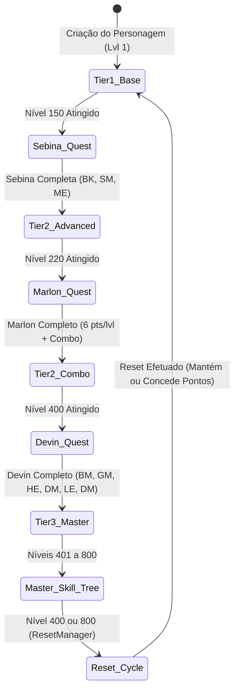
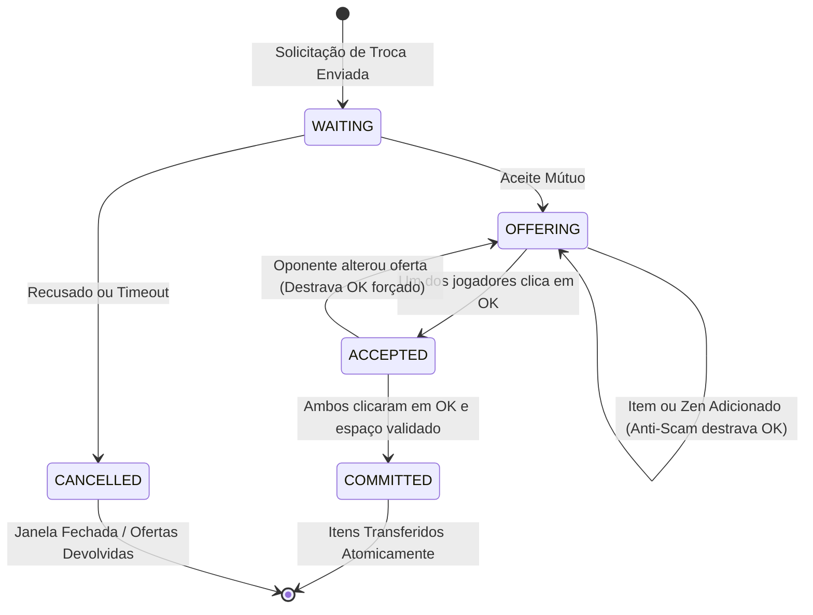

# DASI MMORPG — Bíblia de Orquestração Máxima e Especificação de Funções do GameServer
## Arquitetura Autoritativa, Composições de Módulos, FSMs de Evolução & Protocolo Canônico

> **Autor:** Dasi Architecture & Core Systems Team  
> **IP Canônico de Rede:** `26.32.29.60` (Radmin VPN)  
> **Ambiente de Execução:** Node.js 22+ (TypeScript nativo com `--experimental-strip-types`) / Porta WebSocket 8299 & HTTP Dev Viewer 8080  
> **Filosofia Arquitetural:** Servidor Autoritativo Zero-Trust (Client prevê localmente; Servidor dita a verdade física, matemática e transacional)

---

## 1. Visão Geral da Arquitetura do GameServer

O servidor Dasi opera como uma máquina de estados autoritativa centralizada, responsável por gerenciar conexões de clientes WebGL/Three.js e clientes binários legados via WebSockets e sockets TCP.

```mermaid
flowchart TD
    Client["Client (WebGL / Three.js / Native)"] <-->|Binary C1/C2 or JSON| GS["GameServer (Port 8080 / 8299)"]
    
    subgraph Network & Session
        GS --> SM["SessionManager"]
        GS --> Dispatcher["Packet Dispatcher (protocol.ts)"]
    end
    
    subgraph Core Gameplay & Physics
        GS --> CE["CombatEngine"]
        CE --> CF["CanonicalFormulas"]
        CE --> CSE["ComboSkillEngine"]
        CE --> EM["EffectManager"]
        CE --> DM["DropManager"]
        CE --> MS["MobSpawner & Monster"]
        CE --> DSM["DarkSpiritManager"]
        GS --> CS["CollisionSystem & CanonicalTerrainGrid"]
        GS --> NM["NavigationManager (MoveReq & Gates)"]
    end

    subgraph Bosses & Invasions
        GS --> BM["BossManager & BossEntity"]
        BM --> GIS["GoldenInvasionSystem"]
        BM --> BOK["BoxOfKundun"]
    end

    subgraph Inventory, Economy & Crafting
        GS --> GI["GridInventory 8x8 & Item"]
        GS --> JS["JewelSystem (Bless, Soul, Life)"]
        GS --> CM["ChaosMachine & ChaosMachineEngine"]
        GS --> HS["HarmonyAnd380System"]
        GS --> SIS["SocketItemSystem"]
        GS --> BIS["BinaryItemSerializer"]
        GS --> NPC["NPCShopSystem (Territorial Taxes)"]
        GS --> TM["TradeManager (Anti-Scam FSM)"]
        GS --> PSM["PersonalShopManager (2B Cap)"]
    end

    subgraph Progression & Social
        GS --> RM["ResetManager & MasterReset"]
        GS --> MST["MasterSkillTree (200 ML)"]
        GS --> QM["QuestManager (Sebina, Marlon, Devin)"]
        GS --> PM["PartyManager (Gold Party EXP)"]
        GS --> GSys["GuildSystem & Treasury"]
        GS --> CSM["CastleSiegeManager (Valley of Loren)"]
        GS --> GENS["GensSystem (Duprian & Vanert)"]
    end

    subgraph Event Instances
        GS --> EVM["EventManager"]
        EVM --> BC["BloodCastleInstance"]
        EVM --> DS["DevilSquareInstance"]
        EVM --> CC["ChaosCastleInstance"]
        EVM --> DC["DuelColiseumInstance"]
        EVM --> KM["KalimaInstance (Kundun 1M HP)"]
        EVM --> DUG["DungeonManager"]
    end
```

### Características Centrais de Execução:
1. **Game Loop Autoritativo (100ms / 10Hz):** Executa o processamento periódico de IA de monstros, cooldowns de chefes mundiais, decaimento de buffs/debuffs (`EffectManager.tick`), recuperação de SD/HP/MP e validação de gates de proximidade.
2. **Heartbeat / KeepAlive (15000ms):** Emissão de `MSG_PING` (`0x02:0x01`) e verificação de timeouts de conexões ociosas ou desconexões forçadas.
3. **Persistência e Serialização Binária:** Compatibilidade com o formato binário de 32 bytes por item da Webzen via `BinaryItemSerializer`.

---

## 2. Catálogo Exaustivo de Funções e Métodos por Subsistema

### 2.1 Subsistema de Rede & Sessões (`src/server/network/`)

#### Classe `GameServer` (`GameServer.ts`)
Orquestrador central de todos os subsistemas de jogo.
- `constructor(config: GameServerConfig)`: Instancia todos os 19 gerenciadores do jogo e configura portas.
- `public async start(): Promise<void>`: Inicializa o servidor HTTP (Dev Viewer) e o WebSocketServer, conectando listeners e iniciando o Game Loop.
- `public async stop(): Promise<void>`: Encerra com segurança conexões abertas, salva estados de inventário e cancela os timers ativos.
- `private handleIncomingMessage(session: ClientSession, data: RawData, isBinary: boolean): void`: Deserializa pacotes C1/C2 ou JSON e despacha para `dispatchPacket`.
- `private dispatchPacket(session: ClientSession, packet: PacketMessage): void`: Roteia opcodes para os métodos tratadores autoritativos.
- `public sendPacket(session: ClientSession, opcode: number, subcode: number, payload: unknown): void`: Envia mensagem serializada conforme o protocolo de negociação da sessão.
- `public broadcastPacket(opcode: number, subcode: number, payload: unknown, excludeSessionId?: string): void`: Dispara pacote para todas as sessões conectadas.

#### Classe `SessionManager` (`SessionManager.ts`)
Gerencia o ciclo de vida das sessões, identificadores criptográficos, instâncias de `GridInventory` e estado do herói.
- `public createSession(socket: unknown, isBinaryMode?: boolean): ClientSession`: Cria identificador único `sess-hex-counter`, aloca `GridInventory(8, 8)`, preenche atributos base e vincula o socket.
- `public getSession(sessionId: string): ClientSession | undefined`: Resgate em $O(1)$ por ID de sessão.
- `public getSessionBySocket(socket: unknown): ClientSession | undefined`: Resgate em $O(1)$ pelo socket TCP/WebSocket.
- `public removeSession(sessionId: string): boolean`: Remove e descarta a sessão liberando memória.
- `public getAllSessions(): ClientSession[]`: Retorna a lista completa de sessões conectadas.
- `private populateInitialInventory(inventory: GridInventory): void`: Popula o inventário inicial com itens icônicos (Dragon Helm/Armor/Pants, Dragon Slayer, Jewel of Bless/Soul/Chaos, Box of Kundun).

---

### 2.2 Subsistema de Combate & Física (`src/server/combat/`)

#### Classe `CombatEngine` (`CombatEngine.ts`)
- `public processPlayerAttack(session: ClientSession, req: AttackRequest): AttackResult`: Processa ataque contra monstros normais ou chefes, calculando taxa de acerto PvE, tipo de dano (Normal, Skill, Critical, Excellent, Ignore Defense), stagger, knockback e geração de drops.
- `public processBossAttack(session: ClientSession, req: AttackRequest): AttackResult`: Gerencia dano contra Chefes Mundiais multi-fase, atualizando o agro e disparando telegrafias de habilidades.
- `public processGroundPickup(session: ClientSession, dropId: string): PickupResult`: Validação autoritativa de distância ($\le 3$ metros), propriedade temporária do item e alocação no inventário 8x8.
- `public updateMonsters(deltaTimeMs: number): SerializedMonster[]`: Tick de IA e movimentação de monstros pelo terreno.

#### Classe `CanonicalFormulas` (`CanonicalFormulas.ts`)
Grimório matemático da Webzen para todas as classes canônicas:
- `public static calculateAttackPower(attrs: CharacterAttributes, mainHandWeapon?: ItemInstance, offHandWeapon?: ItemInstance): AttackPower`:
  - **Dark Knight:** $\text{Min} = \lfloor\text{Str}/6\rfloor$, $\text{Max} = \lfloor\text{Str}/4\rfloor$
  - **Dark Wizard:** $\text{Min} = \lfloor\text{Ene}/9\rfloor$, $\text{Max} = \lfloor\text{Ene}/4\rfloor$
  - **Fairy Elf:** $\text{Min} = \lfloor\text{Dex}/7\rfloor + \lfloor\text{Str}/14\rfloor$, $\text{Max} = \lfloor\text{Dex}/4\rfloor + \lfloor\text{Str}/8\rfloor$
  - **Magic Gladiator:** $\text{Min} = \lfloor\text{Str}/6\rfloor$, $\text{Max} = \lfloor\text{Str}/4\rfloor$, $\text{MagicMin} = \lfloor\text{Ene}/9\rfloor$, $\text{MagicMax} = \lfloor\text{Ene}/4\rfloor$
  - **Dark Lord:** $\text{Min} = \lfloor\text{Str}/7\rfloor + \lfloor\text{Ene}/14\rfloor$, $\text{Max} = \lfloor\text{Str}/5\rfloor + \lfloor\text{Ene}/10\rfloor$
  - **Summoner:** $\text{Min} = \lfloor\text{Ene}/8\rfloor$, $\text{Max} = \lfloor\text{Ene}/4\rfloor$
- `public static calculateDefense(attrs: CharacterAttributes, equippedArmorDefense = 0): DefenseStats`: Fórmulas de Defesa, Defense Rate e Attack Rate PvE/PvP.
- `public static distributeDamage(rawDamage: number, target: CharacterAttributes): DamageDistribution`: Repartição canônica PvP de 90% no Shield (SD) e 10% na Vida (HP).

#### Classe `ComboSkillEngine` (`ComboSkillEngine.ts`)
- `public registerSkill(skillId: number, nowTimestamp: number): boolean`: Máquina de estados FSM: Arma $\to$ 1ª Skill de Orbe $\to$ 2ª Skill de Orbe diferente dentro da janela estrita de 3000ms.
- `public static calculateComboDamage(baseDamage: number, str: number, dex: number, ene: number): number`: $\text{Dano} = (2 \times \text{Base}) + \lfloor\frac{\text{Str}+\text{Dex}+\text{Ene}}{2}\rfloor$.
- `public static getDKSkillMultiplier(energy: number): number`: $200\% + \lfloor\text{Energy}/10\rfloor\%$, com teto em $500\%$.

#### Classe `EffectManager` (`EffectManager.ts`)
- `public static calculateManaShield(dex: number, ene: number)`: Redução $\%= 10 + \lfloor\text{Dex}/50\rfloor + \lfloor\text{Ene}/200\rfloor$ (Cap 50%), Duração $= 60 + \lfloor\text{Ene}/40\rfloor$ s.
- `public static calculateGreaterLife(vit: number, ene: number)`: HP Adicional $\%= 12 + \lfloor\text{Vit}/100\rfloor + \lfloor\text{Ene}/20\rfloor$ (Cap 100%), Duração $= 60 + \lfloor\text{Ene}/10\rfloor$ s.
- `public static calculateGreaterDefense(ene: number)`: Defesa $= 2 + \lfloor\text{Ene}/8\rfloor$, Duração $= 60$ s.
- `public static calculateGreaterDamage(ene: number)`: Dano $= 3 + \lfloor\text{Ene}/7\rfloor$, Duração $= 60$ s.
- `public static calculateGreaterCriticalDamage(ene: number, cmd: number)`: Dano Crítico $= \lfloor\text{Ene}/25\rfloor + \lfloor\text{Cmd}/30\rfloor$.
- `public addEffect(...)`, `public removeEffect(...)`, `public tick(deltaSeconds: number): ActiveEffect[]`: Aplica e gerencia a duração de buffs e debuffs ativos com expiração temporal.

#### Classe `DarkSpiritManager` (`DarkSpiritManager.ts`)
- `public static calculateDamage(command: number, energy: number, spiritLevel: number)`: Dano do Corvo Mágico $= \lfloor\text{Cmd}/10\rfloor + \lfloor\text{Ene}/50\rfloor + (\text{Level} \times 15) + 180$.
- `public setMode(mode: DarkSpiritMode)`: Alterna entre os 4 modos de IA (Normal, Auto-Attack, Attack Together, Attack with Master).

---

### 2.3 Subsistema de Chefes & Invasões (`src/server/bosses/`)

#### Classe `BossManager` (`BossManager.ts`)
- `public spawnBoss(bossType: string, x: number, y: number): BossEntity`: Spawna e registra chefes como Gorgon, Ice Queen, Balrog, Hydra, Zaikan e Lord Kundun.
- `public update(deltaTimeMs: number): void`: Atualiza FSM de fases e cooldowns de telegrafias de ataques em área.
- `public getBoss(id: string): BossEntity | undefined`: Localiza entidade de chefe ativo.

#### Classe `GoldenInvasionSystem` (`GoldenInvasionSystem.ts`)
- `public triggerInvasion(tier: number, mapId: string): GoldenMonsterInstance[]`: Dispara invasão de monstros dourados (Golden Budge Dragon, Golden Titan, Golden Dragon, Golden Tantalos) que derrubam Box of Kundun +1 a +5.

#### Classe `BoxOfKundun` (`BoxOfKundun.ts`)
- `public static rollBoxDrop(boxDefId: string, playerLevel: number): GroundDropItem[]`: Gera drops excelentes com opções canônicas baseadas no tier da Box (+1 a +5).

---

### 2.4 Subsistema de Inventário, Forja & Economia (`src/server/inventory/` & `economy/`)

#### Classe `GridInventory` (`GridInventory.ts`)
- `public addItem(item: ItemInstance, preferredX?: number, preferredY?: number): boolean`: Algoritmo de encaixe espacial em grade 8x8 respeitando `width` e `height`.
- `public removeItem(itemUuid: string): ItemInstance | null`: Remove item da grade.
- `public equipItem(itemUuid: string, slot: EquipmentSlot): boolean`: Valida requisitos de classe, força, agilidade, nível e equipa no slot de personagem.
- `public unequipItem(slot: EquipmentSlot): boolean`: Retira do slot de equipamento e devolve à grade se houver espaço.

#### Classe `JewelSystem` (`JewelSystem.ts`)
- `public applyBless(targetItem: ItemInstance): UpgradeOutcome`: 100% de sucesso até +6.
- `public applySoul(targetItem: ItemInstance): UpgradeOutcome`: 50% base (75% com Luck) de +7 a +9. Em caso de falha, se for +7/+8 desce para +0 ou perde 1 nível.
- `public applyLife(targetItem: ItemInstance): UpgradeOutcome`: 50% de sucesso para adicionar 옵션 de +4 até +28.

#### Classe `ChaosMachine` & `ChaosMachineEngine` (`ChaosMachine.ts` & `ChaosMachineEngine.ts`)
- `public mixItemUpgrade(items: ItemInstance[], targetItemUuid: string): MixResult`: Refinamento de itens de +10 a +15 (taxas: +10=60%, +11=60%, +12=55%, +13=55%, +14=50%, +15=50%, +25% com Luck). Destrói o item em caso de falha.
- `public mixChaosWeapon(items: ItemInstance[]): MixResult`: Criação de Chaos Dragon Axe, Chaos Nature Bow ou Chaos Lightning Staff (mínimo 1 item +4 com option).
- `public mixFirstWings(items: ItemInstance[]): MixResult`: Criação de Asas Nível 1 (Wings of Elf, Wings of Heaven, Wings of Satan).
- `public mixSecondWings(items: ItemInstance[]): MixResult`: Criação de Asas Nível 2 usando Pena de Loch (Feather of Condor) e item excelente +4.
- `public mixThirdWings(items: ItemInstance[]): MixResult`: Criação de Asas Nível 3 (Wing of Storm, Space-Time, Illusion, etc.) usando Flame of Condor e Feather of Condor.
- `public mixFruit(items: ItemInstance[]): MixResult`: Combinação de Jewel of Creation + Jewel of Chaos para criar frutas de atributos.

#### Classe `HarmonyAnd380System` (`HarmonyAnd380System.ts`)
- `public static purifyGemstone(items: ItemInstance[]): PurificationResult`: Refino de Gemstone em Jewel of Harmony na Torre de Kanturu.
- `public static applyHarmony(item: ItemInstance, harmony: ItemInstance): HarmonyResult`: Insere opção amarela especial de Harmony.
- `public static restoreHarmony(item: ItemInstance): RestoreResult`: Remove a opção de Harmony recuperando o item limpo.
- `public static apply380Option(item: ItemInstance, jewelOfGuardian: ItemInstance, jewelOfHarmony: ItemInstance): Mix380Result`: Aplica opção roxa de nível 380.

#### Classe `SocketItemSystem` (`SocketItemSystem.ts`)
- `public static mountSeedSphere(item: ItemInstance, socketIndex: number, sphere: ItemInstance): boolean`: Encaixa Seed Sphere (Fogo, Água, Gelo, Vento, Terra, Relâmpago) de Tiers 1 a 5 em até 5 slots de socket.
- `public static extractSeedSphere(item: ItemInstance, socketIndex: number): boolean`: Desencaixa destruindo a esfera ou recuperando conforme a regra.
- `public static evaluatePackageOption(item: ItemInstance): PackageOption | null`: Concede bônus de conjunto (Double Damage +3%, Ignore Defense +1%) ao preencher sockets compatíveis.

#### Classe `TradeManager` (`TradeManager.ts`)
- `public requestTrade(initiatorId: string, targetId: string): TradeResult`: Abre sessão de troca atômica.
- `public addItem(sessionId: string, item: ItemInstance): boolean`: Adiciona item na oferta e reseta o botão OK do oponente via anti-scam.
- `public addZen(sessionId: string, amount: number): boolean`: Adiciona Zen na oferta com anti-scam.
- `public confirmTrade(sessionId: string): { completed: boolean; error?: string }`: Confirmação mútua com verificação atômica de células livres nos dois inventários.
- `public cancelTrade(sessionId: string): void`: Devolve imediatamente itens aos donos originais.

#### Classe `PersonalShopManager` (`PersonalShopManager.ts`)
- `public openShop(playerId: string, title: string, items: PShopItemEntry[]): boolean`: Abre loja pessoal na cidade.
- `public purchaseItem(buyerId: string, sellerId: string, slot: number, ...): PurchaseResult`: Compra de itens com Zen, Bless ou Soul, com proteção contra overflow de 2.000.000.000 Zen.
- `public closeShop(playerId: string): void`: Fecha a loja pessoal.

#### Classe `NPCShopSystem` (`NPCShop.ts`)
- `public static buyItem(npcId: string, itemDefId: string, playerZen: number, castleTaxRate = 0)`: Compra de poções, pergaminhos e armaduras de NPCs com recolhimento de imposto territorial de Castle Siege.
- `public static sellItem(item: ItemInstance): number`: Venda de itens ao NPC por 1/3 do valor base.

---

### 2.5 Subsistema de Progressão, Resets & Quests (`src/server/progression/`)

#### Classe `ResetManager` (`ResetManager.ts`)
- `public static calculateResetZenCost(currentResets: number, config?: ResetConfig): number`: Custo dinâmico em Zen por reset.
- `public static executeReset(state: CharacterResetState, config?: ResetConfig)`: Executa `/reset` ao atingir nível 400.
  - **Modo Pontos:** Retorna ao nível 1, reseta atributos para a base e concede $\text{Resets} \times 500$ pontos de atributo livres.
  - **Modo Acumulativo:** Retorna ao nível 1 preservando todos os atributos acumulados.
- `public static executeMasterReset(state: CharacterResetState, config?: MasterResetConfig)`: Executa Master Reset ao atingir 100 resets, concedendo WCoins e Master Points permanentes.

#### Classe `MasterSkillTree` (`MasterSkillTree.ts`)
- `public static createDefaultTree(characterId: string): MasterSkillTreeState`: Cria os 3 ramos da Árvore Master (Defesa/Proteção, Ataque/Bravura, Habilidade/Suporte).
- `public static allocatePoint(treeState: MasterSkillTreeState, skillId: string): boolean`: Aloca ponto Master (níveis 401 a 800) respeitando o pré-requisito de pontos da fileira anterior.

#### Classe `QuestManager` (`QuestManager.ts`)
- `public static startSebinaPart1(state: CharacterProgressionState): boolean`: Inicia Quest de Sebina no Nível 150.
- `public static completeSebinaPart1(state: CharacterProgressionState): boolean`: Consome *Scroll of the Emperor* e concede 10 pontos.
- `public static completeSebinaPart2(state: CharacterProgressionState): boolean`: Consome o artefato de classe (*Broken Sword*, *Tear of Elf*, *Soul of Wizard*) e evolui o personagem para 2ª Classe (DK $\to$ BK, DW $\to$ SM, ELF $\to$ ME).
- `public static completeMarlonPart1(state: CharacterProgressionState): boolean`: Consome *Ring of Honor* no nível 220 e desbloqueia 6 pontos por nível.
- `public static completeMarlonPart2(state: CharacterProgressionState): boolean`: Consome *Dark Stone* e desbloqueia o Combo do Blade Knight.
- `public static completeDevinPart1/2/3(state: CharacterProgressionState): boolean`: Quests de 3 estágios no nível 400 contra Death Beam Knight, Hell Maine e Dark Phoenix para desbloquear a 3ª Classe (Blade Master, Grand Master, High Elf, Duel Master, Lord Emperor, Dimension Master).

---

### 2.6 Subsistema Social, Alianças, Guerra & Território (`src/server/party/`, `guilds/`, `siege/`, `world/`)

#### Classe `PartyManager` (`PartyManager.ts`)
- `public static isGoldParty(members: PartyMember[]): boolean`: Identifica composição de Grupo Dourado ($\ge 3$ classes fundadoras distintas).
- `public static calculatePartyExp(baseMonsterExp: number, members: PartyMember[], monsterLevel: number): PartyExpDistribution`:
  - **Party Normal:** 2 jogadores = 160%, 3 = 180%, 4 = 200%, 5 = 225%.
  - **Gold Party:** 3 classes = 225%, 4 classes = 260%, 5 classes = 300%.
  - **Trava de Nível:** Membros com mais de 130 níveis de diferença do líder/monstro não recebem EXP.

#### Classe `GuildSystem` (`GuildSystem.ts`)
- `public createGuild(guildName: string, masterSessionId: string, masterName: string)`: Cria guilda com limite de 80 membros e cargo inicial de Guild Master.
- `public inviteMember(...)`, `public respondInvite(...)`, `public setMemberRank(...)`: Gerenciamento hierárquico (Guild Master, Assistant, Battle Master, Normal).
- `public depositTreasury(guildName: string, amount: number)`: Depósito no cofre da guilda.

#### Classe `CastleSiegeManager` (`CastleSiegeManager.ts`)
- `public registerGuild(guildName: string, markOfLordCount: number)`: Inscrição para a disputa do Castelo de Loren com Sign of Lord.
- `public attackStructure(attackerGuild: string, structureId: string, damage: number)`: Dano autoritativo contra os 6 Portões do Castelo e as 4 Estátuas da Vida.
- `public capturePedestal(side: 'west' | 'east', guildName: string)`: Ativação dos dois interruptores sincronizados da Torre do Trono.
- `public progressCrownSeal(guildName: string, deltaSeconds: number)`: Acúmulo do Selo da Coroa (necessita de 120 segundos contínuos para vitória).

#### Classe `GensSystem` (`GensSystem.ts`)
- `public static calculateGensSymbol(contribution: number, rank = 0): GensSymbol`: Calcula uma das 14 patentes (de Soldado Raso até Grão-Duque).
- `public static isHostileCombat(attackerFamily: GensFamily, targetFamily: GensFamily, isBattleZone: boolean)`: Combate hostil Duprian vs Vanert sem penalidade de PK.
- `public static calculateKillReward(...)`: Pontos de contribuição por abate com trava anti-farming (máx 3 abates/hora por vítima).

---

### 2.7 Subsistema de Mundo, Navegação & Eventos (`src/server/world/` & `events/`)

#### Classe `CollisionSystem` & `CanonicalTerrainGrid` (`CollisionSystem.ts` & `CanonicalTerrainGrid.ts`)
- `public checkMovement(currentX: number, currentY: number, targetX: number, targetY: number): MovementResolution`: Validação física contra os 56 cenários canônicos e matrizes 256x256 `.att` (`TW_SAFEZONE`, `TW_NOMOVE`, `TW_WATER`).
- `public canWalk(mapId: number, x: number, y: number): boolean`: Consulta rápida em $O(1)$ na grade de caminhabilidade binária.

#### Classe `NavigationManager` (`NavigationManager.ts`)
- `public static processMoveCommand(character: CharacterSummary, destinationName: string, isPhonomania: boolean): MoveResult`:
  - Processa o comando `/move Destino`.
  - Concede **desconto canônico de 1/3 de nível** para classes especiais (Magic Gladiator, Dark Lord).
  - Bloqueia teleporte para jogadores assassinos ($\text{PK Level} \ge 5$).
- `public static checkGateTrigger(character: CharacterSummary, map: number, x: number, y: number): GateInfo | null`: Detecta quando o jogador pisa na área de um portal físico (Flag 1).

#### Instâncias de Eventos Canônicos (`src/server/events/`)
- `BloodCastleInstance`: Temporizador de 15 minutos, destruição do Portão do Castelo, abate de 40 monstros e entrega da Arma do Arcanjo.
- `DevilSquareInstance`: 4 hordas de monstros progressivos com pontuação e bônus de EXP.
- `ChaosCastleInstance`: Batalha campal de até 100 combatentes disfarçados em armaduras idênticas, chão em 3 estágios que desaba ao abismo e dano explosivo de monstros que empurram os jogadores.
- `DuelColiseumInstance`: Arena de duelos 1v1 com contagem de 10 abates.
- `KalimaInstance`: Crafting de Lost Map (5 marcas do mesmo tier), portal de 180 segundos e invocação de Lord Kundun com 1.000.000 HP no 7º andar.

---

## 3. Matrizes de Evolução e FSMs Canônicas

### 3.1 Transição de Classes e Níveis


### 3.2 FSM de Negociação Atômica Anti-Scam (Trade)


---

## 4. Mapeamento Canônico de Opcodes e Protocolo

| Grupo | Opcode:Subcode | Nome do Pacote | Direção | Descrição / Payload |
|---|---|---|---|---|
| `0x01` | `0x01:0x01` | `MSG_HANDSHAKE_HELLO` | C $\to$ S | `{ clientVersion, clientTime }` |
| `0x01` | `0x01:0x02` | `MSG_HANDSHAKE_CHALLENGE` | S $\to$ C | `{ serverVersion, serverTime, salt }` |
| `0x01` | `0x01:0x03` | `MSG_AUTH_LOGIN_REQ` | C $\to$ S | `{ username, token, characterClass }` |
| `0x01` | `0x01:0x04` | `MSG_AUTH_LOGIN_RES` | S $\to$ C | `{ success, sessionId, token, character }` |
| `0x02` | `0x02:0x01` | `MSG_PING` | C $\leftrightarrow$ S | `{ timestamp }` |
| `0x02` | `0x02:0x02` | `MSG_PONG` | C $\leftrightarrow$ S | `{ timestamp, latency }` |
| `0x10` | `0x10:0x01` | `MSG_PLAYER_STATUS_VITALS`| S $\to$ C | `{ hp, maxHp, sd, maxSd, mp, maxMp, bp, maxBp }` |
| `0x15` | `0x15:0x01` | `MSG_MONSTER_SPAWN_OR_MOVE`| S $\to$ C | `{ monsters: SerializedMonster[] }` |
| `0x16` | `0x16:0x01` | `MSG_GROUND_ITEM_DROP` | S $\to$ C | `{ drop: GroundDropItem }` |
| `0x16` | `0x16:0x02` | `MSG_GROUND_ITEM_PICKUP_REQ`| C $\to$ S | `{ dropId, playerX, playerY }` |
| `0x30` | `0x30:0x01` | `MSG_TELEPORT_REQ` | C $\to$ S | `{ destinationName: string }` |
| `0x30` | `0x30:0x02` | `MSG_TELEPORT_RES` | S $\to$ C | `{ success, map, x, y, zenCost, error }` |
| `0x30` | `0x30:0x03` | `MSG_GATE_TRIGGER_REQ` | C $\to$ S | `{ currentMap, currentX, currentY }` |
| `0x50` | `0x50:0x01` | `MSG_COMBAT_ATTACK_REQ` | C $\to$ S | `{ targetMobId, skillId, playerX, playerY }` |
| `0x50` | `0x50:0x02` | `MSG_COMBAT_ATTACK_RES` | S $\to$ C | `AttackResult (Dano, Cor, Stagger, Knockback, Drops)` |
| `0x70` | `0x70:0x01` | `MSG_INVENTORY_SYNC_ALL` | C $\leftrightarrow$ S | `{ grid, equipment, zen }` |
| `0x70` | `0x70:0x02` | `MSG_ITEM_MOVE_REQ` | C $\to$ S | `{ itemUuid, sourceType, targetType, targetSlot, ... }` |
| `0x71` | `0x71:0x01` | `MSG_ITEM_USE_JEWEL_REQ` | C $\to$ S | `{ jewelUuid, targetUuid, targetLocation, ... }` |
| `0x72` | `0x72:0x01` | `MSG_CHAOS_MACHINE_MIX_REQ`| C $\to$ S | `{ mixType, itemUuids, targetItemUuid }` |
| `0x74` | `0x74:0x01` | `MSG_NPC_SHOP_BUY_REQ` | C $\to$ S | `{ npcId, itemDefId, targetX, targetY }` |
| `0x74` | `0x74:0x03` | `MSG_NPC_SHOP_SELL_REQ` | C $\to$ S | `{ itemUuid, slot }` |
| `0x75` | `0x75:0x01` | `MSG_STAT_POINT_ALLOC_REQ` | C $\to$ S | `{ strength, agility, vitality, energy, command }` |
| `0x76` | `0x76:0x01` | `MSG_TRADE_REQUEST_REQ` | C $\to$ S | `{ targetSessionId }` |
| `0x76` | `0x76:0x03` | `MSG_TRADE_RESPOND_REQ` | C $\to$ S | `{ tradeId, accept: boolean }` |
| `0x76` | `0x76:0x05` | `MSG_TRADE_ITEM_ADD_REQ` | C $\to$ S | `{ tradeId, itemUuid }` |
| `0x76` | `0x76:0x07` | `MSG_TRADE_ZEN_ADD_REQ` | C $\to$ S | `{ tradeId, amountZen }` |
| `0x76` | `0x76:0x09` | `MSG_TRADE_CONFIRM_REQ` | C $\to$ S | `{ tradeId }` |
| `0x76` | `0x76:0x0b` | `MSG_TRADE_CANCEL_REQ` | C $\to$ S | `{ tradeId }` |
| `0x77` | `0x77:0x01` | `MSG_PSHOP_OPEN_REQ` | C $\to$ S | `{ title, items: PShopItemEntry[] }` |
| `0x77` | `0x77:0x03` | `MSG_PSHOP_CLOSE_REQ` | C $\to$ S | `{}` |
| `0x77` | `0x77:0x05` | `MSG_PSHOP_BUY_REQ` | C $\to$ S | `{ sellerSessionId, slot }` |
| `0x80` | `0x80:0x01` | `MSG_BOSS_SPAWN_REQ` | C $\to$ S | `{ type, x, y }` |
| `0x80` | `0x80:0x04` | `MSG_GOLDEN_INVASION_REQ`| C $\to$ S | `{ tier, mapId }` |
| `0x80` | `0x80:0x06` | `MSG_BOX_KUNDUN_OPEN_REQ`| C $\to$ S | `{ boxDefId, playerX, playerY }` |
| `0x81` | `0x81:0x01` | `MSG_EVENT_STATUS_REQ` | C $\to$ S | `{}` |
| `0x81` | `0x81:0x03` | `MSG_EVENT_ENTER_REQ` | C $\to$ S | `{ eventType }` |
| `0x81` | `0x81:0x0d` | `MSG_KALIMA_PORTAL_SPAWN_REQ` | C $\to$ S | `{ lostMapDefId, x, y }` |
| `0x81` | `0x81:0x0e` | `MSG_KALIMA_PORTAL_SPAWN_RES` | S $\to$ C | `{ success, portalId, kalimaLevel, durationSeconds, x, y }` |
| `0x81` | `0x81:0x0f` | `MSG_KALIMA_ENTER_REQ` | C $\to$ S | `{ portalId }` |
| `0x81` | `0x81:0x10` | `MSG_KALIMA_ENTER_RES` | S $\to$ C | `{ success, kalimaLevel, mapId, x, y }` |
| `0x82` | `0x82:0x01` | `MSG_DUNGEON_ENTER_REQ` | C $\to$ S | `{}` |
| `0x83` | `0x83:0x01` | `MSG_RESET_REQ` | C $\to$ S | `{}` |
| `0x83` | `0x83:0x03` | `MSG_MASTER_RESET_REQ` | C $\to$ S | `{}` |
| `0x83` | `0x83:0x05` | `MSG_QUEST_INFO_REQ` | C $\to$ S | `{}` |
| `0x83` | `0x83:0x07` | `MSG_QUEST_ACTION_REQ` | C $\to$ S | `{ questId, action: 'START' \| 'COMPLETE' }` |
| `0x83` | `0x83:0x09` | `MSG_MASTER_SKILL_ALLOC_REQ`| C $\to$ S | `{ skillId }` |
| `0x84` | `0x84:0x01` | `MSG_GENS_JOIN_REQ` | C $\to$ S | `{ family: GensFamily }` |
| `0x84` | `0x84:0x03` | `MSG_GENS_STATUS_REQ` | C $\to$ S | `{}` |
| `0x85` | `0x85:0x01` | `MSG_HARMONY_SMELT_REQ` | C $\to$ S | `{ targetItemUuid, harmonyItemUuid }` |
| `0x85` | `0x85:0x03` | `MSG_HARMONY_RESTORE_REQ`| C $\to$ S | `{ targetItemUuid }` |
| `0x85` | `0x85:0x05` | `MSG_SOCKET_MOUNT_REQ` | C $\to$ S | `{ targetItemUuid, socketIndex, sphereUuid }` |
| `0xB0` | `0xB0:0x01` | `MSG_GUILD_STATUS_REQ` | C $\to$ S | `{}` |
| `0xB0` | `0xB0:0x03` | `MSG_GUILD_CREATE_REQ` | C $\to$ S | `{ name }` |
| `0xB1` | `0xB1:0x01` | `MSG_SIEGE_STATUS_REQ` | C $\to$ S | `{}` |
| `0xB2` | `0xB2:0x01` | `MSG_PARTY_INVITE_REQ` | C $\to$ S | `{ targetSessionId }` |
| `0xB2` | `0xB2:0x03` | `MSG_PARTY_RESPOND_INVITE_REQ`| C $\to$ S | `{ partyId, accept: boolean }` |
| `0xB2` | `0xB2:0x05` | `MSG_PARTY_LEAVE_REQ` | C $\to$ S | `{}` |

---

## 5. Diretrizes de Implementação e Orquestração do Servidor

1. **Centralização de Instâncias no GameServer:** Todos os gerenciadores devem ser membros públicos imutáveis da classe `GameServer`, permitindo injeção de dependência e controle coordenado.
2. **Integração no Loop de Atualização:** Buffs em `EffectManager` e cooldowns de combates processam decremento autoritativo a cada segundo do servidor.
3. **Persistência e Atomicidade:** Trocas, lojas pessoais e forjas devem bloquear os itens participantes até o fechamento da transação para impedir clonagem e desbalanceamento de economia.
