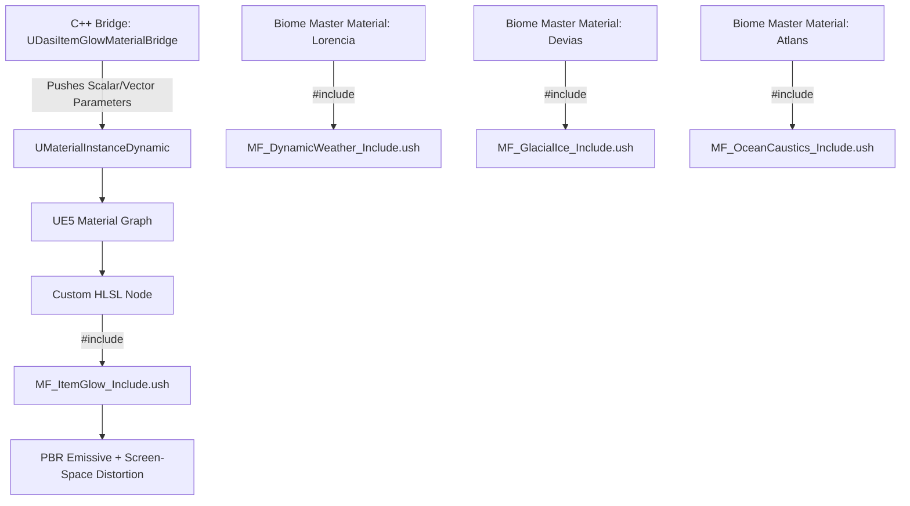
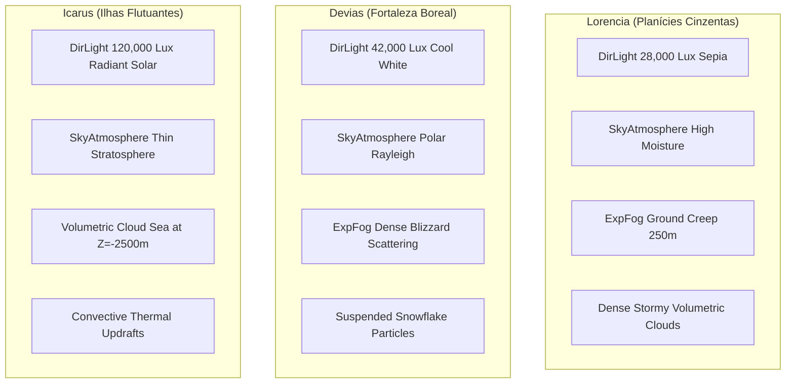

# Dasi MMORPG - Unreal Engine 5 Rendering, Shaders & VFX Architecture

## 1. Executive Summary
This document outlines the technical implementation of the visual infrastructure for **Dasi**, built on **Unreal Engine 5 (UE5.4+)**. It connects the custom HLSL reference shaders (`src/shaders/`) with native UE5 rendering subsystems:
- **Material Graph & Custom HLSL Include Wrappers** (`MF_ItemGlow_Include.ush`, `MF_DynamicWeather_Include.ush`, `MF_GlacialIce_Include.ush`, `MF_OceanCaustics_Include.ush`).
- **Dynamic Material Instance C++ Bridge** (`UDasiItemGlowMaterialBridge`).
- **Niagara Visual Effects Systems** (`NS_JewelDropBeam`, `NS_WingRibbonTrails`, `NS_WeaponTraceRibbon`, `NS_CriticalImpact`).
- **World Partition & Environmental Atmosphere Presets** (`Lorencia_Atmosphere.ini`, `Devias_Atmosphere.ini`, `Icarus_Atmosphere.ini`).

---

## 2. Material Functions & HLSL Integration



### 2.1 File Locations & Purpose
1. `MF_ItemGlow_Include.ush`:
   - Path: `Content/Materials/HLSL/MF_ItemGlow_Include.ush`
   - Purpose: Multi-tier refinement glow (+0 to +15), breathing rune glow, diamond facet glints, chromatic waves, and turbulent heat-haze.
2. `MF_DynamicWeather_Include.ush`:
   - Path: `Content/Materials/HLSL/MF_DynamicWeather_Include.ush`
   - Purpose: Dual-phase procedural rain ripples, puddle accumulation from heightmaps, PBR albedo porosity darkening, and water IOR specular response.
3. `MF_GlacialIce_Include.ush`:
   - Path: `Content/Materials/HLSL/MF_GlacialIce_Include.ush`
   - Purpose: Beer-Lambert spectral subsurface absorption, Henyey-Greenstein forward phase scattering, procedural snow slope accumulation, and Devias brazier thaw masks.
4. `MF_OceanCaustics_Include.ush`:
   - Path: `Content/Materials/HLSL/MF_OceanCaustics_Include.ush`
   - Purpose: Dual-phase Voronoi caustics with chromatic dispersion, exponential depth color decay, and underwater marine haze for Atlans.

### 2.2 UE5 Custom HLSL Node Setup Guide
In any UE5 Master Material, create a **Custom** node and configure:
```hlsl
// Custom Node Code (e.g., for Item Refinement):
#include "/Project/Materials/HLSL/MF_ItemGlow_Include.ush"

return Dasi_EvaluateItemRefinementGlow(
    WorldPos,
    WorldNormal,
    CameraVector,
    UV,
    RuneMask,
    RefineLevel,
    Time,
    AuraColorPrimary,
    AuraColorSecondary,
    PulseSpeed,
    ArcDispersion,
    CoronaIntensity,
    HeatHazeStrength
);
```
- Set Custom Node **Output Type** to `CMOT_Float4`.
- Break `Float4`: `RGB` connects to `Emissive Color`, `A` connects to Screen Distortion Post-Process or opacity mask.

---

## 3. C++ Material Bridge: `UDasiItemGlowMaterialBridge`

### 3.1 Architectural Principles
- **Automatic Registration**: Discovers all `UMeshComponent` instances attached to the owning Actor (`USkeletalMeshComponent` armor pieces, weapons, wings).
- **Dynamic Instancing**: Converts static material slots to `UMaterialInstanceDynamic` (MID) seamlessly without manual blueprint setup.
- **Dynamic Ticking Optimization**: Ticking is strictly disabled (`SetComponentTickEnabled(false)`) for non-upgraded or static tiers (+0 to +6). When upgraded to animated tiers (+7 to +15), ticking is automatically enabled to stream `GlobalTime` and harmonic wave phases.
- **Event-Driven**: Dispatches `OnRefinementLevelChanged(int32 OldLevel, int32 NewLevel)` for audio, haptic, and UI fanfare triggering.

---

## 4. Niagara Visual Effects Systems

### 4.1 Specification Summary

| System Name | Primary Renderer | Key Simulation Modules | Gameplay Hook |
| :--- | :--- | :--- | :--- |
| **`NS_JewelDropBeam`** | Mesh (Cylinder) + Sprite + Light | Instantaneous burst, curve Z-scale, vortex sparks, 80,000 lumen light flash | Triggered on item drop of Bless/Soul/Chaos/Life |
| **`NS_WingRibbonTrails`** | Ribbon Renderer | Bone socket tracking, Catmull-Rom tessellation, curl noise, speed-adaptive width | Attached to wingtips during flight, diving & sprint |
| **`NS_WeaponTraceRibbon`** | Ribbon Renderer + Sprites | Dual-socket blade sweep (`Weapon_Root` to `Weapon_Tip`), refinement tier color & arcs | Driven by `AnimNotifyState_WeaponTrace` on swings |
| **`NS_CriticalImpact`** | Sprites + Lens Flare + GPU Scene Depth | 8-point flare cross, shockwave ring, scene depth bouncing sparks, runic glyphs | Spawned on Critical / Excellent combat hits |

---

## 5. Atmosphere Presets & World Partition

### 5.1 Biome Configuration Parameters (`Config/Environments/`)



### 5.2 World Partition Streaming Grid
- **Lorencia**: 128m cell grid, 384m loading range. Tightly focused for high player density around Central Fountain and Castle Gates.
- **Devias**: 128m cell grid, 420m loading range. Accommodates expansive visibility across frozen lake and glacial fortress walls.
- **Icarus**: 256m cell grid, 640m loading range. Tuned for high-velocity 3D flight maneuvers across floating sky islands and infinite cloud voids.
