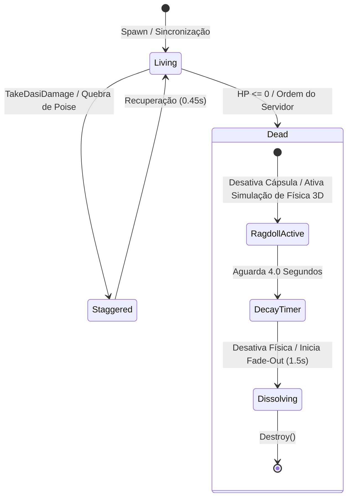

# ARQUITETURA TÉCNICA C++: ENTIDADES 3D, SPAWNS E SINCRONIZAÇÃO ESPACIAL DE LORENCIA NO UNREAL ENGINE 5

> **Documento:** Especificação Técnica de Engenharia de Sistemas & Rede para Unreal Engine 5.4 / 5.5  
> **Módulo:** `DasiClient` (`Source/DasiClient/World/` e `Source/DasiClient/Character/`)  
> **Status:** Implementado, Documentado e Integrado ao `UDasiNetworkSubsystem`  
> **Diretiva Mandatória:** Jogo 100% 3D Nativo (as imagens clássicas 2D do MU Online servem apenas como referência visual de base)

---

## 1. VISÃO GERAL DA ARQUITETURA

O sistema de entidades de mundo e sincronização espacial conecta o servidor autoritativo em tempo real (`ws://localhost:8080`) ao cenário 3D de Lorencia construído em Unreal Engine 5.

```mermaid
flowchart TD
    subgraph Server ["🌐 SERVIDOR AUTORITATIVO (Node.js / ws://localhost:8080)"]
        GS["GameServer Loop (100ms)"]
        MS["MobSpawner (Spiders, Hounds, Bulls, Skeletons)"]
        CE["CombatEngine (Dano, Poise, Knockback, Drops)"]
        GS --> MS
        GS --> CE
    end

    subgraph NetLayer ["⚡ CAMADA DE TRANSPORTE & SUBSISTEMA DE REDE"]
        WS["WebSocket Client (IWebSocket)"]
        NET_SUB["UDasiNetworkSubsystem (GameInstanceSubsystem)"]
        WS --> NET_SUB
    end

    subgraph WorldManager ["🌍 GERENCIADOR DE ENTIDADES DE MUNDO 3D"]
        WEM["UDasiWorldEntityManager (UTickableWorldSubsystem)"]
        COORD["UDasiCoordinateConverter (Ground Raycasting & Projection)"]
        NET_SUB -->|OnMonstersUpdated (0x15:0x01)| WEM
        NET_SUB -->|OnGroundDropsUpdated (0x16:0x01)| WEM
        NET_SUB -->|OnGroundItemRemoved (0x16:0x03)| WEM
        NET_SUB -->|OnCombatAttackResult (0x50:0x02)| WEM
        WEM <--> COORD
    end

    subgraph Entities3D ["🎮 ENTIDADES TRIDIMENSIONAIS NO CENÁRIO (100% 3D NATIVO)"]
        MONSTER["ADasiMonsterCharacter (ACharacter + IDasiCombatInterface)<br/>• Skeletal Mesh 3D + Colisão<br/>• Stencil 250 Mouse Hover Outline<br/>• Interpolação Suave (Speed = 12.0f)<br/>• Ragdoll 3D + Dissolução de Carcaça (4s)<br/>• WidgetComponent 3D (HP Bar + Billboarding)"]
        DROPS["ADasiGroundDropActor (AActor 3D)<br/>• Malha Física 3D com Quique Inicial (Simulate Physics)<br/>• Levitação e Rotação Suave em Repouso<br/>• Feixe Celestial Niagara NS_JewelDropBeam<br/>• Som Sagrado de Joia (Bless, Soul, Chaos, Life)<br/>• Stencil 252 Mouse Hover Outline"]
        DMG_NUM["UDasiDamageNumberSubsystem<br/>• Números de Dano 3D Flutuantes (Pool sem GC)"]
        
        WEM -->|Spawna / Sincroniza| MONSTER
        WEM -->|Spawna / Recolhe| DROPS
        WEM -->|Despacha Impacto| DMG_NUM
    end
```

---

## 2. CONVERSOR DE COORDENADAS DE LORENCIA (`UDasiCoordinateConverter`)

Localização: [`Source/DasiClient/World/DasiCoordinateConverter.h`](file:///d:/Dasi/src/client/ue5_project/Source/DasiClient/World/DasiCoordinateConverter.h) e [`.cpp`](file:///d:/Dasi/src/client/ue5_project/Source/DasiClient/World/DasiCoordinateConverter.cpp).

O conversor traduz bidirecionalmente as coordenadas 2D autoritativas da grade do servidor em coordenadas tridimensionais no espaço de mundo da Unreal Engine 5, realizando **projeção vertical contra o relevo do terreno (Landscape Tracing)**.

### 2.1 Modos de Mapeamento

1. **`CenteredScale` (Padrão para o Nível de Lorencia 2048m x 2048m):**
   - Translação baseada no centro de referência do servidor:
     $$\Delta X = X_{\text{server}} - X_{\text{center}}$$
     $$\Delta Y = Y_{\text{server}} - Y_{\text{center}}$$
   - Coordenadas de Mundo:
     $$X_{\text{world}} = X_{\text{origin}} + (\Delta X \times \text{Scale})$$
     $$Y_{\text{world}} = Y_{\text{origin}} + (\Delta Y \times \text{Scale})$$
   - Padrão: $Scale = 120.0\,\text{cm/unit}$ (1 unidade de servidor = 1,2 metro na UE5).
2. **`IsometricRotated` (Rotação Canônica de 45° do Continent of Legend):**
   - Rotação matricial no plano horizontal:
     $$\begin{pmatrix} X_{\text{rot}} \\ Y_{\text{rot}} \end{pmatrix} = \frac{1}{\sqrt{2}} \begin{pmatrix} 1 & -1 \\ 1 & 1 \end{pmatrix} \begin{pmatrix} \Delta X \\ \Delta Y \end{pmatrix}$$
3. **`DirectUnits`:**
   - Mapeamento direto com multiplicador de escala sem centralização.

### 2.2 Projeção Vertical contra o Relevo (Ground Clamp)

Para impedir que monstros e drops flutuem ou fiquem enterrados no relevo orgânico de Lorencia (Cidadela +18m, Planícies +8m a +12m, Pântanos/Cemitério 0m a +5m):

```cpp
float UDasiCoordinateConverter::QueryGroundZ(
    const UObject* WorldContextObject,
    float WorldX,
    float WorldY,
    float FallbackZ,
    float RaycastStartHeight,
    float RaycastDistance
)
```
- Dispara um raycast vertical para baixo do teto ($+8000\,\text{cm}$) até o piso ($-8000\,\text{cm}$) contra o canal `ECC_WorldStatic` (Landscape / Malhas de Terreno / Pontes).
- O ator é assentado no plano de impacto somado ao meio-tamanho da cápsula de colisão:
  $$Z_{\text{entity}} = Z_{\text{ground}} + H_{\text{capsule\_half}}$$

---

## 3. ENTIDADE C++ DE MONSTRO NO MUNDO 3D (`ADasiMonsterCharacter`)

Localização: [`Source/DasiClient/Character/DasiMonsterCharacter.h`](file:///d:/Dasi/src/client/ue5_project/Source/DasiClient/Character/DasiMonsterCharacter.h) e [`.cpp`](file:///d:/Dasi/src/client/ue5_project/Source/DasiClient/Character/DasiMonsterCharacter.cpp).

Implementa `ACharacter` e a interface de combate [`IDasiCombatInterface`](file:///d:/Dasi/src/client/ue5_project/Source/DasiClient/Combat/DasiCombatInterface.h).

### 3.1 Componentes e Visuais 3D

| Componente | Tipo | Função |
| :--- | :--- | :--- |
| `RootComponent` / Capsule | `UCapsuleComponent` | Colisão cilíndrica tridimensional com o mundo e com o personagem jogador. Bloqueia `ECC_Visibility` e `ECC_Pawn`. |
| `Mesh` (Herdado) | `USkeletalMeshComponent` | Malha esquelética 3D nativa do monstro com animações procedurais de locomoção, ataque e reações. |
| `AccessoryMesh` | `USkeletalMeshComponent` | Malha modular acoplada para armas ou escudos (ex: machado do Bull Fighter, espada enferrujada e escudo do Skeleton). |
| `FloatingHpWidgetComponent` | `UWidgetComponent` | Barra de vida suspensa em World Space com billboarding ativo alinhado à câmera isométrica. |

### 3.2 Interpolação Espacial de Rede

No método `Tick(float DeltaTime)`:
- Posição:
  $$P_{\text{novo}} = \text{VInterpTo}(P_{\text{atual}}, P_{\text{target}}, \Delta t, 12.0\,\text{s}^{-1})$$
- Rotação (orientação de marcha calculada a partir do vetor de deslocamento):
  $$R_{\text{novo}} = \text{RInterpTo}(R_{\text{atual}}, R_{\text{target}}, \Delta t, 12.0\,\text{s}^{-1})$$
- Transição automática entre estados `Idle` e `Walking` quando o monstro se desloca no cenário.

### 3.3 Efeito de Foco (Mouse Hover Outline)

- Ao ser hovered pelo cursor do mouse no [`ADasiIsometricPlayerController`](file:///d:/Dasi/src/client/ue5_project/Source/DasiClient/Character/DasiIsometricPlayerController.cpp):
  - Ativa `SetRenderCustomDepth(true)`.
  - Configura o valor do estêncil:
    ```cpp
    Mesh->SetCustomDepthStencilValue(250);
    ```
  - Dispara o contorno luminoso vermelho/dourado configurado no Post-Process Material de Lorencia.

### 3.4 Ciclo de Morte: Ragdoll 3D e Dissolução de Carcaça



1. **Ativação do Ragdoll Físico Tridimensional:**
   - `CapsuleComponent->SetCollisionEnabled(ECollisionEnabled::NoCollision)`
   - `FloatingHpWidgetComponent->SetVisibility(false)`
   - `GetMesh()->SetCollisionProfileName(TEXT("Ragdoll"))`
   - `GetMesh()->SetSimulatePhysics(true)`
   - `GetMesh()->AddImpulseAtLocation(KnockbackImpulse * 150.0f, HitLocation)`
2. **Dissolução de Carcaça (Após 4 Segundos):**
   - Temporizador de 4.0s dispara `StartCorpseDissolution()`.
   - Modula o parâmetro escalar `Dissolve` (de 0.0 a 1.0) e `Opacity` nos materiais dinâmicos.
   - Aplica afundamento suave no solo ($-30\,\text{cm/s}$) e invoca `Destroy()`.

---

## 4. ATOR DE ITEM NO SOLO (`ADasiGroundDropActor`)

Localização: [`Source/DasiClient/World/DasiGroundDropActor.h`](file:///d:/Dasi/src/client/ue5_project/Source/DasiClient/World/DasiGroundDropActor.h) e [`.cpp`](file:///d:/Dasi/src/client/ue5_project/Source/DasiClient/World/DasiGroundDropActor.cpp).

### 4.1 Características Tridimensionais

1. **Quique Físico Inicial 3D (Simulate Physics):**
   - Ao cair, o `DropMesh` recebe um impulso inicial aleatório no plano horizontal com elevação ascendente ($+150\,\text{cm}$ a $+250\,\text{cm}$).
   - Colide fisicamente com o terreno de Lorencia (`ECC_WorldStatic`).
   - Após 0.7s, a física é congelada suavemente e o item entra em modo de **levitação rúnica suave** (rotação contínua em Yaw a $85^\circ/\text{s}$ e oscilação senoidal em Z de $\pm 5\,\text{cm}$).
2. **Feixe Celestial Niagara (`NS_JewelDropBeam`) e Som Sagrado:**
   - Quando `bIsJewel == true` (Joias da Bênção, Alma, Caos, Vida):
     - Ativa o componente Niagara `CelestialBeamComponent` com feixe vertical volumétrico que sobe aos céus de Lorencia.
     - Reproduz o som sagrado icônico de drop de joia via `UGameplayStatics::PlaySoundAtLocation`.
3. **Placa de Identificação 3D (Nameplate) com Cores Canônicas:**
   - **Zen:** Ouro Radiante (`#FFD700`, ex: `Zen (15,400)`)
   - **Itens Excelentes:** Verde Neon (`#39FF14`, ex: `Dragon Blade +9 +Skill [Ex]`)
   - **Joias Sagradas:** Rosa Celestial (`#FF78DC`, ex: `Jewel of Bless`)
   - **Itens Normais +7/+9:** Laranja Mágico (`#FFB432`) ou Branco (`#FFFFFF`)
   - Mantém billboarding constante voltado para a câmera isométrica.
4. **Hover Stencil 252:**
   - Quando o cursor passa sobre o item, ativa Custom Depth Stencil 252 (outline dourado/azul para itens).
5. **Feedback de Coleta (Pickup Feedback):**
   - Na coleta, dispara o emissor de partículas Niagara `NS_ItemPickupBurst`, reproduz o som `A_ItemPickup`, interpola a escala do ator para 0.0 em 0.22s e destrói o ator.

---

## 5. GERENCIADOR DE ENTIDADES DE MUNDO (`UDasiWorldEntityManager`)

Localização: [`Source/DasiClient/World/DasiWorldEntityManager.h`](file:///d:/Dasi/src/client/ue5_project/Source/DasiClient/World/DasiWorldEntityManager.h) e [`.cpp`](file:///d:/Dasi/src/client/ue5_project/Source/DasiClient/World/DasiWorldEntityManager.cpp).

Implementado como um `UTickableWorldSubsystem`, garantindo vínculo automático com o ciclo de vida de qualquer nível/mapa carregado.

### 5.1 Tabela de Mapeamento de Arquétipos de Monstros de Lorencia

| Tipo do Servidor | Nível | HP Base | Arquétipo Visual 3D | Classe / Configuração |
| :--- | :---: | :---: | :--- | :--- |
| `spider` | 2 | 40 | Aranha gigante ágil das planícies do norte | Cápsula achatada (45x35cm), escala 1.1x, scurry rasteiro |
| `hound` | 9 | 130 | Lobo / cão de caça feroz das planícies do poente | Cápsula quadrúpede (45x60cm), postura agressiva |
| `bull_fighter` | 6 | 100 | Touro guerreiro encouraçado dos charcos do sul | Cápsula volumosa (65x105cm), escala 1.35x, machado pesado |
| `skeleton` | 14 | 180 | Soldado esqueleto do Cemitério Abandonado | Cápsula humanoide (45x92cm), espada enferrujada e escudo |

### 5.2 Fluxo de Integração com o Subsistema de Rede (`UDasiNetworkSubsystem`)

```
UDasiNetworkSubsystem::OnMonstersUpdated
   └──> UDasiWorldEntityManager::HandleMonstersUpdated
          ├── Para cada Mob recebido:
          │      ├── Converte (TargetX, TargetY) -> World 3D (UDasiCoordinateConverter)
          │      ├── Se já existe em ActiveMonsters -> UpdateFromSerialized()
          │      └── Se novo -> SpawnActor<ADasiMonsterCharacter>()
          └── Limpa monstros removidos do servidor

UDasiNetworkSubsystem::OnGroundDropsUpdated
   └──> UDasiWorldEntityManager::HandleGroundDropsUpdated
          └── Para cada Drop recebido:
                 ├── Converte (X, Y) -> World 3D (UDasiCoordinateConverter)
                 ├── SpawnActor<ADasiGroundDropActor>()
                 └── Inicia quique físico 3D + Feixe Celestial de Joias

UDasiNetworkSubsystem::OnGroundItemRemoved
   └──> UDasiWorldEntityManager::HandleGroundItemRemoved
          └── Localiza em ActiveDrops -> PlayPickupFeedback() -> Destroy()

UDasiNetworkSubsystem::OnCombatAttackResult
   └──> UDasiWorldEntityManager::HandleCombatAttackResult
          ├── Spawna número de dano 3D (UDasiDamageNumberSubsystem)
          ├── Aplica dano, Hit-Stop e Knockback via IDasiCombatInterface
          └── Spawna drops gerados na morte do monstro (se presentes no pacote)
```

---

## 6. ESTRUTURA DOS ARQUIVOS DO PROJETO

```
d:\Dasi\src\client\ue5_project\Source\DasiClient\
├── DasiClient.h / .cpp                   # Módulo principal com categoria LogDasiWorld
├── Character\
│   ├── DasiCharacterBase.h / .cpp        # Herói jogável com LeaderPose e asas
│   ├── DasiIsometricPlayerController.h   # Câmera isométrica e seleção de alvos
│   ├── DasiMonsterCharacter.h / .cpp     # Entidade 3D de Monstro com Ragdoll e Stencil 250
│   └── DasiMonsterHpWidget.h / .cpp      # Barra de vida 3D flutuante com Ghost Bar
├── World\
│   ├── DasiCoordinateConverter.h / .cpp  # Conversor de Coordenadas 2D->3D com Landscape Raycast
│   ├── DasiGroundDropActor.h / .cpp      # Item 3D caído no solo com feixe celestial de Joias
│   └── DasiWorldEntityManager.h / .cpp   # UTickableWorldSubsystem gerenciador de entidades
├── Combat\
│   ├── DasiCombatInterface.h             # Interface IDasiCombatInterface
│   ├── DasiCombatTypes.h                 # Tipos e configurações de dano do Continent of Legend
│   ├── DasiCombatComponent.h / .cpp      # Varredura volumétrica de armas e combos
│   └── DasiDamageNumberSubsystem.h / .cpp# Números de dano 3D em pool
└── Network\
    ├── DasiNetworkSubsystem.h / .cpp     # Conexão WebSocket e dispatch de delegates
    └── DasiNetworkTypes.h                # Opcodes e estruturas serializadas
```
