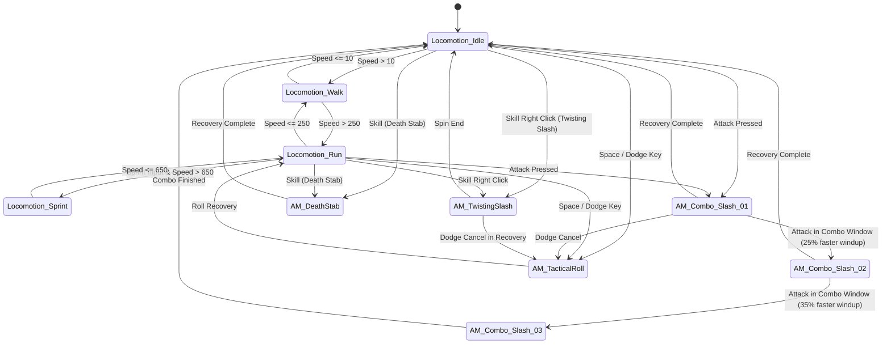

# CATÁLOGO DE ANIMAÇÕES DO ACTION RPG DINÂMICO: DARK KNIGHT

> **Documento:** Catálogo Mestre de Montagens de Animação, BlendSpaces e Poses do Cavaleiro do Sangue  
> **Classe:** Dark Knight / Cavaleiro do Sangue (`ADasiCharacterBase`)  
> **Localização dos Assets:** `Content/Characters/DarkKnight/Animations/`  

---

## 1. MATRIZ DE ANIMAÇÕES DO DARK KNIGHT

| ID do Asset | Tipo de Asset | Duração Base | Slot / Camada | Notifies Principais | Função no Gameplay |
| :--- | :--- | :--- | :--- | :--- | :--- |
| **`AM_TwistingSlash`** | `UAnimMontage` | 1.20 s | `FullBody` | `WeaponTrace` (0.2-0.95s), `VortexStart/End`, `ComboWindow` | Corte circular contínuo de 360° com sucção centrípeta de monstros. |
| **`AM_DeathStab`** | `UAnimMontage` | 0.85 s | `FullBody` | `ForwardImpulse` (850 cm/s), `WeaponTrace`, `SonicCone` | Estocada de penetração frontal com perfuração de armadura e cone de choque. |
| **`AM_TacticalRoll`** | `UAnimMontage` | 0.65 s | `FullBody` | `IFrame_Begin` (0.08s), `IFrame_End` (0.42s), `CapsuleScale` | Esquiva tática com 340ms de invulnerabilidade e redução de cápsula para 45cm. |
| **`AM_Combo_Slash_01`** | `UAnimMontage` | 0.75 s | `DefaultSlot` | `WeaponTrace` (0.15-0.42s), `ComboWindow` (0.45-0.75s) | Corte diagonal descendente da direita para a esquerda (Início de combo). |
| **`AM_Combo_Slash_02`** | `UAnimMontage` | 0.62 s | `DefaultSlot` | `WeaponTrace` (0.12-0.38s), `ComboWindow` (0.40-0.62s) | Corte horizontal cruzado de retorno com 25% menos windup (Inércia acumulada). |
| **`AM_Combo_Slash_03`** | `UAnimMontage` | 0.90 s | `FullBody` | `WeaponTrace` (0.10-0.45s), `KnockdownBurst` (0.42s) | Golpe colossal de duas mãos de cima para baixo partindo o solo (Finalizador). |
| **`BS_DarkKnight_Locomotion`** | `UBlendSpace` | Loop | `LowerBody` / Base | `Sync Markers` (`Foot_L_Down`, `Foot_R_Down`) | Locomoção de 8 direções: Idle (0), Walk (180), Run (550) e Sprint (800 cm/s). |
| **`AS_DarkKnight_HeroicIdle_Paperdoll`**| `UAnimSequence`| 3.20 s | Base | `Thoracic_Expansion`, `Wing_Sway` | Exibição na janela 3D de inventário/equipamento com respiração e asas. |
| **`AM_LightHitReaction`** | `UAnimMontage` | 0.28 s | `UpperBody` (spine_01) | *None* (Layered blend sem interromper pernas) | Flinch leve quando Poise > 0; pernas continuam correndo/andando. |
| **`AM_HeavyStagger`** | `UAnimMontage` | 0.65 s | `FullBody` | `HitStopRestore` | Recuo severo com quebra de postura e perda temporária de controle. |

---

## 2. GRAFO DE TRANSIÇÃO DO ACTION RPG

---

## 3. COMPATIBILIDADE DE BLEND MASK & LAYERED BLEND PER BONE

Para permitir que o Dark Knight execute ataques ou flinches sem que o personagem pare bruscamente de andar ou correr, a árvore de animação utiliza máscaras de mistura óssea:
- **`UpperBody_Spine01_Mask`:** Filtro a partir de `spine_01` (inclui tronco, braços, mãos e cabeça). Permite disparar o combo básico enquanto as pernas continuam avaliando o `BS_DarkKnight_Locomotion` com traçado de solo do `CR_DarkKnight_ControlRig`.
- **`FullBody_Override_Mask`:** Habilidades de impacto colossal como *Twisting Slash*, *Death Stab* e *Tactical Roll* usam a pose de corpo inteiro (`FullBody`), onde a raiz e a pélvis participam ativamente da transferência de força física.
