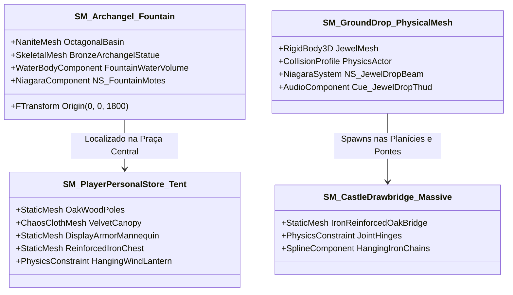

# REGISTRO DE MALHAS 3D NATIVAS, PROPS & NANITE: LORENCIA

> **Projeto:** Dasi (Continent of Legend Inspired MMORPG)  
> **Motor Gráfico:** Unreal Engine 5.4+ (Nanite Geometry & Chaos Physics)  
> **Diretiva Mandatória:** *Todo o mundo é 100% 3D nativo. Imagens e sprites clássicos do Continent of Legend são puramente referências estéticas e conceituais de partida.*  
> **Caminho dos Assets:** `Content/Maps/Lorencia/Props/` | `Content/VFX/Niagara/`

---

## 1. VISÃO GERAL DA FILOSOFIA 100% 3D NATIVA

No Dasi, nenhuma entidade no cenário ou na interface do mundo é representada por "billboards" ou "sprites falsos":
1. **Topografia e Alvenaria:** O terreno e os blocos de muralha usam **Nanite Mesh Streaming** com milhões de micro-triângulos reais, chanfros físicos, argamassa em relevo e micro-deslocamento.
2. **Drops no Chão (Ground Drops):** Itens e Joias (Bless, Soul, Chaos, Life) caem com simulação de física de corpo rígido (*Rigid Body Physics*), quicam no solo de paralelepípedo ou lamaçal, e emitem feixes 3D cilíndricos volumétricos com refração mística.
3. **Lojas Pessoais da Praça Central (Player Personal Stores):** Diferente dos letreiros 2D do passado, os bazares são **tendas 3D físicas completas** com tecido interativo (Chaos Cloth), manequins de exibição de armaduras com o Shader de Refinamento ativo e baús de ferro articulados.
4. **Água e Clima:** Volumes d'água 3D com profundidade de absorção óptica real (*Beer-Lambert*), correntes, estacas submersas e colisão de física aquática.

---

## 2. REGISTRO DE MALHAS 3D PRINCIPAIS (PROPS ESSENCIAIS)

---

### 2.1 `SM_Archangel_Fountain` (A Fonte Monumental do Arcanjo de Loren)
- **Caminho:** `/Game/Maps/Lorencia/Props/SM_Archangel_Fountain.uasset`
- **Dimensões:** Diâmetro da base octogonal: 1200 cm (12m). Altura total com a estátua: 850 cm (8,5m). Envergadura das asas: 600 cm.
- **Estrutura 3D:**
  - **Bacia de Mármore Cinzento:** Malha Nanite de 450.000 polígonos com relevos rúnicos esculpidos e canaletas de deságue em quatro faces cardeais.
  - **Estátua em Bronze Envelhecido:** Malha com pátina esverdeada de azinhavre (*verdigris*) nos recessos e metal polido nas bordas expostas à água.
  - **Volume de Água Embutido:** Bacia octogonal preenchida por `WaterBody_ArchangelFountain` com refração IOR 1.333 e profundidade de 80 cm.
  - **Cascata Dinâmica:** Malha de fluido translúcido com textura de ruído VDB em UV scrolling vertical e emissor Niagara de respingos na colisão com a superfície da bacia.

---

### 2.2 `SM_PlayerPersonalStore_Tent` (Tenda 3D de Bazar Pessoal de Jogador)
- **Caminho:** `/Game/Maps/Lorencia/Props/SM_PlayerPersonalStore_Tent.uasset`
- **Dimensões:** Base quadrada de `400 x 400 cm`, altura do topo do mastro de `320 cm`.
- **Componentes 3D Integrados:**
  1. **Armação de Madeira de Carvalho Escurecido:** 4 postes estruturais com colisão `BlockAll` e estacas de amarração no chão.
  2. **Toldo de Veludo com Chaos Cloth:** Malha de tecido de alta densidade que simula drapejamento realista, oscilação com o vento do mapa (`MPC_Lorencia_Weather.WindSpeed`) e acúmulo de peso por chuva.
  3. **Manequim de Armaduras (Armor Mannequin):** Suporte de exibição esculpido em freixo escuro com sockets para capacete, armadura peitoral, calças e botas; reflete em tempo real o brilho do shader de auras dinâmicas (+9 a +15).
  4. **Baú do Tesouro em Ferro Negro:** Baú físico com tampa articulada que se abre quando um cliente interage com a loja.
  5. **Lanterna de Ferro Pendurada:** Presa por um `PhysicsConstraint` no travessão frontal, balançando livremente conforme os transeuntes passam ao lado.

---

### 2.3 `SM_GroundDrop_Jewel` (Joias Físicas no Chão com Feixe Volumétrico 3D)
- **Caminho:** `/Game/Items/Meshes/SM_GroundDrop_Jewel.uasset`
- **Tipos de Joias:** Blessing (Safira Lapidada Azul), Soul (Ametista Hexagonal Púrpura), Chaos (Cristal Bipiramidal Dourado/Rubi), Life (Esmeralda Oval Fluorescente).
- **Comportamento Físico:**
  - Ao ser dropada pelo monstro abatido (`MSG_GROUND_ITEM_DROP`), a joia é instanciada como ator físico `ADasiGroundDropActor` com impulso radial aleatório.
  - Colisão física com o terreno/paralelepípedo (`Walkable_Ground`), quicando realisticamente de 2 a 3 vezes antes de repousar.
  - Disparo de som de quique metálico-cristalino (`Cue_Jewel_Bounce_01..03`).
- **Feixe Volumétrico 3D (Niagara `NS_JewelDropBeam`):**
  - Cilindro translúcido de luz volumétrica que sobe verticalmente até 400 cm de altura, com anéis rúnicos giratórios na base e partículas de fagulha cintilantes ascendentes.

---

### 2.4 `SM_CastleDrawbridge_Massive` (Ponte Levadiça Principal de Lorencia)
- **Caminho:** `/Game/Maps/Lorencia/Props/SM_CastleDrawbridge_Massive.uasset`
- **Dimensões:** Tablado de `800 cm` de largura, `2000 cm` de comprimento e `60 cm` de espessura.
- **Estrutura 3D:**
  - Tábuas maciças de carvalho desgastadas com cabeças de pregos e reforços diagonais de ferro forjado.
  - Articulação traseira com mancais de bronze lubrificados com sebo.
  - Duas correntes gigantescas de elos 3D fechados conectadas aos baluartes superiores das torres da muralha sul.
  - Sons de rangido de madeira e estalo de correntes ao cruzar com cavalos ou grupos de combate pesados.

---

### 2.5 `SM_Tombstone_Gothic` (Lápides e Criptas do Cemitério Abandonado)
- **Caminho:** `/Game/Maps/Lorencia/Props/SM_Tombstone_Gothic_01..04.uasset`
- **Variações:**
  - `SM_Tombstone_Cross`: Cruz céltico-gótica quebrada com inscrições fúnebres gastas.
  - `SM_Tombstone_Obelisk`: Obelisco fúnebre rachado tombado em ângulo de 35° no lodo.
  - `SM_Mausoleum_Crypt`: Cripta familiar em cantaria com sarcófago interno aberto e degraus de descida semi-inundados pela água do lençol freático.
- **Interação:** Todas as lápides possuem colisão estática precisa em `ECC_WorldStatic`, projetando sombras suaves no nevoeiro rasteiro via Lumen.
