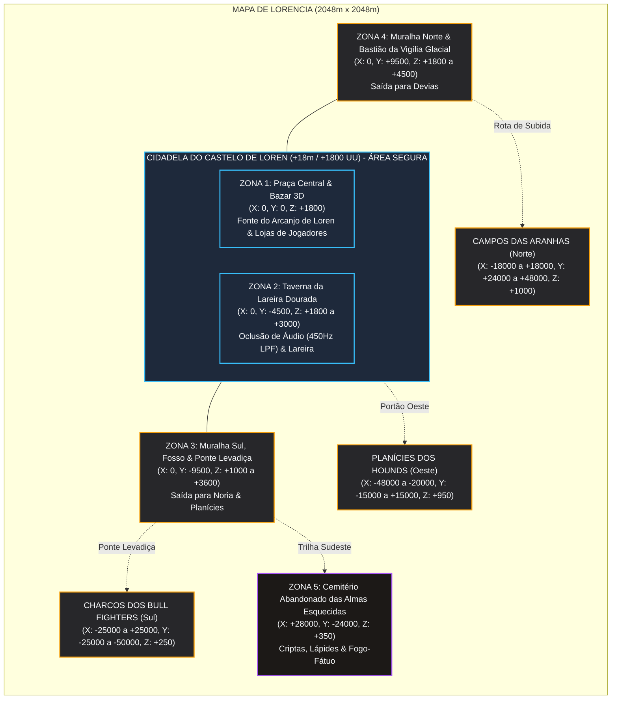

# ESPECIFICAÇÃO DE LEVEL BLOCKOUT & MACRO-LAYOUT 3D: LORENCIA & O CASTELO DE LOREN

> **Projeto:** Dasi (Continent of Legend Inspired MMORPG)  
> **Motor Gráfico:** Unreal Engine 5.4+  
> **Área do Mapa:** 2048m x 2048m (204.800 cm x 204.800 cm no UE5)  
> **Origem (0, 0, 0):** Centro geográfico absoluto da Praça Central de Lorencia  
> **Mapeamento:** `Content/Maps/Lorencia/Lorencia_Main.umap`  
> **Documentos Relacionados:** [Lorencia_Level_Design.md](file:///d:/Dasi/docs/level_design/Lorencia_Level_Design.md) | [M_Lorencia_Landscape_Master.ush](file:///d:/Dasi/src/client/ue5_project/Content/Materials/Landscape/M_Lorencia_Landscape_Master.ush) | [DasiLorenciaLevelScriptActor.h](file:///d:/Dasi/src/client/ue5_project/Source/DasiClient/World/DasiLorenciaLevelScriptActor.h)

---

## 1. SISTEMA DE COORDENADAS & TOPOGRAFIA MACRO

### 1.1 Limites Globais do Mundo (World Bounds)
| Eixo | Mínimo (UE5 UU) | Máximo (UE5 UU) | Extensão Total | Equivalência Métrica |
| :--- | :--- | :--- | :--- | :--- |
| **X (Oeste ➔ Leste)** | -102.400 cm | +102.400 cm | 204.800 cm | 2048,0 metros |
| **Y (Sul ➔ Norte)** | -102.400 cm | +102.400 cm | 204.800 cm | 2048,0 metros |
| **Z (Elevação)** | -1.000 cm (Leito do Fosso/Criptas) | +5.500 cm (Torres & Bastião Norte) | 6.500 cm | 65,0 metros |

### 1.2 Platôs de Elevação e Camadas Geológicas
```
Z (UU)
▲
│                                          [+4500 a +5500] Torres de Sentinela & Bastião Norte
│                                                ┌────────┐
│                                                │ BASTIÃO│
│   [+1800] Platô da Cidadela / Praça Central    │ DO     │
│   ┌────────────────────────────────────────────┤ NORTE  │
│   │ PRAÇA CENTRAL & TAVERNA DA LAREIRA DOURADA │        │
│   │                                            │        │
│   └──┬─────────────┬───────────────────────────┴────────┴──
│      │             │  [+800 a +1200] Planícies Médias Lamacentas
│   [+1400] Superfície│  ┌─────────────────────────────────────
│      │    da Água  │  │ CAMPOS DOS HOUNDS & ARANHAS
│   [+1000] Leito do └──┼─────────────────────────────────────
│           Fosso       │  [+0 a +500] Baixadas Pantanosas & Cemitério
│                       └─────────────────────────────────────
▼
```

- **Platô da Cidadela (+18,0m / +1800 cm):** Fundações em granito maciço e paralelepípedos chanfrados (`Cobblestone_Wet`), drenagem rápida da chuva com galerias subterrâneas.
- **Platô Médio das Planícies (+8,0m a +12,0m / +800 a +1200 cm):** Solo arável, estradas de terra batida com sulcos de rodas preenchidos de lama e grama agreste (`Mud_Puddles` & `Grass_Sparse`).
- **Depressões das Baixadas Pantanosas & Cemitério (+0,0m a +5,0m / +0 a +500 cm):** Zonas de aluvião onde a água estagnada forma lamaçal viscoso e poças rasas permanentes (`Graveyard_Ash`).
- **Profundidade do Fosso do Castelo (Moat):** Leito em Z = +1000 cm com estacas pontiagudas de carvalho; nível da água em Z = +1400 cm (4 metros de coluna d'água sob a ponte levadiça).

---

## 2. ZONEAMENTO MÉTRICO DETALHADO (POINTS OF INTEREST)



---

### 2.1 ZONA 1: Praça Central & Bazar 3D (Coração Social)
- **Centróide:** `(X: 0.0, Y: 0.0, Z: 1800.0)`
- **Raio de Ação:** 6000 cm (60 metros)
- **Bounding Box (UU):**
  - Min: `(-6000.0, -6000.0, 1800.0)`
  - Max: `(+6000.0, +2500.0, 3200.0)`
- **Elementos e Malhas de Blockout:**
  1. **Fonte do Arcanjo de Loren (`SM_Archangel_Fountain`):**
     - Posição: `(X: 0.0, Y: 0.0, Z: 1800.0)`
     - Geometria: Bacia octogonal em mármore cinzelado com 1200 cm (12m) de diâmetro externo, borda de 60 cm de altura (`Z: 1800 -> 1860`), estátua monumental em bronze com 850 cm de altura (envergadura de asas de 600 cm).
     - Água: Volume cilíndrico `WaterBody_ArchangelFountain` (`Raio: 540 cm`, `Z: 1845 cm`, profundidade 80 cm).
     - VFX / Iluminação: Feixe translúcido místico azul-celeste saindo do cálice do Arcanjo (`PointLight_Fountain`: `Color: #38bdf8`, `Intensity: 4200 lm`, `AttenuationRadius: 1400 cm`).
  2. **Tendas de Bazar 3D (Player Personal Stores):**
     - Quatro setores radiais dispostos nos vértices da praça (Noroeste, Nordeste, Sudoeste, Sudeste).
     - Módulo de Cada Tenda: Caixa de colisão cúbica de `400 x 400 x 320 cm`. Postes de madeira rígida com colisão bloqueadora; tecido superior com malha deformável via *Cloth Simulation* acoplada ao vetor de vento global `MPC_Lorencia_Weather.WindVector`.
     - Manequins e baús de exibição com sockets para preview dinâmico de itens +9 a +15.
  3. **Bancadas & Postos Avançados de NPCs:**
     - **Mestre de Armas & Forja:** `(X: -2800.0, Y: 1200.0, Z: 1800.0)`, bigorna de ferro, forja aberta com brasas e partículas de fagulha contínuas.
     - **Banqueiro da Cripta (Vault):** `(X: 2800.0, Y: 1200.0, Z: 1800.0)`, balcão de carvalho entalhado com grades de ferro e guardas com alabarda.
     - **Potionmaster Liam:** `(X: 0.0, Y: 3200.0, Z: 1800.0)`, barraca com alambiques de vidro âmbar e prateleiras de frascos iluminados por luz verde/vermelha suave.
- **Tipo de Colisão:** `ECC_WorldStatic` para bacia da fonte e paredes; canais customizados `ECC_GameTraceChannel1` (Interaction/ClickToMove).

---

### 2.2 ZONA 2: Taverna da Lareira Dourada (The Hearth Tavern)
- **Centróide:** `(X: 0.0, Y: -4500.0, Z: 1800.0)`
- **Dimensões do Edifício (UU):** 2400 cm (Largura X) x 3200 cm (Comprimento Y) x 1200 cm (Altura Z)
- **Bounding Box (UU):**
  - Min: `(-1200.0, -6100.0, 1800.0)`
  - Max: `(+1200.0, -2900.0, 3000.0)`
- **Portais de Acesso:** Portas duplas de carvalho maciço em `(X: 0.0, Y: -2900.0, Z: 1800.0)` (vão de `300 x 360 cm`).
- **Componentes de Iluminação e Volumes:**
  1. **A Grande Lareira Titânica:**
     - Posição: `(X: 0.0, Y: -5900.0, Z: 1800.0)`
     - Nicho em pedra de cantaria de `400 x 200 x 350 cm` com grelha de ferro negro.
     - Ponto de Luz: `PointLight_Hearth` (`Color: #ff8a3d`, `Temperature: 2100K`, `Intensity: 8500 lm`, `AttenuationRadius: 1600 cm`, `SourceRadius: 60 cm` para sombras suaves de brasas).
  2. **Volume de Oclusão Acústica (`AudioVolume_Tavern`):**
     - Caixa: Min `(-1250, -6150, 1780)`, Max `(+1250, -2850, 3050)`.
     - Propriedades de Áudio: Ativa `SubmixEffect_LowPassFilter` no canal Master de Clima exterior.
     - Cutoff Frequency: `450.0 Hz`, Q-Factor: `1.414`.
     - Reverb Preset: `MediumStoneRoom` (Decay Time: 1.4s, Wet/Dry: 0.35).
  3. **Volume de Oclusão Climática (`TriggerVolume_WeatherOcclusion`):**
     - Ao cruzar o portal de entrada, interpola em 0.4s o parâmetro local do jogador `WeatherExposure` de `1.0` (chuva direta) para `0.0` (abrigo completo), desativando decals de impacto de gotas no personagem e partículas de respingos em sua armadura.

---

### 2.3 ZONA 3: Muralha Sul, Fosso & Ponte Levadiça
- **Centróide da Ponte:** `(X: 0.0, Y: -9500.0, Z: 1800.0)`
- **Fosso do Castelo (`WaterBody_CastleMoat`):**
  - Traçado: Fosso perimetral que circunda a cidadela pelo sul, leste e oeste com largura de 1600 cm (16 metros).
  - Profundidade: Leito rochoso em `Z: 1000.0 cm`, superfície espelhada da água em `Z: 1400.0 cm`.
  - Malhas Submersas: Estacas defensivas de madeira aguçadas (`SM_DefenseSpikes`, colisão `BlockAll`), rochedos cobertos de algas viscosas e juncos fluviais.
- **A Ponte Levadiça Principal:**
  - Posição: `(X: 0.0, Y: -9500.0, Z: 1800.0)`
  - Dimensões: 800 cm (Largura) x 2000 cm (Comprimento) x 60 cm (Espessura do Tablado de Madeira).
  - Mecanismos de Ferro: Correntes maciças de aço negro conectadas às roldanas das torres em `(X: ±450.0, Y: -8600.0, Z: 2800.0)`.
- **Torres Gêmeas de Sentinela da Guarda Real:**
  - Torre Leste: `(X: +900.0, Y: -8600.0, Z: 1800.0)`, altura 1800 cm (topo em `Z: 3600.0`).
  - Torre Oeste: `(X: -900.0, Y: -8600.0, Z: 1800.0)`, altura 1800 cm (topo em `Z: 3600.0`).
  - Tochas de Muralha em Baluarte: Emissores Niagara com 40 partículas de faíscas/seg e luz de 1800K tremeluzente.

---

### 2.4 ZONA 4: Muralha Norte & Bastião da Vigília Glacial
- **Centróide do Portão Norte:** `(X: 0.0, Y: +9500.0, Z: 1800.0)`
- **Bastião de Vigilância:**
  - Estrutura maciça em pedra gótica reforçada contra avalanches e ventos do norte.
  - Muralhas com parapeitos dentados e gárgulas esculpidas projetando-se para o abismo, expelindo filetes de água quando a intensidade da chuva `g_RainIntensity > 0.4`.
- **Rampa de Ascensão para Devias:**
  - Início da subida rochosa em `Y: +11000.0` com elevação progressiva de `Z: 1800.0` até `Z: 4800.0` ao longo de um corredor esculpido em granito de 1400 cm de largura.
  - Transição de material no terreno: Mistura progressiva de `Cobblestone_Wet` com a camada de geada e gelo `GlacialIceSnow` com ventos soprando no sentido Norte-Sul.

---

### 2.5 ZONA 5: O Cemitério Abandonado das Almas Esquecidas
- **Centróide:** `(X: +28000.0, Y: -24000.0, Z: 350.0)`
- **Raio da Zona:** 12000 cm (120 metros)
- **Bounding Box (UU):**
  - Min: `(+16000.0, -36000.0, 0.0)`
  - Max: `(+40000.0, -12000.0, 1800.0)`
- **Características de Blockout:**
  - Depressão topográfica natural com desnível de 15 metros em relação à cidadela, retendo névoa densa de solo (*Ground Fog*).
  - Mausoléus góticos desmoronados com sarcófagos abertos que revelam criptas inundadas.
  - Portões enferrujados de ferro batido caídos sobre o barro.
  - Tochas Espectrais (*Fogo-Fátuo*): Chamas esmeralda tremeluzentes (`Color: #10b981`, `Intensity: 1800 lm`, `AttenuationRadius: 900 cm`, sem fumaça quente, apenas volutas frias de ectoplasma).
- **Spawns Autoritativos do Servidor:** Zona associada ao `zone_lorencia_skeletons` do `MobSpawner.ts`.

---

### 2.6 ZONAS EXTERNAS DE CAÇA & PLANÍCIES
| Identificador da Zona | Centróide (UE5 UU) | Raio / Dimensões | Elevação Média | Monstro Autoritativo (`MobSpawner.ts`) | Camada Dominante de Terreno |
| :--- | :--- | :--- | :--- | :--- | :--- |
| **Campos das Aranhas** | `(X: 0, Y: +36000, Z: 1000)` | Raio 18000 cm | +10,0m | `spider` (Aranha Gigante) | `Grass_Sparse` & Teias em Decals |
| **Planícies dos Hounds** | `(X: -34000, Y: 0, Z: 950)` | Raio 20000 cm | +9,5m | `hound` (Lobo / Cão de Caça) | `Grass_Sparse` & `Mud_Puddles` |
| **Charcos dos Bull Fighters** | `(X: 0, Y: -36000, Z: 250)` | Raio 22000 cm | +2,5m | `bull_fighter` (Touro Guerreiro) | `Mud_Puddles` & `WaterBody_SwampPuddles` |

---

## 3. ESPECIFICAÇÃO DE MALHAS DE COLISÃO & NANITE

### 3.1 Presets de Colisão de Cenário (Collision Profiles)
1. **`BlockAll_Environment`:**
   - Usado para: Muralhas externas, portões de ferro fechados, rochedos periféricos de contenção e bases de torres.
   - Resposta: Bloqueia `Pawn`, `Camera`, `Visibility`, `GameTraceChannel1` (Navigation Click).
2. **`Walkable_Ground`:**
   - Usado para: Malha do Landscape, tablado de madeira da ponte levadiça e lajes da praça central.
   - Resposta: Permite navegação NavMesh, bloqueia `Pawn` em Z, retorna ponto de impacto para cliques do mouse do `DasiIsometricPlayerController`.
3. **`Water_Surface_QueryOnly`:**
   - Usado para: Superfície dos volumes de água (`WaterBody_CastleMoat`, `WaterBody_SwampPuddles`).
   - Resposta: Ignora colisão física de jogadores (jogadores vadeiam pela água rasa ou ativam animação de nado/resistência), mas gera overlap com detecção de passos para gerar partículas de respingo no shader e no áudio.

### 3.2 Diretrizes de Nanite & Malhas Estáticas
- **Muralhas e Alvenaria:** Malhas Nanite com contagem poli de 500k a 2M triângulos por bloco modular de 8 metros. A compressão geométrica de Nanite permite detalhes de chanfro real sem mapas de normais cozidos em baixa resolução.
- **Foliage (Vegetação & Grama Interativa):**
  - Tufos de relva agrupados com suporte a *Nanite Foliage* ativado.
  - Colisão física desativada na folhagem rasteira; a deformação ocorre no Vertex Shader através de `WorldPositionOffset` lendo a posição em tempo real do ator do jogador (`MPC_PlayerInteraction.PlayerWorldPos`).
