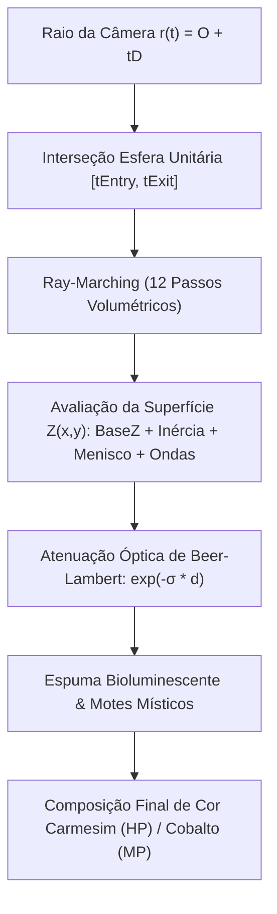

# RELATÓRIO TÉCNICO & MATEMÁTICO: SHADERS DE FLUIDO VOLUMÉTRICO 3D, VIDRO & PEDESTAL DE INSPEÇÃO

> **Projeto:** Dasi (Continent of Legend Inspired MMORPG)  
> **Motor Gráfico:** Unreal Engine 5.4+ (Lumen Global Illumination, Translucency Volume, Hardware Ray Tracing)  
> **Diretiva de Interface:** **100% 3D Nativa** — os orbes de Vida (HP) e Mana (MP), a armação gótica e o pedestal do paperdoll são malhas tridimensionais físicas completas, eliminando sprites e billboarding 2D.  
> **Arquivos Entregues:**  
> - [`MF_FluidVolume_Include.ush`](file:///d:/Dasi/src/client/ue5_project/Content/Materials/HLSL/MF_FluidVolume_Include.ush) | [`MF_FluidVolume_Include.ush (UI Alias)`](file:///d:/Dasi/src/client/ue5_project/Content/Materials/UI/MF_FluidVolume_Include.ush)  
> - [`M_UI_FluidOrb_Master.ush`](file:///d:/Dasi/src/client/ue5_project/Content/Materials/UI/M_UI_FluidOrb_Master.ush) & [`M_UI_FluidOrb_Master.json`](file:///d:/Dasi/src/client/ue5_project/Content/Materials/UI/M_UI_FluidOrb_Master.json)  
> - [`M_UI_PaperdollPedestal.ush`](file:///d:/Dasi/src/client/ue5_project/Content/Materials/UI/M_UI_PaperdollPedestal.ush) & [`M_UI_PaperdollPedestal.json`](file:///d:/Dasi/src/client/ue5_project/Content/Materials/UI/M_UI_PaperdollPedestal.json)

---

## 1. FORMULAÇÃO MATEMÁTICA DO FLUIDO VOLUMÉTRICO 3D (`MF_FluidVolume_Include.ush`)

O interior dos globos de Vida e Mana é renderizado através de **Ray-Marching Analítico** dentro de uma esfera unitária ($\|\vec{p}\| \le 1.0$), calculando dinamicamente a interseção do raio da câmera com a casca de vidro e o volume do líquido.

### 1.1 Equação de Interseção Raio-Esfera
Para um raio de visualização em coordenadas locais $\vec{r}(t) = \vec{O} + t\vec{D}$, onde $\|\vec{D}\| = 1$, a interseção com a esfera unitária centrada na origem ($\|\vec{p}\|^2 = 1$) resulta na equação quadrática:
$$t^2 + 2(\vec{O} \cdot \vec{D})t + (\|\vec{O}\|^2 - 1) = 0$$
O discriminante é dado por $\Delta = (\vec{O} \cdot \vec{D})^2 - (\|\vec{O}\|^2 - 1)$. Se $\Delta \ge 0$:
$$t_{entry} = \max(0, -(\vec{O} \cdot \vec{D}) - \sqrt{\Delta}), \quad t_{exit} = -(\vec{O} \cdot \vec{D}) + \sqrt{\Delta}$$

### 1.2 Superfície Dinâmica do Líquido & Inércia de Movimento (Sloshing)
O nível de líquido base é derivado do preenchimento percentual $F \in [0, 1]$:
$$Z_{base} = -1.0 + 2.0 \cdot F$$
A aceleração do herói no mundo 3D $\vec{A}_{hero} = (a_x, a_y)$ induz uma força de inércia oposta à gravidade, inclinando o plano de corte:
$$\vec{v}_{tilt} = k_{inertia} \cdot \vec{A}_{hero}^{xy}, \quad \Delta Z_{tilt}(x,y) = x \cdot v_{tilt}^x + y \cdot v_{tilt}^y$$

### 1.3 Menisco Côncavo de Tensão Superficial
Devido à molhabilidade do vidro e à atração capilar, a água sobe ao aproximar-se da parede côncava da esfera:
$$r = \sqrt{x^2 + y^2}, \quad w_{wall} = \text{saturate}\left(\frac{r - 0.70}{0.30}\right)$$
$$\Delta Z_{meniscus}(r) = k_{meniscus} \cdot w_{wall}^2$$
onde $k_{meniscus} = 0.085$. Isso cria um anel de menisco tridimensional idêntico aos fluidos em tubos de ensaio e redomas de vidro reais.

### 1.4 Turbulência de Dano & Ondas de Choque
Ao sofrer dano em combate ou desferir feitiços intensos, a variável `TurbulenceIntensity` $\in [0, 1]$ excita o fluido com harmônicos circulares e turbulência 3D de alta frequência:
$$W_1(r, t) = \sin(18r - 6.2t) \cdot 0.035$$
$$W_2(\vec{p}, t) = \text{Noise3D}(4.5x, 4.5y, 2.5t) \cdot 0.045$$
$$W_3(x, y, t) = \sin(12x + 8y + 4t) \cdot 0.025$$
$$\Delta Z_{turbulence} = (W_1 + W_2 + W_3) \cdot \text{TurbulenceIntensity}$$
A cota final da superfície líquida para cada coordenada $(x, y)$ é:
$$Z_{surface}(x,y) = Z_{base} + \Delta Z_{tilt} + \Delta Z_{meniscus} + \Delta Z_{turbulence}$$

### 1.5 Lei de Absorção Volumétrica de Beer-Lambert
A luz que penetra no líquido sofre atenuação espectral exponencial dependente da distância óptica percorrida $d_{optical}$:
$$\mathbf{T}(\lambda, d_{optical}) = \exp(-\vec{\sigma}_{absorption} \cdot 2.2 \cdot d_{optical})$$
- **Para o Orbe de Vida (HP):**
  $$\vec{\sigma}_{absorption} = (0.15, 3.40, 4.80)$$
  *Comportamento óptico:* As componentes verde e azul são extintas quase instantaneamente. O vermelho penetra profundamente, resultando em um carmesim/rubi translúcido brilhante nas bordas finas e um tom denso de vinho tinto/sangue no núcleo volumétrico.
- **Para o Orbe de Mana (MP):**
  $$\vec{\sigma}_{absorption} = (4.20, 1.80, 0.18)$$
  *Comportamento óptico:* O vermelho e o amarelo sofrem absorção imediata, enquanto o azul safira e o ciano atravessam livremente, produzindo reflexos cobalto abissais e brilho etéreo.

---

## 2. CAMADA DE VIDRO LAPIDADO & ARMAÇÃO GÓTICA (`M_UI_FluidOrb_Master.ush`)

O orbe externo é composto por uma fusão PBR entre **vidro de quartzo facetado** e **armação gótica em ouro envelhecido**.

### 2.1 Refração de Snell-Descartes & Fresnel de Schlick
- Índice de Refração do Vidro: $n_{glass} = 1.52$ (versus ar $n_{air} = 1.0$).
- Razão de refração: $\eta = \frac{n_{air}}{n_{glass}} \approx 0.6579$.
- O raio incidente da câmera $\vec{V}$ é refratado na casca de vidro antes de adentrar o fluido volumétrico:
  $$\vec{D}_{refracted} = \text{refract}(\vec{V}, \vec{N}_{glass}, \eta)$$
- Refletância especular de Fresnel via aproximação de Schlick:
  $$F_0 = \left(\frac{1.52 - 1.0}{1.52 + 1.0}\right)^2 \approx 0.043$$
  $$F(\theta) = 0.043 + (1 - 0.043)(1 - \cos\theta)^5$$
  onde $\cos\theta = \vec{N}_{glass} \cdot (-\vec{V})$.

### 2.2 Chanfros Facetados (Diamond Cut Normals)
A superfície externa do vidro apresenta chanfros geométricos facetados em padrão de losangos/diamantes, quebrando as reflexões especulares e gerando dispersão angular de luz:
$$\text{Dist}_{Manhattan} = |u - \lfloor u \rfloor - 0.5| + |v - \lfloor v \rfloor - 0.5|$$
$$\vec{N}_{faceted} = \text{normalize}\left(\vec{N} + \nabla \text{Facet} \cdot k_{bevel}\right)$$

### 2.3 Armação Gótica Dourada Metálica
Uma garra quádrupla ornamental com anel equatorial envolve a metade inferior da redoma:
- **Albedo:** `#f2c94c` (Ouro 24k medieval polido).
- **Metallic:** `0.95`.
- **Roughness:** `0.28`.
- **Glint Especular:** $\text{Glint} = (\vec{N} \cdot -\vec{V})^8 \cdot 0.4$.

---

## 3. PEDESTAL DO PAPERDOLL & INSPETOR 3D (`M_UI_PaperdollPedestal.ush`)

O pedestal onde o personagem e os equipamentos inspecionados repousam utiliza **Mármore Obsidiano Negro**, entalhes rúnicos tridimensionais via **Parallax Occlusion Mapping (POM)** e **Reflexão Anisotrópica Radial**.

### 3.1 Parallax Occlusion Mapping (POM)
Em vez de desenhar runas planas, o shader projeta os entalhes profundamente na espessura do mármore:
- O raio do observador em espaço tangente $\vec{V}_{TS}$ realiza ray-marching através do mapa de altura da pedra em até 32 passos discretos.
- Interpolação linear entre o passo anterior e posterior:
  $$UV_{pom} = \text{lerp}(UV_{curr}, UV_{prev}, w_{pom})$$
  Isso gera relevo e oclusão real das bordas das runas conforme o jogador rotaciona o personagem no Paperdoll.

### 3.2 Anisotropia Radial de Polimento em Torno
O pedestal apresenta micro-estrias de polimento mecânico circular concêntrico ao redor de seu eixo central $(0.5, 0.5)$:
$$\vec{T}_{radial}^{2D} = \text{normalize}(-(y - 0.5), x - 0.5)$$
$$\vec{T}_{aniso}^{3D} = \vec{T}_X \cdot T_x + \vec{T}_Y \cdot T_y$$
- **Anisotropy:** `0.65`.
- **Roughness da Superfície Espelhada:** `0.045` (reflete nítida e perfeitamente as botas, capas e asas do personagem via Lumen).
- **Roughness no Fundo dos Entalhes:** `0.45` (acabamento poroso e áspero onde o ouro em folha foi aplicado).

### 3.3 Ressonância Rúnica Harmônica com o Refinamento do Item (+0 a +15)
O canal emissivo dos entalhes rúnicos pulsa em repouso e reage dinamicamente ao tier de refinamento do item inspecionado:
$$\omega_{pulse} = 1.2 + \left(\frac{\text{RefinementTier}}{15.0}\right) \cdot 2.2 \quad \text{rad/s}$$
$$I_{emissive} = \left(0.8 + \frac{\text{RefinementTier}}{15.0} \cdot 2.8\right) \cdot (\sin(\omega_{pulse} \cdot t) \cdot 0.5 + 0.5)$$
- **Tiers +0 a +8:** Ouro místico suave (`#d97706`).
- **Tiers +9 a +12:** Ouro solar radiante (`#f59e0b`).
- **Tiers +13 a +15:** Transição celestial para ouro com ressonância ciano-etérea (`#67e8f9`).
