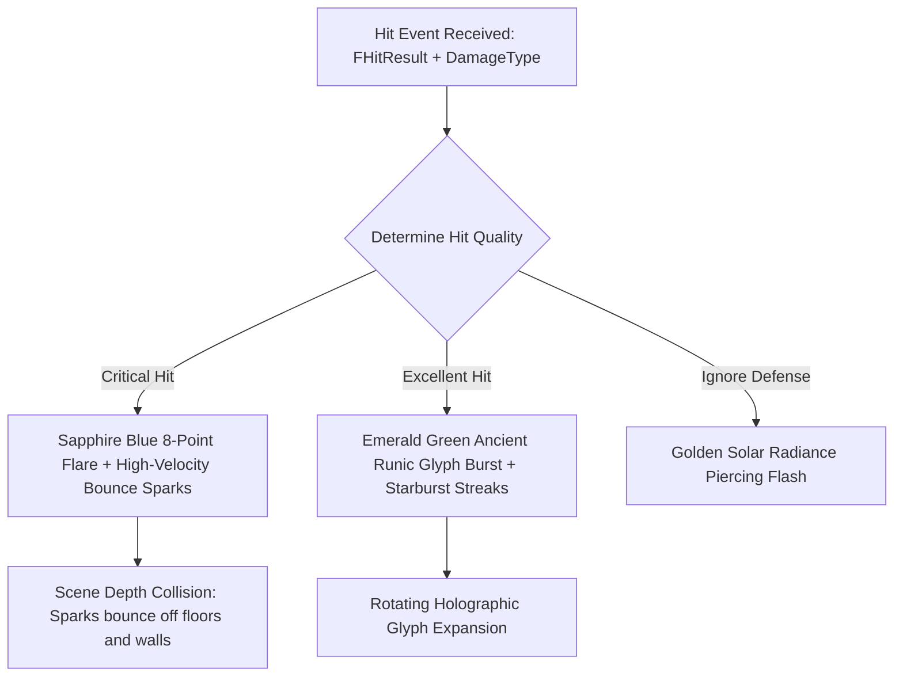

# NS_CriticalImpact - Niagara VFX Specification & Integration Guide

## 1. Overview & Visual Targets
Hit feedback is the emotional core of Continent of Legend combat. Players immediately recognize the quality of their strike through distinctive color codes, geometry shapes, and auditory sensations:
- **Critical Hit**: Intense **Electric Sapphire Blue** (`#00A6FF`) flash with directional spark shrapnel bouncing against surfaces.
- **Excellent Hit**: Dazzling **Emerald Green** (`#00F576`) explosion featuring rotating ancient runic glyphs and starburst flare spikes.
- **Double Damage / Ignore Defense**: Dual harmonic shockwaves (Yellow-Gold + Emerald).

---

## 2. Emitter Hierarchy & Behavior



### 2.1 Emitter Components:
1. `Emitter_FlashCross`:
   - 8-point camera-facing anamorphic flare cross.
   - Lifetime: 0.18s (sub-frame snap to punch up combat responsiveness).
   - Peak size: 220cm screen-space scale.
2. `Emitter_ShockwaveRing`:
   - Aligned directly with the surface contact normal (`User.HitNormal`).
   - Expands to 260cm diameter within 0.28 seconds.
   - Refracts background pixels via normal map distortion.
3. `Emitter_HighVelocitySparks`:
   - 35 directional spark streaks ejected in a 55° cone along the impact reflection normal.
   - Initial velocity: 450 to 950 cm/s.
   - **Scene Depth / CPU Collision**: Sparks bounce off floors, obstacles, and dungeon walls with a 0.55 restitution elasticity and 0.25 friction.
4. `Emitter_ExcellentGlyphBurst`:
   - Holographic circular MU runic seal expanding and spinning (`180 deg/s`) around the wound point.
   - Only triggers when `HitType == Excellent`.

---

## 3. Hit Quality Matrix

| Hit Type | Primary Color | Secondary Color | Screen Shake Profile | Audio Trigger |
| :--- | :--- | :--- | :--- | :--- |
| **Normal Hit** | `#FFA726` (Bronze Amber) | `#FF7043` | None | `SFX_Hit_Normal` |
| **Critical Hit** | `#00A6FF` (Sapphire Blue) | `#80D8FF` | Amplitude 1.2, Frequency 35 Hz | `SFX_Hit_Critical` |
| **Excellent Hit**| `#00E676` (Emerald Green) | `#B9F6CA` | Amplitude 2.0, Frequency 45 Hz | `SFX_Hit_Excellent` |
| **Ignore Defense**| `#FFD600` (Solar Gold) | `#FFFFFF` | Amplitude 2.5, Frequency 50 Hz | `SFX_Hit_IgnoreDef` |

---

## 4. Integration Blueprint / C++ Hook

```cpp
void UDasiCombatVisualFeedback::SpawnCombatHitVFX(const FHitResult& HitResult, EDasiDamageType DamageType)
{
    UNiagaraSystem* ImpactSystem = LoadObject<UNiagaraSystem>(nullptr, TEXT("/Game/VFX/Niagara/NS_CriticalImpact.NS_CriticalImpact"));
    if (!ImpactSystem) return;

    UNiagaraComponent* NiagaraComp = UNiagaraFunctionLibrary::SpawnSystemAtLocation(
        HitResult.GetActor()->GetWorld(),
        ImpactSystem,
        HitResult.ImpactPoint,
        HitResult.ImpactNormal.Rotation()
    );

    if (NiagaraComp)
    {
        NiagaraComp->SetVariableVec3(TEXT("HitNormal"), HitResult.ImpactNormal);
        
        if (DamageType == EDasiDamageType::Critical)
        {
            NiagaraComp->SetVariableEnum(TEXT("HitType"), 1); // Critical
            NiagaraComp->SetVariableLinearColor(TEXT("ImpactColorPrimary"), FLinearColor(0.02f, 0.65f, 1.0f));
        }
        else if (DamageType == EDasiDamageType::Excellent)
        {
            NiagaraComp->SetVariableEnum(TEXT("HitType"), 2); // Excellent
            NiagaraComp->SetVariableLinearColor(TEXT("ImpactColorPrimary"), FLinearColor(0.0f, 0.95f, 0.45f));
            NiagaraComp->SetVariableLinearColor(TEXT("ImpactColorSecondary"), FLinearColor(0.7f, 1.0f, 0.8f));
        }
    }
}
```
