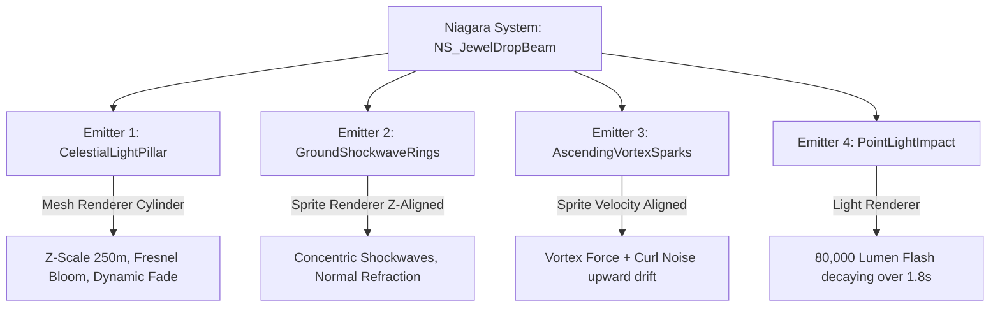

# NS_JewelDropBeam - Niagara VFX Specification & Integration Guide

## 1. Overview & Lore Context
In the Continente Lendário, the drop of a high-value celestial jewel (**Jewel of Blessing**, **Jewel of Soul**, **Jewel of Chaos**, or **Jewel of Life**) is a climactic gameplay moment. The iconic visual signifier is a **towering skyward beacon of light** piercing through atmospheric clouds, accompanied by concentric shockwave rings expanding across the terrain and swirling star vortices.

This system provides instantaneous high-visibility feedback across vast distances in Lorencia, Devias, Noria, Atlans, and Icarus.

---

## 2. System Architecture & Emitter Stack



### 2.1 Emitter 1: CelestialLightPillar
- **Renderer**: `NiagaraMeshRendererProperties` using an inverted/two-sided tapered cylinder.
- **Material**: `M_JewelPillarBeam`
  - Custom depth fading against ground geometry.
  - Multiplicative vertical gradient fading into the sky atmosphere.
  - Sinusoidal scrolling noise coordinates producing energy ripples along the beam.
  - HDR Emissive Multiplier: `150.0 cd/m²` to trigger Unreal Engine 5 Lumen and Bloom threshold.
- **Lifetime**: 4.5 seconds with quadratic ease-in and exponential decay.
- **Scale**: Initial radius 45cm, Z-length 25,000cm (250m).

### 2.2 Emitter 2: GroundShockwaveRings
- **Renderer**: `NiagaraSpriteRendererProperties` aligned with World Up vector `(0, 0, 1)`.
- **Material**: `M_ShockwaveRing` with radial polar coordinates and chromatic distortion.
- **Burst Pattern**: Staggered triple pulse (t = 0.00s, 0.12s, 0.25s).
- **Scale Dynamics**: Expands rapidly from 20cm to 450cm diameter with deceleration curve (`CubicEaseOut`).
- **Color**: Saturated harmonic aura matching jewel archetype.

### 2.3 Emitter 3: AscendingVortexSparks
- **Renderer**: `NiagaraSpriteRendererProperties` (Velocity Aligned).
- **Physics Forces**:
  - `ConeVelocity`: 180 to 420 cm/s upwards.
  - `VortexForce`: Axis `(0, 0, 1)`, rotational velocity `380.0 deg/s`.
  - `CurlNoiseForce`: Frequency `0.025`, amplitude `80 cm/s²` to produce organic turbulence.
  - `Drag`: Linear damping `0.35`.
- **Particle Count**: 160 particles spawned over 3.5s.
- **Lifetime**: 1.5s - 2.8s.

### 2.4 Emitter 4: PointLightImpact
- **Renderer**: `NiagaraLightRendererProperties`.
- **Intensity**: Peak 80,000 Lumens at impact frame, decaying over 1.8 seconds.
- **Attenuation Radius**: 850 units (8.5 meters).
- **Shadows**: Dynamic shadow casting on hero props (Lumen compatible).

---

## 3. Jewel Color Profiles

| Jewel Type | Core Color (`BeamColorCore`) | Aura Color (`BeamColorAura`) | Secondary Sparkle |
| :--- | :--- | :--- | :--- |
| **Jewel of Blessing** | `#26D7FF` (Sapphire Cyan) | `#0B58F2` (Deep Azure) | `#FFFFFF` Diamond Glints |
| **Jewel of Soul** | `#E62EE6` (Radiant Magenta) | `#6A00F4` (Astral Violet) | `#FF88FE` Arc Sparks |
| **Jewel of Chaos** | `#FF9D00` (Amber Gold) | `#B83A00` (Infernal Orange)| `#FFE49E` Fire Flecks |
| **Jewel of Life** | `#00FF99` (Emerald Glow) | `#008F4C` (Viridian Deep) | `#ADFFD8` Nature Motes |
| **Jewel of Creation**| `#E2F4FF` (Glacial Silver) | `#79B4D9` (Aethel Blue) | `#FFFFFF` Starlight |

---

## 4. C++ & Blueprint Spawn Example

```cpp
// In Gameplay / Drop Manager:
void AGameItemDropActor::TriggerDropBeacon(EJewelType InType)
{
    UNiagaraSystem* JewelSystemAsset = LoadObject<UNiagaraSystem>(nullptr, TEXT("/Game/VFX/Niagara/NS_JewelDropBeam.NS_JewelDropBeam"));
    if (!JewelSystemAsset) return;

    UNiagaraComponent* NiagaraComp = UNiagaraFunctionLibrary::SpawnSystemAtLocation(
        GetWorld(),
        JewelSystemAsset,
        GetActorLocation(),
        FRotator::ZeroRotator,
        FVector(1.0f),
        true,
        true,
        ENCPoolMethod::AutoRelease
    );

    if (NiagaraComp)
    {
        FLinearColor CoreColor, AuraColor;
        GetJewelColors(InType, CoreColor, AuraColor);
        NiagaraComp->SetVariableLinearColor(TEXT("BeamColorCore"), CoreColor);
        NiagaraComp->SetVariableLinearColor(TEXT("BeamColorAura"), AuraColor);
    }
}
```
