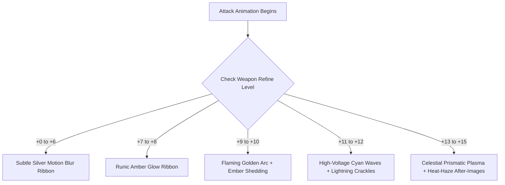

# NS_WeaponTraceRibbon - Niagara VFX Specification & Integration Guide

## 1. Overview & Mechanics
In high-octane melee combat (Knight Cyclone Slash, Magic Gladiator Fire Slash, Blade Master Crescent Cleave), weapons generate continuous swept ribbon surfaces representing the cutting edge geometry.

In Dasi, this ribbon is not a static mesh arc; it is an active Niagara simulation connecting `Weapon_Root` and `Weapon_Tip` sockets whose **color, luminescence, trailing embers, and electric micro-arcs directly reflect item refinement (+0 to +15)**.

---

## 2. Refinement Tier Progression Matrix



### Detailed Visual Parameters:

| Tier | Refinement Name | Color Primary | Color Secondary | HDR Lumens | Sub-Emitters Active |
| :--- | :--- | :--- | :--- | :--- | :--- |
| **+0 to +6** | Natural Steel | `#E0E0E0` (Silver Grey) | `#B0B0B0` (Faded Steel) | 2.5 cd/m² | Blade Ribbon Sheet only |
| **+7 to +8** | Runic Awakening | `#FFCC44` (Amber Gold) | `#FF9900` (Warm Sun) | 12.0 cd/m² | Blade Ribbon Sheet |
| **+9 to +10** | Radiant Might | `#FF8800` (Solar Flame) | `#FFDD66` (White-Hot) | 35.0 cd/m² | Blade Ribbon + Embers |
| **+11 to +12**| Prismatic Voltage | `#00D0FF` (Cyan Arc) | `#CC22FF` (Astral Violet)| 65.0 cd/m² | Blade Ribbon + Arcs + Embers |
| **+13 to +14**| Divine Sovereign | `#FF1744` (Crimson Flare) | `#FFD700` (Godly Gold) | 110.0 cd/m² | All + Heat Haze |
| **+15** | Celestial Transcendent | `#FFF8E7` (God Core) | `#651FFF` (Deep Cosmic) | 180.0 cd/m² | All + Rainbow Dispersion |

---

## 3. Ribbon Geometry Sampling
- **Socket Pair**: Samples two sockets: `Weapon_Root` (guard/hilt) and `Weapon_Tip` (blade point).
- **Sub-stepping**: Uses Niagara high-frequency tick sub-stepping (up to 4 sub-steps per frame) to prevent polygon angular pinching during 60 FPS / 120 FPS high-velocity swing animations.
- **Tessellation**: 8 subdivisions along the trajectory curve using Catmull-Rom interpolation.
- **UV Coordinates**:
  - `U`: Length along the trailing arc (0 = newest edge, 1 = oldest dissipating tail).
  - `V`: Normalized span between `Weapon_Root` (0.0) and `Weapon_Tip` (1.0).

---

## 4. Animation Notify State Integration (UE5)

We provide an `AnimNotifyState_WeaponTrace` C++ class to drive the trace lifetime precisely during attack animation frames:

```cpp
void UAnimNotifyState_WeaponTrace::NotifyBegin(USkeletalMeshComponent* MeshComp, UAnimSequenceBase* Animation, float TotalDuration)
{
    if (!MeshComp) return;

    UDasiItemGlowMaterialBridge* GlowBridge = MeshComp->GetOwner()->FindComponentByClass<UDasiItemGlowMaterialBridge>();
    int32 RefineLevel = GlowBridge ? GlowBridge->GetRefineLevel() : 0;

    UNiagaraSystem* RibbonSystem = LoadObject<UNiagaraSystem>(nullptr, TEXT("/Game/VFX/Niagara/NS_WeaponTraceRibbon.NS_WeaponTraceRibbon"));
    ActiveTraceComp = UNiagaraFunctionLibrary::SpawnSystemAttached(
        RibbonSystem,
        MeshComp,
        NAME_None,
        FVector::ZeroVector,
        FRotator::ZeroRotator,
        EAttachLocation::KeepRelativeOffset,
        true
    );

    if (ActiveTraceComp)
    {
        ActiveTraceComp->SetVariableInt(TEXT("RefinementTier"), RefineLevel);
        ActiveTraceComp->SetVariableFloat(TEXT("TrailDuration"), 0.35f);
    }
}

void UAnimNotifyState_WeaponTrace::NotifyEnd(USkeletalMeshComponent* MeshComp, UAnimSequenceBase* Animation)
{
    if (ActiveTraceComp)
    {
        ActiveTraceComp->Deactivate();
        ActiveTraceComp = nullptr;
    }
}
```
