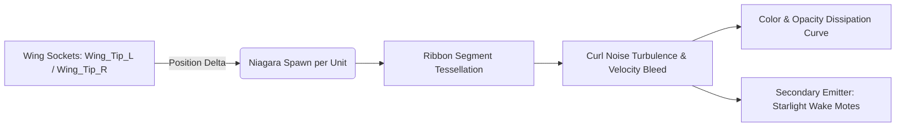

# NS_WingRibbonTrails - Niagara VFX Specification & Integration Guide

## 1. Overview & Lore Context
In Dasi, Wings are both paramount status symbols and core aerial transport mechanisms (allowing flight across high-altitude precipices in Devias and the floating island chain of Icarus). When characters move, sprint, or dive, the wingtips slice through the air, shedding **fluid aerodynamic energy ribbons** and **starlight motes**.

This system attaches directly to character skeletal meshes and tracks wing socket transforms at sub-frame precision.

---

## 2. Ribbon Topology & Parameter Dynamics



### 2.1 Emitter Hierarchy
- `Emitter_LeftWingRibbon`: Samples `Wing_Tip_L` socket.
- `Emitter_RightWingRibbon`: Samples `Wing_Tip_R` socket.
- `Emitter_WingWakeSparkles`: Samples wing sockets to shed micro-crystalline motes along the flight wake.

### 2.2 Ribbon Rendering Properties
- **Facing Mode**: `Screen` (ribbon plane automatically faces camera for optimal visibility at isometric and third-person angles).
- **Ribbon Twist Mode**: `PassThrough` to prevent visual pinch artifacts during high-speed rolling or turning maneuvers.
- **Tessellation**: Custom tessellation (up to 6 subdivisions per segment) ensures butter-smooth curved ribbons even during erratic directional changes.
- **Texture Coordinates**: U mapped along Ribbon Length (0.0 to 1.0 normalized over lifetime), V mapped across Ribbon Width.

### 2.3 Wing Generation Profiles

| Wing Generation | Default Color Gradient | Ribbon Width | Wake Mote Effect |
| :--- | :--- | :--- | :--- |
| **Gen 1 (Fairy / Angel / Satan)** | Translucent Cyan to Ice Blue | 14 cm | Subtle silver vapor |
| **Gen 2 (Wings of Butterfly / Dragon / Spirit)** | Saturated Azure to Amethyst Violet | 22 cm | Luminous starlight flecks |
| **Gen 3 (Wings of Storm / Illusion / Ruin)** | Solar Golden Flame to Prismatic Magenta | 32 cm | High-velocity micro-arcs |
| **Gen 4 (Godly Sovereign Wings)** | Prismatic Rainbow to Cosmic Void Indigo | 45 cm | Radiant vortex shockwaves |

---

## 3. Dynamic Velocity Scaling
The system samples the owning character's flight velocity (`CharacterFlightVelocity`):
- **Hovering (< 100 cm/s)**: Ribbons contract to soft 8cm glowing wisps; spawn rate drops to prevent point accumulation.
- **Cruising (500 - 900 cm/s)**: Nominal 22cm ribbons with gentle curl noise trailing behind the character.
- **High-Speed Dive (> 1200 cm/s)**: Ribbon expands to 40cm, lifetime extends to 1.2s, and wake sparkle emission rate triples to convey immense kinetic energy.

---

## 4. Integration Blueprint / C++ Hook

```cpp
// In Character / Wing Equipment Component:
void UDasiWingComponent::AttachWingTrails(USkeletalMeshComponent* WingMeshComp)
{
    if (!WingMeshComp) return;

    UNiagaraSystem* TrailSystem = LoadObject<UNiagaraSystem>(nullptr, TEXT("/Game/VFX/Niagara/NS_WingRibbonTrails.NS_WingRibbonTrails"));
    if (!TrailSystem) return;

    UNiagaraComponent* RibbonComp = UNiagaraFunctionLibrary::SpawnSystemAttached(
        TrailSystem,
        WingMeshComp,
        NAME_None,
        FVector::ZeroVector,
        FRotator::ZeroRotator,
        EAttachLocation::KeepRelativeOffset,
        true
    );

    if (RibbonComp)
    {
        RibbonComp->SetVariableObject(TEXT("SkeletalMeshTarget"), WingMeshComp);
        RibbonComp->SetVariableLinearColor(TEXT("RibbonColorStart"), GetWingStartColor());
        RibbonComp->SetVariableLinearColor(TEXT("RibbonColorEnd"), GetWingEndColor());
    }
}
```
